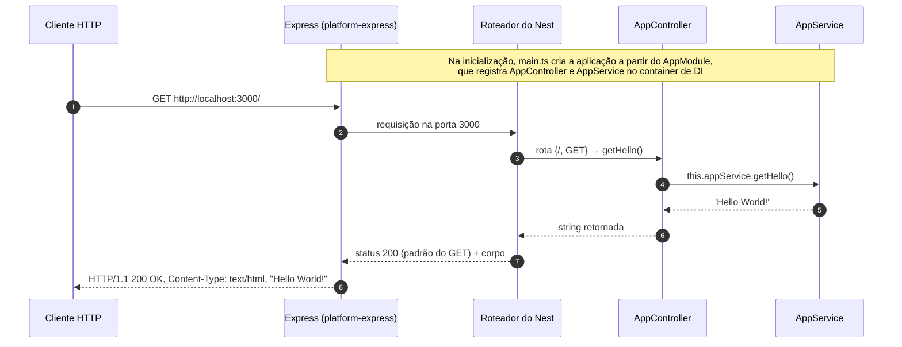
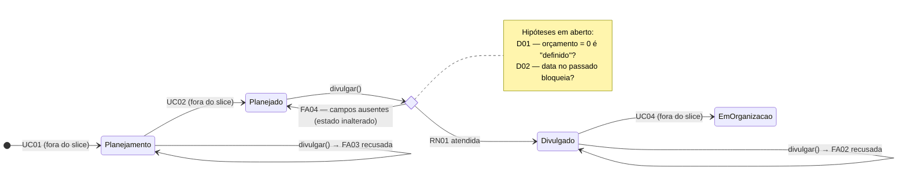

# ARENA XVIII — Base Técnica NestJS 12 e Planejamento do Primeiro Slice Arquitetural

**Disciplina:** Desenvolvimento de Sistemas Corporativos — DSC 2026/1
**Sistema:** ARENA XVIII — Administração de Recursos, Esportes, Negócios e Associados
**Equipe:** Adriel Ostrovski, Bolivar Torres Neto, Luna Ribeiro
**Repositório:** https://github.com/ArenaXVIII/arena-xviii-backend
**Organization:** https://github.com/ArenaXVIII
**Data da execução prática:** 05/11/2026

> **Convenção deste relatório.** Toda saída de terminal, de navegador e de REST Client aqui reproduzida foi obtida na execução real de 05/11/2026. Nenhum resultado foi simulado.

---

## Sumário

- [Parte A — Preparação e execução prática do backend](#parte-a--preparação-e-execução-prática-do-backend)
  - [Etapa 1 — Identificação do sistema e do ponto de partida](#etapa-1--identificação-do-sistema-e-do-ponto-de-partida)
  - [Etapa 2 — Inventário e compatibilidade do ambiente](#etapa-2--inventário-e-compatibilidade-do-ambiente)
  - [Etapa 3 — Diagnóstico e recuperação](#etapa-3--diagnóstico-e-recuperação)
  - [Etapa 4 — Verificação da aplicação NestJS 12](#etapa-4--verificação-da-aplicação-nestjs-12)
  - [Etapa 5 — Dependências, projeto e execução](#etapa-5--dependências-projeto-e-execução)
  - [Etapa 6 — Leitura dos arquivos gerados](#etapa-6--leitura-dos-arquivos-gerados)
  - [Etapa 7 — Três experimentos HTTP](#etapa-7--três-experimentos-http)
  - [Etapa 8 — Checkpoint de prontidão técnica](#etapa-8--checkpoint-de-prontidão-técnica)
- [Parte B — Transição arquitetural aplicada ao ARENA XVIII](#parte-b--transição-arquitetural-aplicada-ao-arena-xviii)
  - [Etapa 9 a Etapa 17](#etapa-9--da-prova-de-vida-ao-comportamento-real)
- [Apêndice — Uso de Inteligência Artificial](#apêndice--uso-de-inteligência-artificial)

---

# Parte A — Preparação e execução prática do backend

## Etapa 1 — Identificação do sistema e do ponto de partida

| Item | Descrição |
|---|---|
| Sistema | ARENA XVIII — sistema de gestão da Atlética XVIII de Março (UTFPR Câmpus Medianeira) |
| Responsáveis | Adriel Ostrovski, Bolivar Torres Neto, Luna Ribeiro |
| Organization / repositório | `ArenaXVIII` / [`arena-xviii-backend`](https://github.com/ArenaXVIII/arena-xviii-backend) (branch `main`) |
| Problema | Informações de associados, modalidades, eventos, finanças, patrocínios e materiais ficam espalhadas, com atividades pouco padronizadas e responsabilidades pouco claras ([`README.md`](../README.md)) |
| Público interessado | Diretoria e membros da atlética, associados e atletas |
| Primeiro slice | **UC03 — Divulgar Evento** ([`docs/casos-de-uso.md`](casos-de-uso.md), seção 5.3). Escolhido porque deriva da RN01, apontada no modelo conceitual como a regra de maior impacto, e porque define a transição central Planejado → Divulgado do ciclo de vida do Evento |
| Estágio do backend antes deste trabalho | **Parcialmente criado.** O projeto NestJS 12 já existia (template, `package.json`, `pnpm-lock.yaml`), mas as dependências **não estavam instaladas** (sem `node_modules`). Além do template, já havia código preexistente do domínio de Eventos em `src/modules/events/` e `src/common/`, **não registrado** no `AppModule` (ver Etapa 4) |
| Sistema operacional e terminal | Windows 11 Pro; Git Bash (MINGW64) para a maior parte dos comandos registrados; PowerShell 5.1 também usado para `pnpm start:dev` (ver Etapa 3) |

Artefatos anteriores referenciados (não reescritos aqui): [`docs/visao-geral.md`](visao-geral.md) (modelo conceitual), [`docs/casos-de-uso.md`](casos-de-uso.md) (catálogo e especificações), [`docs/planejamento/`](planejamento/README.md) (planejamento do UC03, épico **#12**, sub-issues **#13 a #19**).

---

## Etapa 2 — Inventário e compatibilidade do ambiente

Comandos executados antes de qualquer instalação:

```bash
node -v
npm -v
pnpm -v
nest --version
```

Saída real:

```text
v24.22.0
11.19.1
10.33.2
/usr/bin/bash: line 1: nest: command not found
```

Consulta das versões publicadas, para decidir se havia incompatibilidade real:

```bash
npm view pnpm dist-tags.latest
npm view @nestjs/cli dist-tags.latest
npm view @nestjs/core dist-tags.latest
```

```text
12.16.1
12.0.11
12.3.3
```

| Ferramenta | Versão observada | Linha adotada | Compatível? | Intervenção necessária? |
|---|---|---|---|---|
| Node.js | 24.22.0 | 24, compatível com Nest CLI 12 | Sim | Não |
| npm | 11.19.1 | Compatível com Node.js | Sim (é o npm distribuído com o Node 24) | Não |
| pnpm | 10.33.2 → **12.16.1** | 12 | Não, inicialmente (linha 10) | **Sim** — atualizado para 12 (Etapa 3) |
| Nest CLI (global) | não instalado (`command not found`) | 12 | Não se aplica | **Não** — a CLI 12 já é devDependency do projeto (`@nestjs/cli` 12.0.8 local), usada pelos scripts `pnpm start:dev` e por `pnpm exec nest` |

### Diferença entre as ferramentas

- **Node.js** é o *runtime*: executa JavaScript fora do navegador. É ele que, no fim, roda `dist/main.js`.
- **npm** é o gerenciador de pacotes distribuído junto com o Node. Neste projeto ele foi usado apenas para instalar o próprio pnpm globalmente.
- **pnpm** é o gerenciador de dependências adotado pelo projeto. Resolve as versões, grava o `pnpm-lock.yaml` e cria o `node_modules` usando um *store* com links, o que economiza disco e impede o uso de dependências não declaradas.
- **TypeScript** é a linguagem (JavaScript + tipos estáticos e decorators). O código-fonte em `src/*.ts` precisa ser compilado para JavaScript antes de rodar no Node.
- **Framework NestJS** (`@nestjs/core`, `@nestjs/common`, `@nestjs/platform-express`) é a biblioteca que roda **dentro** da aplicação: injeção de dependências, módulos, roteamento HTTP sobre o Express.
- **Nest CLI** (`@nestjs/cli`) é uma ferramenta de **desenvolvimento**: gera projetos e arquivos (schematics), compila e inicia a aplicação (`nest start --watch`). Ela não faz parte da aplicação em execução.

**CLI global × framework local.** A versão de `nest --version` (global) **não** diz qual framework o projeto usa. A versão efetiva do framework é a de `@nestjs/core` em `node_modules`, conferida com `pnpm list @nestjs/core` (Etapa 5): **12.1.2**. Neste ambiente nem havia CLI global; a CLI usada foi a local, **12.0.8**.

**Por que um único gerenciador de dependências.** Cada gerenciador tem seu próprio lockfile (`pnpm-lock.yaml`, `package-lock.json`, `yarn.lock`) e seu próprio layout de `node_modules`. Misturar gera árvores de dependências diferentes entre membros da equipe e lockfiles conflitantes. Com só o pnpm, todo mundo instala exatamente as versões registradas no `pnpm-lock.yaml`.

---

## Etapa 3 — Diagnóstico e recuperação

Houve quatro situações reais. A primeira e a terceira exigiram correção; a segunda e a quarta foram resolvidas sem alterar o ambiente.

| Sintoma real | Interpretação | Diagnóstico executado | Correção aplicada | Validação após a correção |
|---|---|---|---|---|
| `pnpm -v` → `10.33.2` | Versão incompatível com a linha adotada (12) | `npm view pnpm dist-tags.latest` → `12.16.1`; `which pnpm` → `/c/Users/<usuário>/AppData/Roaming/npm/pnpm` (pnpm foi instalado via npm global) | `npm install -g pnpm@12` (mesmo canal da instalação original). Não houve alteração de `PATH` nem de `PNPM_HOME` | `pnpm -v` → `12.16.1`; `pnpm install` concluiu com `Done in 2m 42.2s using pnpm v12.16.1` |
| `nest --version` → `command not found` | A CLI não está instalada globalmente / não está no `PATH` | `package.json` declara `"@nestjs/cli": "^12.0.0"` em `devDependencies`; após a instalação, `pnpm exec nest --version` → `12.0.8` | **Nenhuma.** A CLI local é suficiente e é a que os scripts usam. Instalar uma CLI global só para a atividade criaria uma segunda versão para manter | `pnpm start:dev` executou `nest start --watch` com sucesso (Etapa 5) |
| `pnpm start:dev` no **PowerShell** → `O arquivo ...\npm\pnpm.ps1 não pode ser carregado porque a execução de scripts foi desabilitada neste sistema` (`PSSecurityException`, `UnauthorizedAccess`) | O pnpm está correto; quem bloqueia é a *Execution Policy* do Windows, que impede o PowerShell de rodar o *shim* `pnpm.ps1` criado pelo npm | A mensagem aponta `about_Execution_Policies`; o mesmo comando funcionava no Git Bash, que usa outro *shim* | Política do usuário alterada para `RemoteSigned` (escopo `CurrentUser`, sem afetar outros usuários). Alternativa sem alteração: `pnpm.cmd start:dev` | `Get-ExecutionPolicy -List` → `CurrentUser RemoteSigned`; `pnpm start:dev` passou a executar no PowerShell (processo `nest start --watch` iniciado às 15:33:58) |
| A segunda execução de `pnpm start:dev` (no clone Git, 15:33) não ficou com a porta 3000 | A porta já estava ocupada pela primeira instância (PID 11340, iniciada às 15:22 a partir da cópia baixada em `.zip`), que continuou rodando | `netstat -ano` → porta 3000 `LISTENING` apenas pelo PID 11340; lista de processos mostrou que a instância das 15:33 tinha só o processo da CLI, sem o processo da aplicação (`dist/main`); `diff -rq --strip-trailing-cr` entre as duas pastas → `src/`, `package.json` e `pnpm-lock.yaml` **idênticos** (só diferem as quebras de linha) | **Nenhuma troca de porta.** Mantivemos a primeira instância, que roda o mesmo código, para que os três experimentos fossem atendidos pela **mesma aplicação**, como pede a Etapa 7 | Os três clientes receberam respostas do PID 11340, com o mesmo `ETag` `W/"c-Lve95gjOVATpfV8EL5X4nxwjKHE"` no cURL e no REST Client |

Saída da atualização do pnpm:

```text
$ npm install -g pnpm@12
added 1 package, and changed 1 package in 17s
npm warn install-scripts 1 package has install scripts not yet covered by allowScripts:
npm warn install-scripts   pnpm@12.16.1 (preinstall: node install.js; postinstall: node install.js)
...
$ pnpm -v
12.16.1
```

O aviso `install-scripts` do npm indica que os scripts de instalação do pacote pnpm não foram executados automaticamente. Ele não impediu o funcionamento: `pnpm -v` respondeu 12.16.1 e a instalação do projeto foi concluída por essa versão.

---

## Etapa 4 — Verificação da aplicação NestJS 12

**A estrutura já existia; o projeto não foi recriado.** O comando `nest new` original não foi executado nesta atividade, e por isso não é reproduzido aqui. O estado real foi conferido arquivo por arquivo:

| Escolha exigida | Evidência no repositório | Situação |
|---|---|---|
| pnpm como gerenciador | `pnpm-lock.yaml` (`lockfileVersion: '9.0'`); não existe `package-lock.json` nem `yarn.lock` | Conferido |
| ESM como sistema de módulos | `package.json` → `"type": "module"`; `tsconfig.json` → `"module": "nodenext"`; imports com extensão `.js` (`import { AppModule } from './app.module.js'`); `await bootstrap()` no nível superior de `main.ts` (só é válido em ESM) | Conferido |
| Vitest como ferramenta de testes | `vitest.config.ts` e `vitest.config.e2e.ts`; script `"test": "vitest run"`; specs usam `vi.fn()` | Conferido |
| Sem `@nestjs/observe` | O pacote não aparece em `dependencies` nem em `devDependencies` | Conferido |

**Diferença em relação ao exemplo do material:** além dos arquivos do template, o repositório já contém código do domínio de Eventos (`src/modules/events/` — entidade `Event`, `EventsService`, interface `IEventsRepository`, `PublishEventResponseDto`; `src/common/` — enum `EventStatus` e quatro exceções). Esse código **não está registrado** no `AppModule` (que importa só `AppController` e `AppService`). Por isso o log de inicialização mapeia apenas `GET /`. O código foi mantido como está e é tratado como **insumo da Parte B**, não como slice implementado. Nada foi alterado nele.

### Estrutura, dependências, aplicação iniciada e aplicação validada

| Condição | Significado | Como foi verificada |
|---|---|---|
| Estrutura gerada | Os arquivos do template e de configuração existem | Listagem dos arquivos (`package.json`, `nest-cli.json`, `tsconfig*.json`, `src/main.ts`, `src/app.*.ts`) |
| Dependências instaladas | `node_modules` populado conforme o lockfile | Antes: `ls node_modules` → `No such file or directory`. Depois: `pnpm install` → `Packages: +329`; `pnpm list @nestjs/core` → `12.1.2` |
| Aplicação iniciada | O processo compilou e abriu a porta | Log `Found 0 errors` e `Nest application successfully started`; `netstat` mostra a porta 3000 em `LISTENING` |
| Aplicação validada | Uma requisição HTTP recebeu a resposta esperada | `curl -i http://localhost:3000/` → `HTTP/1.1 200 OK` e corpo `Hello World!` (Etapa 7) |

---

## Etapa 5 — Dependências, projeto e execução

### `package.json` e `start:dev`

```json
"type": "module",
"scripts": {
  "build": "nest build",
  "start": "nest start",
  "start:dev": "nest start --watch",
  "test": "vitest run",
  "test:e2e": "vitest run --config ./vitest.config.e2e.ts"
}
```

### Instalação das dependências

Foi necessária porque `node_modules` não existia. Executada uma única vez:

```text
$ pnpm install
Packages: +329
Progress: resolved 329, reused 0, downloaded 329, added 329, done

dependencies:
+ @nestjs/common 12.1.2
+ @nestjs/core 12.1.2
+ @nestjs/platform-express 12.1.2
+ reflect-metadata 0.2.2
+ rxjs 7.8.2

devDependencies:
+ @nestjs/cli 12.0.8
+ @nestjs/schematics 12.0.6
+ @nestjs/testing 12.1.2
+ typescript 6.0.3
+ vitest 4.1.11
...
Done in 2m 42.2s using pnpm v12.16.1
```

O `pnpm-lock.yaml` **não foi modificado** pela instalação (mesmo tamanho, 113.543 bytes, e mesma data de modificação): as versões instaladas são as registradas no lockfile.

### Versão local do framework

```text
$ pnpm list @nestjs/core
arena-xviii-backend@0.0.1 <pasta do projeto> (PRIVATE)
│
│   dependencies:
└── @nestjs/core@12.1.2

$ pnpm exec nest --version
12.0.8
```

### Porta antes da execução

```text
$ netstat -ano | grep ":3000 "
(sem saída — porta livre)
```

### Execução

```bash
pnpm start:dev
```

```text
$ nest start --watch
[15:22:30] Starting compilation in watch mode...
[15:22:36] Found 0 errors. Watching for file changes.

[Nest] 11340  - 05/11/2026, 15:22:38     LOG [NestFactory] Starting Nest application...
[Nest] 11340  - 05/11/2026, 15:22:38     LOG [InstanceLoader] AppModule dependencies initialized +11ms
[Nest] 11340  - 05/11/2026, 15:22:38     LOG [RoutesResolver] AppController {/}: +18ms
[Nest] 11340  - 05/11/2026, 15:22:38     LOG [RouterExplorer] Mapped {/, GET} route +4ms
[Nest] 11340  - 05/11/2026, 15:22:38     LOG [NestApplication] Nest application successfully started +3ms
```

```text
$ netstat -ano | grep ":3000 " | grep LISTEN
  TCP    0.0.0.0:3000           0.0.0.0:0              LISTENING       11340
  TCP    [::]:3000              [::]:0                 LISTENING       11340
```

| Item | Valor |
|---|---|
| `@nestjs/core` efetivo | 12.1.2 |
| Porta | 3000 (`process.env.PORT ?? 3000`; a variável `PORT` não estava definida) |
| URL de teste | `http://localhost:3000/` |
| PID do processo | 11340 (o mesmo no log do Nest e no `netstat`) |

**Por que "successfully started" ainda não prova uma resposta HTTP.** Esse log só diz que o Nest montou o container de dependências, registrou as rotas e chamou `listen`. Ele não mostra que algum cliente conseguiu se conectar (firewall, porta errada, outro processo na porta, proxy), nem que a rota responde com o status e o corpo esperados. Uma rota mapeada pode falhar na execução do handler. Só a requisição observada no cliente (Etapa 7) fecha o ciclo.

Evidência complementar: os testes já existentes passaram com o pnpm 12 e o Vitest 4:

```text
$ pnpm test
 RUN  v4.1.11
 Test Files  2 passed (2)
      Tests  8 passed (8)
```

Os testes do template (`app.controller.spec.ts`) e do código preexistente de Eventos (`events.service.spec.ts`) **não fazem parte** da validação HTTP exigida e não comprovam o slice: o código de Eventos não está exposto por HTTP nem persiste nada.

---

## Etapa 6 — Leitura dos arquivos gerados

| Arquivo | O que identificamos no código | Papel no Hello World |
|---|---|---|
| `package.json` | `"type": "module"` (ESM); dependências `@nestjs/core`, `@nestjs/common`, `@nestjs/platform-express` na linha 12; scripts que chamam a CLI local (`nest start --watch`) e o Vitest | Define o que é instalado e como a aplicação é iniciada (`pnpm start:dev`) |
| `src/main.ts` | `NestFactory.create(AppModule)` e `app.listen(process.env.PORT ?? 3000)`; `await bootstrap()` no nível superior | Ponto de entrada: cria a aplicação a partir do módulo raiz e abre a porta 3000 |
| `src/app.module.ts` | `@Module({ imports: [], controllers: [AppController], providers: [AppService] })` | Diz ao container de injeção de dependências quais controllers e providers existem e como ligá-los |
| `src/app.controller.ts` | `@Controller()` sem prefixo; `@Get()` em `getHello()`; recebe `AppService` pelo construtor | Associa `GET /` ao método `getHello()` e repassa a chamada ao service |
| `src/app.service.ts` | `@Injectable()`; `getHello()` retorna a string `'Hello World!'` | Produz o texto que vira o corpo da resposta |

### Caminho da mensagem até a resposta HTTP



1. `main.ts` cria a aplicação a partir do `AppModule`. O container instancia `AppService` e o injeta no construtor de `AppController`.
2. O `RouterExplorer` lê `@Controller()` + `@Get()` e registra `{/, GET}`, como aparece no log.
3. Na requisição, o Express a entrega ao Nest, que chama `getHello()` do controller. O controller delega ao service.
4. O valor retornado (uma *string*) é serializado pelo Nest como corpo. Por isso o `Content-Type` observado é `text/html` e não JSON. O status padrão de um `@Get()` é 200.

### Template × conceitos arquiteturais

| No template (mecanismo do NestJS) | Conceito arquitetural (decisão do projeto) |
|---|---|
| **Module**: agrupa controllers e providers e define o que é injetável | **Bounded Context**: fronteira de linguagem e de modelo do domínio (por exemplo, Eventos). Um módulo *pode* materializar um contexto, mas criar `@Module` não define um contexto |
| **Controller**: recebe a requisição HTTP e devolve a resposta | Fronteira de **Interface**: traduz HTTP para a intenção do caso de uso. Não decide regra de negócio |
| **Provider / Service** (`@Injectable`): qualquer classe que o container sabe injetar | **Application Service** coordena um caso de uso. **Domínio** decide e protege invariantes. O `AppService` do template não é nenhum dos dois: só devolve um texto fixo. O nome "Service" vem do framework, não da arquitetura |

---

## Etapa 7 — Três experimentos HTTP

Todos os experimentos usam a **mesma aplicação em execução** (PID 11340, porta 3000), iniciada na Etapa 5. A porta padrão foi mantida porque estava livre.

### Experimento A — Navegador

Com `pnpm start:dev` rodando, a URL foi aberta no Mozilla Firefox, com as Ferramentas de desenvolvimento (aba **Rede**) abertas.

```text
Navegador: Mozilla Firefox
URL: http://localhost:3000/
Texto exibido na página: Hello World!

Ferramentas de desenvolvimento → Rede:
Status  Método  Domínio          Arquivo      Iniciador  Tipo  Transferido  Tamanho
304     GET     localhost:3000   /            document   html  em cache     12 B
404     GET     localhost:3000   favicon.ico  img        json  em cache     74 B
```

**Interpretação.** O status observado foi **304 Not Modified**, e não 200. O Firefox já tinha recebido essa página antes e guardou a resposta com o `ETag` enviado pelo Express (o mesmo `W/"c-..."` visto no cURL). Nesta requisição o navegador perguntou ao servidor se o conteúdo tinha mudado (`If-None-Match`); como o `AppService` devolve sempre o mesmo texto, o servidor respondeu 304 sem corpo e o navegador exibiu a cópia em cache. O tamanho, **12 B**, é exatamente o `Content-Length: 12` de `Hello World!`. Ou seja, a requisição chegou à aplicação e foi respondida com sucesso; o 304 é um comportamento de cache do navegador, não uma falha.

A segunda linha, `GET /favicon.ico` → **404**, é uma requisição que o próprio navegador faz automaticamente em busca do ícone da aba. A aplicação não tem essa rota, então o Nest responde 404 com um corpo JSON padrão. Isso é esperado e não afeta o `GET /`.

### Experimento B — REST Client

Arquivo versionado na raiz do repositório: [`requests.http`](../requests.http).

```http
### Base técnica — prova de vida do template NestJS 12
# Porta padrão definida em src/main.ts (process.env.PORT ?? 3000)
# Execute com a extensão REST Client (VS Code): clique em "Send Request".

GET http://localhost:3000/
```

A extensão **REST Client** (Huachao Mao) não estava instalada no VS Code (`code --list-extensions` não a listava) e foi instalada para este experimento. Com a aplicação rodando, o `requests.http` foi aberto e a requisição enviada por *Send Request*. Resposta exibida no painel *Response*:

```http
HTTP/1.1 200 OK
X-Powered-By: Express
Content-Type: text/html; charset=utf-8
Content-Length: 12
ETag: W/"c-Lve95gjOVATpfV8EL5X4nxwjKHE"
Date: Thu, 05 Nov 2026 18:37:08 GMT
Connection: close

Hello World!
```

O `ETag` é idêntico ao do cURL (Experimento C), o que confirma que o mesmo servidor produziu o mesmo conteúdo. Diferente do navegador, o REST Client não guarda cache entre envios, por isso recebeu `200` com o corpo completo. A única diferença de cabeçalho em relação ao cURL é `Connection: close`: o REST Client pede para encerrar a conexão após a resposta, enquanto o cURL a manteve aberta (`keep-alive`). Isso é decisão do cliente, não da aplicação.

### Experimento C — cURL

Executado em um segundo terminal, com a aplicação rodando no primeiro:

```bash
curl -i http://localhost:3000/
```

```http
HTTP/1.1 200 OK
X-Powered-By: Express
Content-Type: text/html; charset=utf-8
Content-Length: 12
ETag: W/"c-Lve95gjOVATpfV8EL5X4nxwjKHE"
Date: Thu, 05 Nov 2026 18:22:43 GMT
Connection: keep-alive
Keep-Alive: timeout=5

Hello World!
```

Cliente: `curl 8.7.1 (x86_64-w64-mingw32)`. O cabeçalho `Date` está em GMT; 18:22:43 GMT corresponde a 15:22:43 no horário local (UTC−03:00), 5 segundos depois do log `successfully started`.

### Resultados

| Cliente | Requisição realizada | Status observado | Corpo observado | Evidência no relatório/repositório |
|---|---|---|---|---|
| Navegador (Firefox) | `GET http://localhost:3000/` | `304 Not Modified` (revalidação de cache) | `Hello World!` exibido (12 B, cópia em cache) | Experimento A |
| REST Client | `GET http://localhost:3000/` (`requests.http`) | `200 OK` | `Hello World!` (12 bytes) | `requests.http` + resposta completa no Experimento B |
| cURL | `curl -i http://localhost:3000/` | `200 OK` | `Hello World!` (12 bytes) | Saída completa no Experimento C |

**O que permanece igual:** servidor (mesmo processo, porta 3000), rota (`GET /`), handler (`AppController.getHello` → `AppService.getHello`) e resposta produzida (`200`, `Hello World!`).
**O que muda:** o cliente e a forma de ver a resposta. O navegador renderiza só o corpo como página e usa cache (por isso o `304` na revalidação). O REST Client mostra status, cabeçalhos e corpo num painel do editor e deixa a requisição salva no repositório. O cURL com `-i` mostra a resposta HTTP crua no terminal, com os cabeçalhos (`X-Powered-By: Express` confirma o adaptador `platform-express`).

---

## Etapa 8 — Checkpoint de prontidão técnica

| Verificação | Situação | Evidência / observação |
|---|---|---|
| Ferramentas e versões compatíveis | Sim | Node 24.22.0, npm 11.19.1, pnpm 12.16.1 (após atualização), CLI local 12.0.8 (Etapas 2 e 3) |
| Projeto NestJS 12 criado ou validado | Sim (validado) | Estrutura preexistente conferida; não recriada (Etapa 4) |
| pnpm utilizado como gerenciador do projeto | Sim | Único lockfile: `pnpm-lock.yaml`; instalação com pnpm v12.16.1 |
| Configuração ESM/Vitest conferida | Sim | `"type": "module"`, `module: nodenext`, imports `.js`; `vitest.config.ts`; `pnpm test` → 8 testes aprovados |
| Dependências instaladas | Sim | `pnpm install` → `+329` pacotes; lockfile inalterado |
| Framework NestJS 12 verificado no projeto | Sim | `pnpm list @nestjs/core` → `12.1.2` |
| Aplicação iniciada sem erro bloqueante | Sim | `Found 0 errors` + `Nest application successfully started` |
| Porta e endereço identificados | Sim | `http://localhost:3000/`; PID 11340 em `LISTENING` |
| Principais arquivos compreendidos | Sim | Etapa 6 |
| `GET /` validado no navegador | Sim | Firefox exibiu `Hello World!`; aba Rede mostrou `304` (revalidação de cache do conteúdo de 12 B) — Experimento A |
| `GET /` validado no REST Client | Sim | `requests.http` → `HTTP/1.1 200 OK` + `Hello World!` (Experimento B) |
| `GET /` validado no cURL | Sim | `HTTP/1.1 200 OK` + `Hello World!` |
| Código e documentação relevantes versionados no GitHub | Sim | `package.json`, `pnpm-lock.yaml`, `src/`, `requests.http`, README atualizado e este relatório estão no `main` de [ArenaXVIII/arena-xviii-backend](https://github.com/ArenaXVIII/arena-xviii-backend); `node_modules` e `dist` ignorados pelo `.gitignore` |

**O que o Hello World comprova e o que não comprova.** O Hello World comprova que a cadeia técnica funciona de ponta a ponta neste ambiente: o Node 24 executa o código, o pnpm 12 instalou as dependências do lockfile, o TypeScript compila em ESM sem erros, o NestJS 12 monta o container de DI e o roteamento, e uma requisição HTTP real a `GET /` volta com `200 OK` e o corpo esperado. Ele **não** comprova nada sobre o ARENA XVIII: nenhum Evento é localizado, nenhuma regra de negócio (RN01, RN-UC03-01 a 03) é avaliada pela aplicação em execução, nada é persistido, não há contrato de erro e não há rota de divulgação. O código preexistente de Eventos sequer está registrado no `AppModule`. A base técnica está pronta; o primeiro slice não.

---

# Parte B — Transição arquitetural aplicada ao ARENA XVIII

Todas as etapas desta parte são **análise e planejamento**. Nenhum endpoint foi criado e o template `Hello World!` não foi alterado.

## Etapa 9 — Da prova de vida ao comportamento real

| Item | Definição fundamentada no próprio projeto | Referência à documentação anterior |
|---|---|---|
| Caso de Uso | **UC03 — Divulgar Evento** (módulo Eventos, sustentação Alta) | `casos-de-uso.md` §5.3 |
| Ator e objetivo | Diretoria (ator **provisório**; funções organizacionais ainda não definidas) quer tornar público um evento já planejado | `casos-de-uso.md` §1 (Ator) e §5.3; dúvida D04 em `planejamento/01-01` |
| Resultado esperado | Evento no estado **Divulgado**, alteração persistida e confirmação devolvida ao ator. Em falha, o evento permanece inalterado | §5.3, pós-condições |
| Conceitos do domínio envolvidos | **Evento** (identificador, estado, data, local, orçamento, responsáveis, atividades/atrações); **Estado do Evento** (ciclo de vida); **Responsável** (associado) | `visao-geral.md` (Evento e ciclo de vida); `src/common/enum/event-status.enum.ts` |
| Regra de negócio central | **RN01**: só divulga com data, local, orçamento, responsáveis e atrações/atividades definidos. Complementos: **RN-UC03-01** (só a partir de Planejado), **RN-UC03-02** (não divulga duas vezes), **RN-UC03-03** (só persiste se tudo passar) | §5.3, Regras de negócio |
| Elementos incluídos no primeiro recorte | Localizar o evento; validar estado e RN01 no domínio; transição Planejado → Divulgado; persistência por uma porta de repositório; resposta de confirmação; fluxos FA01–FA04 e FE01; rota HTTP de divulgação | §5.3, Fluxos; sub-issues #13 a #19 |
| Elementos deliberadamente excluídos | Cadastro e planejamento do evento (UC01, UC02); vendas/inscrições (UC04+); autenticação e autorização (H05); banco de dados definitivo (H03: adaptador em memória primeiro); notificação ou publicação externa do evento | `planejamento/01-01` (H03, H05); §4 do catálogo |

**Por que `Hello World!` não substitui este comportamento.** O `GET /` não recebe nenhuma entrada, não consulta nenhum estado, não tem nenhuma condição que possa falhar e devolve sempre a mesma string. O UC03 precisa identificar *qual* evento, saber em *que estado* ele está, *recusar* a operação em quatro situações diferentes com motivos diferentes e *mudar e guardar* o estado só quando tudo passa. Uma rota que responde 200 prova que o transporte funciona, não que a regra foi respeitada.

---

## Etapa 10 — Responsabilidades antes de classes e pastas

| Responsabilidade identificada | Papel arquitetural provável | Por que pertence a esse papel? | Evidência no Caso de Uso |
|---|---|---|---|
| Receber a solicitação de divulgação e extrair o identificador do evento | Interface | Depende de HTTP (rota, parâmetro de caminho); não decide nada | FP-1 |
| Traduzir o resultado (sucesso ou falha) para status e corpo HTTP | Interface | Status HTTP é detalhe de transporte; o domínio não deve conhecê-lo | FP-7; FA01–FA04; FE01 |
| Localizar o evento pelo identificador e tratar "não encontrado" | Aplicação | Coordena o acesso à porta de repositório. "Não existe" não é regra do Evento: um evento inexistente não pode decidir nada | FP-2; FA01 |
| Verificar se o evento já está Divulgado | Domínio | Depende só do estado do próprio Evento | FP-3; FA02; RN-UC03-02 |
| Verificar se o evento está Planejado | Domínio | Invariante do ciclo de vida | FP-3; FA03; RN-UC03-01 |
| Verificar os campos da RN01 e informar quais faltam | Domínio | É a regra central do slice e só depende dos dados do Evento | FP-4; FA04; RN01 |
| Mudar o estado para Divulgado e atualizar a data de modificação | Domínio | A transição só pode acontecer dentro do Evento, depois das verificações, para não existir evento "Divulgado" inválido | FP-5 |
| Persistir somente após uma transição bem-sucedida | Aplicação (decide *quando*) + Infraestrutura (decide *como*) | A ordem "decidir → persistir" é coordenação; gravar em memória ou em banco é detalhe técnico | FP-6; RN-UC03-03 |
| Converter falha técnica de gravação em falha informada ao ator | Aplicação (contrato) + Infraestrutura (origem) | O ator precisa saber que não concluiu, sem receber detalhes técnicos | FE01; H04 |
| Montar a confirmação (id, estado, data, mensagem) | Aplicação | É o resultado do caso de uso, independente de HTTP | FP-7 |

**Controller recebe e traduz; Application Service coordena; domínio decide e protege invariantes; infraestrutura realiza detalhes técnicos.** O código preexistente já segue essa divisão: `Event.publish()` concentra as três verificações e a transição; `EventsService.publishEvent()` só localiza, delega, salva e monta o DTO. O risco é o caminho contrário: colocar a checagem da RN01 no `EventsService` "porque é o service", deixando a entidade como um saco de dados.

---

## Etapa 11 — Comportamento, estados e invariantes

| Pergunta | Resposta |
|---|---|
| Qual conceito do domínio precisa proteger a decisão? | **Evento**. Só ele conhece seu estado e seus dados de planejamento |
| Qual operação representa intenção de negócio? | **`publish()` / "divulgar"**. A operação não é `setStatus('published')`: é um verbo do domínio que só termina se as regras deixarem |
| Que condições permitem ou impedem? | Permitem: estado **Planejado** **e** data, local, orçamento, responsáveis e atividades definidos. Impedem: estado **Divulgado** (FA02); qualquer outro estado diferente de Planejado (FA03); um ou mais campos da RN01 ausentes (FA04, com a lista dos campos) |
| Que informações a aplicação deve fornecer ao domínio? | O **Evento já carregado** pela porta de repositório. A divulgação não precisa de dados externos: tudo que a RN01 exige já está no Evento. Se a D02 for decidida a favor de bloquear datas passadas, a aplicação passará a fornecer também a **data atual** (relógio injetável), para o domínio não depender de `new Date()` |
| Que dúvidas ainda impedem uma decisão definitiva? | **D01**: orçamento igual a zero conta como "definido"? (o código atual só considera `null` como ausente). **D02**: data no passado impede a divulgação? **D04**: qual função organizacional real divulga? **H04**: qual o contrato de erro de FE01? |

O ciclo de vida é significativo para este slice, porque o UC03 **é** uma transição de estado. O diagrama abaixo mostra só o que importa ao UC03:



- **Transição permitida:** Planejado → Divulgado, só com a RN01 atendida.
- **Impedimentos:** FA02 (já Divulgado), FA03 (qualquer estado diferente de Planejado; o diagrama mostra Planejamento como exemplo, mas vale também para Em Organização, Remarcado, Cancelado, Realizado e Encerrado) e FA04 (campos ausentes). Em todos, o estado fica inalterado.
- **Hipóteses:** D01 e D02 podem acrescentar condições à checagem.

---

## Etapa 12 — Portas, persistência e limites técnicos

| Necessidade | Porta/abstração candidata | Quem a utiliza? | Possível implementação futura | Justificativa |
|---|---|---|---|---|
| Obter um Evento pelo identificador | `IEventsRepository.findEventById(eventId): Promise<Event \| null>` (já declarada) | Application Service (`EventsService`) | 1º: adaptador **em memória** (H03). Depois: adaptador com ORM sobre PostgreSQL | FP-2 e FA01 exigem saber se o evento existe; a aplicação não deve conhecer a tecnologia de armazenamento |
| Preservar o Evento após a transição | `IEventsRepository.save(event): Promise<Event>` (já declarada) | Application Service | Idem | FP-6 e RN-UC03-03; a regra "só salvar depois de decidir" fica na aplicação, a forma de salvar fica na infraestrutura |
| Sinalizar falha técnica de gravação | Exceção de aplicação para FE01 (proposta H04, ex.: `EventPersistenceException`) | Adaptador lança/traduz; Application Service propaga; Controller converte | Adaptador captura o erro do driver/ORM e lança a exceção do contrato | O ator precisa de uma falha clara sem vazar detalhe do banco |
| Data atual (somente se D02 exigir) | Relógio (`Clock`) | Application Service → Domínio | `SystemClock` em produção, relógio fixo nos testes | Mantém o domínio determinístico e testável |

**Por que Repository não é uma tabela, um ORM nem o PostgreSQL.** O `IEventsRepository` é um **contrato** escrito na linguagem do domínio ("encontre o evento", "guarde o evento") e definido pela necessidade do caso de uso. Uma tabela é uma forma de organizar dados num banco relacional; um ORM é uma biblioteca que faz o mapeamento objeto-relacional; o PostgreSQL é um produto de banco. Os três são **possíveis implementações** do contrato, entre outras (memória, arquivo, outro banco). Por isso o slice pode ser implementado e testado inteiro com um adaptador em memória, e trocar a tecnologia depois não muda o domínio nem o Application Service.

**Onde ORM, PostgreSQL e Docker poderão participar (sem configurar agora):**
- **ORM:** só dentro de um adaptador de infraestrutura que implemente `IEventsRepository`, registrado no módulo de Eventos com o token `EVENTS_REPOSITORY`. A entidade de domínio `Event` não deve receber decorators de ORM; o mapeamento fica num modelo de persistência separado.
- **PostgreSQL:** como armazenamento desse adaptador, quando a equipe decidir a tecnologia de banco (hoje em aberto — H03).
- **Docker:** para subir o PostgreSQL localmente e nos testes de integração, de forma reprodutível entre os membros da equipe.

Nenhuma tabela, migration ou mapeamento persistente foi criado nesta entrega.

---

## Etapa 13 — Fronteira HTTP e intenção do Caso de Uso

| Elemento | Proposta da equipe | Justificativa |
|---|---|---|
| Método e rota | `PATCH /events/:eventId/publish` (hipótese H01) | Altera parcialmente um recurso existente (o estado). O sufixo `/publish` deixa explícita a **intenção** de negócio, em vez de aceitar um `PATCH` genérico com `{ "status": "published" }`, que permitiria pular as regras |
| Dados recebidos na entrada | Somente `eventId` (parâmetro de caminho). Sem corpo | A RN01 usa dados que o Evento já tem; o ator só escolhe qual evento divulgar |
| Necessidade de DTO | **Entrada: Não. Saída: Sim** | Não há corpo de entrada para validar; um DTO de entrada seria vazio. A saída precisa de forma estável (`PublishEventResponseDto` já declarado: `eventId`, `status`, `updatedAt`, `message`) para não expor a entidade |
| Intenção Command ou Query | **Command** ("divulgar evento") | Muda estado e tem efeito persistente. A equipe não pretende criar uma classe `Command` agora: com um único parâmetro, `publishEvent(eventId)` já expressa a intenção |
| Componente que coordena | `EventsService.publishEvent(eventId)` (Application Service) | Localiza, delega ao domínio, persiste e monta o resultado |
| Comportamento solicitado ao domínio | `event.publish()` | Única forma de chegar ao estado Divulgado |
| Resultado independente de HTTP | `PublishEventResponseDto` em caso de sucesso; exceções de domínio/aplicação (`EventNotFound`, `EventAlreadyPublished`, `EventNotPlanned`, `EventPlanningIncomplete` com `missingFields`, falha de persistência) | O Application Service pode ser chamado por HTTP, por teste ou por outro mecanismo sem mudar |
| Representação HTTP possível | `200 OK` com JSON do DTO; erros com corpo padronizado (mensagem e, no FA04, a lista de campos) — ver Etapa 14 | Tradução feita só na fronteira (controller/filtro de exceções) |

**Endpoint × intenção × coordenação × regra × representação.** O *endpoint* (`PATCH /events/:eventId/publish`) é só o endereço de entrada. A *intenção* é "divulgar este evento". A *coordenação* é o roteiro do `EventsService`. A *regra* (RN01 e estado) mora em `Event.publish()`. A *representação HTTP* (status, JSON) é como o resultado é mostrado ao cliente e pode mudar sem mudar as quatro anteriores.

---

## Etapa 14 — Resultados, impedimentos e falhas

A classificação foi feita antes da escolha do status HTTP. Os status são a hipótese H02 do planejamento e ainda precisam ser confirmados.

| Cenário do próprio sistema | Significado | Categoria | Quem reconhece? | Possível tradução HTTP | Certeza / dúvida |
|---|---|---|---|---|---|
| Sucesso | Evento Planejado e completo passa a Divulgado e é persistido | — | Domínio (transição) + Aplicação (persistência concluída) | `200 OK` com o DTO | Certeza no comportamento; formato do corpo a confirmar |
| Evento não encontrado (FA01) | O identificador não corresponde a nenhum evento | Aplicação | `EventsService` (repositório devolve `null`) | `404 Not Found` | Certeza |
| Informação necessária ausente na entrada | — | Aplicação | — | — | **Não se aplica como cenário próprio**: a única entrada é `eventId`, que vem do caminho. Rota sem id não casa com a rota. `eventId` em formato inválido só pode ser tratado depois de definido o formato do identificador (dúvida) |
| Evento já divulgado (FA02) | Tentativa repetida de divulgação | Domínio | `Event.publish()` | `409 Conflict` | Certeza na regra; status a confirmar |
| Evento fora do estado Planejado (FA03) | Ex.: ainda em Planejamento, ou já Cancelado | Domínio | `Event.publish()` | `409 Conflict` | Certeza na regra; status a confirmar |
| Planejamento incompleto (FA04) | Faltam campos da RN01 | Domínio | `Event.publish()` (com `missingFields`) | `422 Unprocessable Content` com a lista de campos | Regra certa; **D01** (orçamento 0) e **D02** (data passada) podem mudar o que conta como "ausente" |
| Falha técnica ao persistir (FE01) | O armazenamento recusou ou não respondeu | Infraestrutura | Adaptador do repositório (origem); Application Service (contrato H04) | `500 Internal Server Error` (ou `503` se for indisponibilidade) | Ocorrência certa; contrato da exceção em aberto (H04) |

Não usamos `500` para recusas de regra (FA02–FA04): são respostas esperadas do sistema, não defeitos. E não devolvemos `200` em nenhuma falha.

---

## Etapa 15 — Diagrama do slice futuro

```mermaid
sequenceDiagram
    autonumber
    actor D as Diretoria (ator provisório)
    participant EC as EventsController<br/>(Interface — PLANEJADO)
    participant ES as EventsService<br/>(Aplicação — código preexistente)
    participant R as IEventsRepository<br/>(Porta — declarada)
    participant A as Adaptador em memória<br/>(Infraestrutura — PLANEJADO, H03)
    participant EV as Event<br/>(Domínio — código preexistente)

    D->>EC: PATCH /events/:eventId/publish
    EC->>ES: publishEvent(eventId)
    ES->>R: findEventById(eventId)
    R->>A: busca
    A-->>ES: Event ou null

    alt Evento não encontrado (FA01)
        ES-->>EC: EventNotFoundException
        EC-->>D: 404
    else Evento encontrado
        ES->>EV: publish()
        alt Já Divulgado (FA02) ou fora de Planejado (FA03)
            EV-->>ES: EventAlreadyPublished / EventNotPlanned
            ES-->>EC: propaga (save NÃO é chamado)
            EC-->>D: 409
        else RN01 incompleta (FA04)
            EV-->>ES: EventPlanningIncomplete(missingFields)
            ES-->>EC: propaga (save NÃO é chamado)
            EC-->>D: 422 + campos ausentes
        else Regras atendidas
            EV->>EV: status = Divulgado; updatedAt = agora
            ES->>R: save(event)
            R->>A: grava
            alt Falha de persistência (FE01)
                A-->>ES: erro técnico
                ES-->>EC: falha de persistência (contrato H04)
                EC-->>D: 500
            else Gravado
                A-->>ES: Event salvo
                ES-->>EC: PublishEventResponseDto
                EC-->>D: 200 + JSON
            end
        end
    end
```

**O que já existe de fato e o que é só planejado:**

| Elemento | Situação real em 05/11/2026 |
|---|---|
| Base NestJS (Express, DI, roteamento) | **Existe e foi validada** (Parte A) |
| `Event` com `publish()` e as exceções de FA01–FA04 | **Código preexistente**, com teste unitário via `EventsService`; não está registrado em nenhum módulo e não é alcançável por HTTP |
| `EventsService.publishEvent` | **Código preexistente**, testado com repositório simulado; sem tratamento de FE01 |
| `IEventsRepository` + token `EVENTS_REPOSITORY` | **Declarados**; nenhuma implementação concreta |
| Adaptador em memória, `EventsController`, `EventsModule`, filtro de exceções → HTTP, contrato de FE01 | **Apenas planejados** (#14, #16, #17) |

Cada participante do diagrama tem um motivo no UC03: o controller porque existe uma fronteira HTTP; o service porque há uma ordem obrigatória (localizar → decidir → persistir); a porta porque o banco não foi escolhido; o adaptador em memória porque a H03 permite validar o slice sem banco. Não incluímos componentes que o UC03 não pede (fila, notificação, cache, autenticação).

---

## Etapa 16 — Próximos passos, rastreabilidade e governança

| Passo futuro | Objetivo | Dependência | Evidência de conclusão esperada |
|---|---|---|---|
| Decidir D01 e D02 | Fechar o que conta como "definido" na RN01 | Reunião da equipe | Decisão registrada na Issue #13 |
| #13 — Entidade Evento e transição | Testes unitários da própria entidade (cada campo da RN01, todos os estados) | D01, D02 | PR + `pnpm test` com `event.entity.spec.ts` aprovado |
| #14 — Contratos (porta, DTO, FE01) | Contrato de FE01 (H04) e padrão de idioma das mensagens | #13 | PR + `pnpm build` e `pnpm lint` sem erros |
| #15 — Application Service | Tratar FE01 e verificar `save` não chamado em FA02–FA04 | #13, #14 | PR + testes do service aprovados |
| #16 — Adaptador de persistência em memória | Primeira implementação de `IEventsRepository` | #14 | PR + testes do adaptador |
| #17 — Controller e `EventsModule` | Expor `PATCH /events/:eventId/publish` e registrar o módulo no `AppModule` | #15, #16 | Log do Nest mostrando a nova rota + requisição real em `requests.http` |
| #18 — Testes e2e do slice | Cobrir sucesso, FA01–FA04 e FE01 via HTTP | #17 | `pnpm test:e2e` aprovado |
| #19 — Documentação técnica do slice | Registrar decisões e como executar | #17, #18 | PR com a documentação |

**Rastreabilidade.** O trabalho está organizado no épico [#12 — `[UC03] Divulgar Evento`](https://github.com/ArenaXVIII/arena-xviii-backend/issues/12), com as sub-issues [#13](https://github.com/ArenaXVIII/arena-xviii-backend/issues/13) a [#19](https://github.com/ArenaXVIII/arena-xviii-backend/issues/19), no Project [Arena XVIII (#3)](https://github.com/orgs/ArenaXVIII/projects/3) (ver `docs/planejamento/01-13-execucao-github-evidencias.md`). Nenhum PR foi aberto até esta entrega; nenhuma sub-issue foi concluída. A base técnica validada aqui é o pré-requisito comum de todas elas: a #17 vai registrar o módulo de Eventos sobre o mesmo `AppModule` estudado na Etapa 6, e a validação HTTP do slice vai seguir o mesmo método dos três clientes da Etapa 7.

### Pendências de atualização documental

| Artefato anterior | Revisão percebida | Motivo/evidência | Impacto futuro | Prioridade |
|---|---|---|---|---|
| `docs/casos-de-uso.md` (§3 e §5.3) | Status do UC03 diz "Validada (**implementada** — primeiro slice arquitetural)" | O código de Eventos não está registrado no `AppModule`; não há controller, adaptador de repositório nem rota; o log só mapeia `GET /` | Leitores podem achar que o slice está pronto. Trocar para "Validada (implementação parcial — em andamento)" | Alta |
| `README.md` | "Tecnologia principal prevista: *(a definir)*" e "Primeiro slice arquitetural: *(a definir)*" | A tecnologia é NestJS 12 / Node 24 / pnpm 12 e o primeiro slice é o UC03 | README desatualizado na porta de entrada do repositório | Alta — **corrigido nesta entrega** (seções de tecnologia, primeiro slice e execução) |
| `README.md` (Documentação) | Lista só `visao-geral.md` | Não aponta `casos-de-uso.md`, `planejamento/` nem este relatório | Dificulta encontrar a especificação e o planejamento | Média — **corrigido nesta entrega** |
| `docs/planejamento/01-01-analise-tecnica.md` (D03) | Diz que `docs/` contém apenas `visao-geral.md` | `casos-de-uso.md` já está em `docs/` | D03 pode ser marcada como resolvida | Baixa |
| Código preexistente (`src/common/exceptions/`) | Exceções **de domínio** do Evento estão numa pasta "common" | `EventAlreadyPublished`, `EventNotPlanned` e `EventPlanningIncomplete` só fazem sentido no contexto de Eventos | Pode virar um "depósito" compartilhado entre módulos. Avaliar movê-las para `src/modules/events/` na #13 | Média |
| Código preexistente (`event.entity.ts`) | `budget` é `number` | Valor monetário em ponto flutuante tem erro de arredondamento | Decidir o tipo de dinheiro antes da persistência (#16) | Média |
| Código preexistente (mensagens) | Exceções em inglês ("Event not found.") e DTO em português ("Evento divulgado com sucesso.") | Já apontado como critério de aceite da #14 | Padronizar o idioma | Baixa |

---

## Etapa 17 — Reflexão crítica

1. **Que evidência demonstra que a aplicação funciona, além do log?** A resposta real do cURL: `HTTP/1.1 200 OK`, `Content-Length: 12`, corpo `Hello World!`, com cabeçalho `Date` 5 segundos depois do log de inicialização, e o `netstat` mostrando o mesmo PID (11340) do log escutando na porta 3000. Complementam os 8 testes aprovados no `pnpm test`.
2. **Que dificuldade técnica ocorreu?** O pnpm local estava na linha 10, o `nest` global não existia, o PowerShell bloqueou o `pnpm.ps1` pela *Execution Policy* e uma segunda instância encontrou a porta 3000 ocupada pela primeira. O checkpoint "verificar antes de instalar" evitou intervenções desnecessárias: não reinstalamos o Node (24 já compatível), não instalamos a CLI global (a local, 12.0.8, já resolvia) e não trocamos de porta, porque o `netstat` mostrou que a porta estava com a nossa própria aplicação, rodando o mesmo código.
3. **Diferença entre Nest CLI e framework NestJS?** Ficou concreta: a CLI global nem existia e a aplicação rodou mesmo assim, porque a CLI é só ferramenta de desenvolvimento (local 12.0.8) e o framework é dependência da aplicação (`@nestjs/core` 12.1.2). As versões são diferentes e independentes.
4. **O que os arquivos do template explicam sobre `GET /`?** Que a rota nasce da combinação `@Controller()` sem prefixo + `@Get()` sem caminho; que o controller não produz o texto, só delega ao service injetado pelo `AppModule`; e que o `Content-Type: text/html` vem de o handler devolver uma string, não um objeto.
5. **Por que o NestJS não determina sozinho a arquitetura?** Ele oferece mecanismos (módulo, controller, provider, DI), mas não sabe o que é um Evento, qual regra é invariante nem onde ela deve morar. Dá para escrever toda a RN01 dentro de um controller e o Nest compilaria igual. A divisão Interface/Aplicação/Domínio/Infraestrutura é decisão da equipe.
6. **Em que o primeiro slice difere do `Hello World!`?** O slice tem entrada (qual evento), estado (o ciclo de vida), quatro recusas com motivos diferentes, uma mudança de estado que só acontece se tudo passar e uma gravação que pode falhar. O Hello World não tem nada disso.
7. **Qual regra exigirá maior cuidado?** A RN01, por causa das dúvidas D01 (orçamento zero) e D02 (data passada), e da ordem das verificações (já divulgado → Planejado → RN01), que muda qual erro o ator recebe.
8. **Qual responsabilidade seria fácil posicionar errado?** A checagem dos campos da RN01: é tentador colocá-la no `EventsService` "porque é o service". Também a tradução para status HTTP, que pode escorregar para dentro do domínio se as exceções carregarem códigos HTTP.
9. **Que parte do blueprint foi confirmada ou precisa ser refinada?** Confirmada: a divisão de responsabilidades do UC03 e a porta `IEventsRepository`, que o código preexistente já segue. A refinar: o status "implementada" no catálogo, o lugar das exceções de domínio, o tipo do orçamento e o contrato de FE01.
10. **O que ainda não está pronto para afirmar que o primeiro slice funciona?** Não há rota, controller, módulo de Eventos registrado, adaptador de repositório, tratamento de FE01, tradução de exceções para HTTP nem teste e2e do slice. D01, D02 e H04 seguem em aberto. Nenhuma requisição real divulgou um evento.

---

# Apêndice — Uso de Inteligência Artificial

| Item | Registro |
|---|---|
| Ferramenta | Claude Code (Anthropic), no VS Code |
| Finalidade | Executar e registrar os comandos de verificação do ambiente; ler o template e os documentos anteriores; redigir o rascunho deste relatório |
| Exemplos de pedidos | "Preciso entregar este trabalho" (com o PDF do enunciado); a ferramenta então listou os arquivos do projeto, executou `node -v`, `pnpm -v`, `pnpm install`, `pnpm start:dev`, `curl -i` e `pnpm test` |
| Contribuição real | Executou os comandos no terminal e registrou as saídas reais; identificou que o pnpm 10 estava fora da linha adotada e que a CLI local dispensava a global; encontrou o código de Eventos não registrado no `AppModule` e a inconsistência com o status "implementada" do catálogo; criou o `requests.http`; redigiu as tabelas da Parte B a partir de `casos-de-uso.md` e `planejamento/` |
| Sugestões rejeitadas/corrigidas | Instalar a Nest CLI globalmente foi descartado (desnecessário). A IA não preencheu os resultados do navegador e do REST Client: eles foram executados pela equipe (Firefox e extensão REST Client) e só então registrados, a partir do print e da resposta copiada do painel |
| Método de verificação | As saídas registradas na Parte A vêm das execuções reais de 05/11/2026 (horários do log e do cabeçalho `Date` batem). A equipe deve reexecutar `curl -i`, abrir o navegador e enviar o `requests.http` para conferir e completar as pendências |
| Limitações | A IA não opera o navegador nem a interface da extensão REST Client; essas evidências são de responsabilidade da equipe |
| "Conseguiríamos explicar e repetir os procedimentos e defender as decisões sem a IA?" | **Sim, com ressalvas.** Os procedimentos da Parte A conseguimos repetir sozinhos: são poucos comandos (`node -v`, `pnpm -v`, `pnpm install`, `pnpm start:dev`, `curl -i`), e os testes no navegador e no REST Client foram feitos pela própria equipe, inclusive resolvendo o bloqueio do PowerShell. Também conseguimos explicar o caminho do `GET /` pelo template e por que o navegador mostrou `304` e não `200`. As decisões da Parte B vêm dos nossos próprios documentos (`casos-de-uso.md`, planejamento do UC03), então conseguimos defendê-las. A ressalva é que a IA acelerou o diagnóstico (por exemplo, perceber que a CLI local dispensava a global e investigar a porta ocupada) e a redação; sem ela levaríamos mais tempo e precisaríamos consultar a documentação do NestJS e do pnpm |
