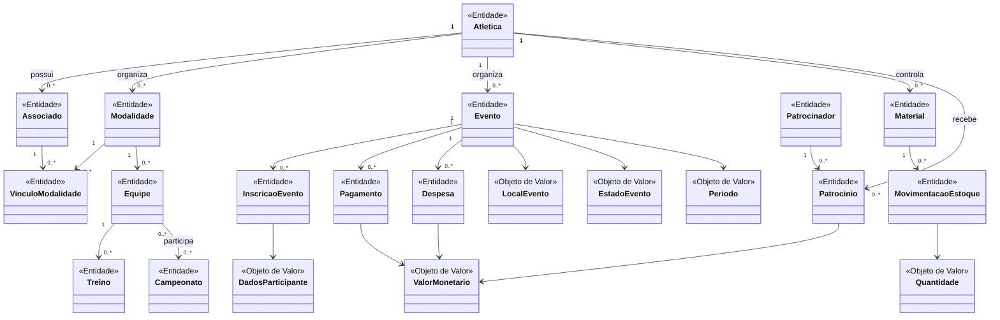
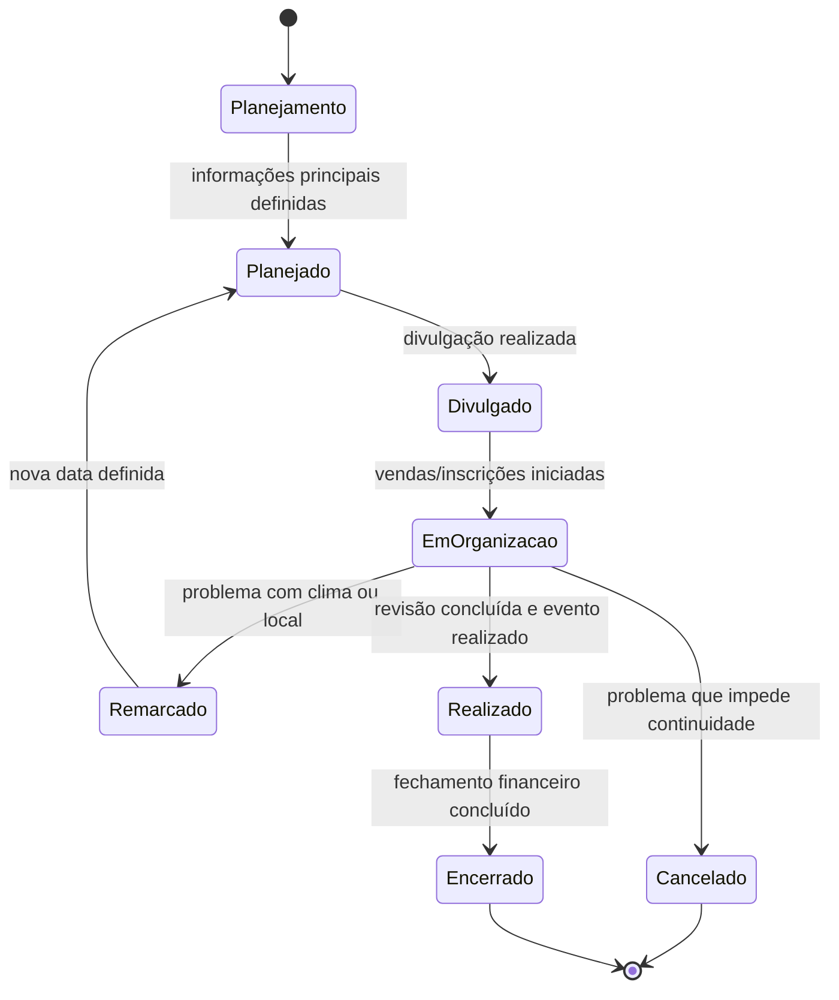

# Da Informação ao Domínio — Modelo Conceitual do Sistema de Gestão de Atlética Universitária

**Disciplina:** Desenvolvimento de Sistemas Corporativos  
**Professor:** Everton Coimbra de Araujo  

**Integrantes:**  
- Adriel Ostrovski
- Bolivar Torres Neto
- Luna Ribeiro

**Tema:** Sistema de Gestão de Atlética Universitária  
**Data:** 15/09/2026

---

# 1. Introdução

O Sistema de Gestão de Atlética Universitária tem como objetivo apoiar a organização das diferentes atividades administrativas e esportivas realizadas por uma atlética.

Nas etapas anteriores, foram identificados problemas relacionados principalmente à existência de informações espalhadas, atividades realizadas sem uma padronização clara e dificuldades na divisão das responsabilidades entre as diferentes funções da organização.

O sistema possui um escopo amplo, envolvendo associados e atletas, modalidades esportivas, treinos, eventos, campeonatos, movimentações financeiras, patrocínios, materiais esportivos e uniformes.

Na análise anterior, entre os diferentes processos existentes no sistema, foi escolhido como fluxo principal a **organização de um evento da atlética, desde seu planejamento inicial até o fechamento financeiro**. Esse fluxo permitiu identificar operações, informações importantes, decisões e situações que podem alterar o andamento de um evento.

Nesta etapa, o objetivo é evoluir esse conhecimento para uma primeira representação conceitual do domínio. A preocupação não está em definir como o sistema será implementado, mas em identificar os conceitos que possuem significado para a atlética, suas relações, regras e ciclos de vida.

---

# 2. Conceitos Identificados no Domínio

A partir das análises anteriores, foram identificados conceitos que representam informações ou elementos importantes para o funcionamento da atlética.

Nem todos possuem o mesmo nível de certeza. Alguns aparecem claramente no funcionamento já analisado, enquanto outros ainda precisam ser confirmados ou refinados.

| Conceito | Classificação inicial | Motivo |
|---|---|---|
| Atlética | Entidade | Representa a organização cujas atividades estão sendo administradas. |
| Associado | Entidade | Representa uma pessoa vinculada à atlética e que precisa ser identificada ao longo do tempo. |
| Modalidade | Entidade | Representa uma modalidade esportiva mantida pela atlética. |
| Vínculo com Modalidade | Entidade | Representa a participação de um associado em determinada modalidade. |
| Equipe | Entidade | Representa um grupo esportivo organizado dentro de determinada modalidade. |
| Treino | Entidade | Representa uma ocorrência de treinamento de uma equipe ou modalidade. |
| Evento | Entidade | Representa um evento organizado pela atlética e possui um ciclo de vida próprio. |
| Campeonato | Entidade | Representa uma competição da qual equipes da atlética podem participar. |
| Inscrição em Evento | Entidade provisória | Representa o registro de uma venda ou inscrição relacionada a um evento. |
| Pagamento | Entidade | Representa um registro financeiro que precisa ser preservado e consultado posteriormente. |
| Despesa | Entidade | Representa um gasto relacionado às atividades da atlética ou a um evento. |
| Patrocinador | Entidade | Representa uma organização ou empresa que mantém relação de patrocínio com a atlética. |
| Patrocínio | Entidade | Representa uma relação específica entre patrocinador e atlética, possuindo período, valor e situação próprios. |
| Material | Entidade | Representa um tipo de material ou uniforme controlado pela atlética. |
| Movimentação de Estoque | Entidade | Representa uma entrada ou retirada de material. |
| Papel/Função Organizacional | Em aberto | É necessário representar funções como diretoria e financeiro, mas sua forma conceitual ainda precisa ser investigada. |

---

# 3. Entidades e Identidade

Uma entidade é um conceito que precisa continuar sendo reconhecido mesmo quando algumas de suas informações mudam.

## 3.1 Associado

O associado possui identidade própria porque continua representando a mesma pessoa mesmo que seus dados ou sua participação em modalidades sejam alterados.

Também pode existir um histórico relacionado a pagamentos, modalidades, equipes ou atividades realizadas dentro da atlética.

Nesta primeira modelagem, **Atleta não foi separado como uma entidade diferente de Associado**.

A interpretação adotada é que um associado pode assumir o papel de atleta ao possuir vínculo com uma modalidade esportiva.

Essa decisão evita representar a mesma pessoa duas vezes no modelo. Entretanto, ela deverá ser validada conforme o domínio for melhor compreendido.

---

## 3.2 Evento

Evento possui identidade porque precisa ser acompanhado durante diferentes momentos de seu ciclo de vida.

Um mesmo evento pode passar por planejamento, divulgação, vendas, organização, remarcação, realização e fechamento financeiro sem deixar de representar o mesmo evento.

Além disso, pagamentos, despesas, inscrições e alterações precisam continuar relacionados àquele evento específico.

---

## 3.3 Modalidade

A modalidade representa uma atividade esportiva existente dentro da atlética.

Ela precisa ser reconhecida de forma independente, pois diferentes associados, equipes, treinos e campeonatos podem estar relacionados a uma mesma modalidade.

---

## 3.4 Equipe

A equipe representa um grupo organizado de atletas dentro de uma modalidade.

Ela possui identidade porque sua composição pode mudar ao longo do tempo enquanto a equipe continua existindo.

---

## 3.5 Treino

Um treino representa uma ocorrência específica relacionada a uma modalidade ou equipe.

Mesmo que dois treinos tenham mesma modalidade e local, continuam sendo acontecimentos diferentes quando ocorrem em datas ou horários diferentes.

---

## 3.6 Campeonato

Um campeonato representa uma competição específica na qual uma ou mais equipes podem participar.

Ele possui identidade própria porque informações como período, participação e resultados precisam estar relacionadas à competição correta.

---

## 3.7 Pagamento e Despesa

Pagamentos e despesas precisam ser preservados individualmente porque fazem parte do histórico financeiro.

Mesmo que dois pagamentos tenham o mesmo valor, representam ocorrências diferentes.

O mesmo acontece com despesas.

---

## 3.8 Patrocinador e Patrocínio

Patrocinador e Patrocínio possuem significados diferentes.

O **Patrocinador** representa a empresa ou organização.

O **Patrocínio** representa uma relação específica estabelecida com esse patrocinador.

Dessa forma, um mesmo patrocinador poderá, em princípio, possuir diferentes patrocínios ao longo do tempo.

---

## 3.9 Material e Movimentação de Estoque

Material representa aquilo que é controlado pela atlética, como equipamentos esportivos ou uniformes.

A Movimentação de Estoque representa cada operação de entrada ou retirada desses materiais e precisa ser preservada para que seja possível compreender as alterações realizadas no estoque.

---

# 4. Objetos de Valor

Algumas informações são importantes não por possuírem identidade própria, mas pelo valor que representam.

Nesta primeira modelagem, foram identificados os seguintes candidatos a Objetos de Valor.

| Objeto de Valor | Descrição |
|---|---|
| Valor Monetário | Representa valores relacionados a pagamentos, despesas, patrocínios e orçamento. |
| Período | Representa um intervalo de tempo utilizado, por exemplo, em eventos, campeonatos ou patrocínios. |
| Local do Evento | Representa as informações necessárias para indicar onde determinada atividade será realizada. |
| Dados do Participante | Reúne as informações utilizadas para identificar um participante ou comprador em uma inscrição de evento. |
| Estado do Evento | Representa a situação atual do evento dentro de seu ciclo de vida. |
| Quantidade | Representa quantidades utilizadas no controle de materiais e movimentações. |

Esses conceitos foram classificados como Objetos de Valor porque, até o momento, o que importa é o conteúdo que carregam e não uma identidade própria independente.

Essa classificação ainda poderá ser revista conforme o conhecimento do domínio aumentar.

---

# 5. Relações entre os Conceitos

As principais relações identificadas nesta primeira modelagem são apresentadas abaixo.

| Relação | Cardinalidade inicial | Justificativa |
|---|---|---|
| Atlética — Associado | 1 para 0..* | Uma atlética pode possuir vários associados. |
| Atlética — Modalidade | 1 para 0..* | Uma atlética pode organizar diferentes modalidades. |
| Atlética — Evento | 1 para 0..* | Diversos eventos podem ser organizados pela atlética. |
| Atlética — Material | 1 para 0..* | A atlética pode controlar diversos tipos de materiais. |
| Associado — Vínculo com Modalidade | 1 para 0..* | Um associado pode possuir vínculos com diferentes modalidades. |
| Modalidade — Vínculo com Modalidade | 1 para 0..* | Uma modalidade pode possuir diversos associados vinculados. |
| Modalidade — Equipe | 1 para 0..* | Uma modalidade pode possuir diferentes equipes. |
| Equipe — Treino | 1 para 0..* | Uma equipe pode realizar diferentes treinos. |
| Equipe — Campeonato | 0..* para 0..* | Uma equipe pode participar de diferentes campeonatos e um campeonato pode receber diferentes equipes. |
| Evento — Inscrição em Evento | 1 para 0..* | Um evento pode possuir diversas vendas ou inscrições. |
| Evento — Despesa | 1 para 0..* | Um evento pode gerar diversas despesas. |
| Evento — Pagamento | 1 para 0..* | Um evento pode possuir diferentes pagamentos registrados durante seu processo. |
| Patrocinador — Patrocínio | 1 para 0..* | Um patrocinador pode possuir mais de uma relação de patrocínio ao longo do tempo. |
| Material — Movimentação de Estoque | 1 para 0..* | Um material pode possuir várias entradas e retiradas registradas. |

As cardinalidades representam o entendimento atual da equipe e não devem ser consideradas imutáveis. Elas poderão ser revistas caso novas informações sobre o funcionamento real da atlética sejam identificadas.

---

# 6. Modelo Conceitual

O diagrama abaixo representa a primeira versão do modelo conceitual.

O objetivo do diagrama não é representar tabelas ou uma estrutura de banco de dados. Ele procura apenas mostrar os conceitos que atualmente parecem importantes para o domínio e como eles se relacionam.

---

# 7. Decisões de Modelagem

Durante a construção do modelo, algumas decisões precisaram ser tomadas.

| ID | Decisão | Justificativa | Situação |
|---|---|---|---|
| DM01 | Associado e Atleta não foram separados em duas entidades. | A interpretação atual é que atleta representa um papel de um associado que participa de uma modalidade. | Provisória |
| DM02 | Foi criado o conceito Vínculo com Modalidade. | Ele permite representar a relação entre associado e modalidade sem considerar que ambos deixam de existir de forma independente. | Provisória |
| DM03 | Evento foi tratado como entidade. | Ele possui identidade e passa por diferentes estados durante seu ciclo de vida. | Atual |
| DM04 | Pagamento e Despesa foram tratados como entidades. | Cada ocorrência precisa permanecer identificável dentro do histórico financeiro. | Atual |
| DM05 | Valor Monetário foi tratado como Objeto de Valor. | Seu significado está no valor representado e não em uma identidade independente. | Atual |
| DM06 | Patrocinador e Patrocínio foram tratados como conceitos diferentes. | Uma empresa é diferente do acordo de patrocínio estabelecido com ela. | Provisória |
| DM07 | A classificação das funções organizacionais não foi fechada. | Ainda não está clara a responsabilidade exata de cada cargo dentro da atlética. | Em aberto |
| DM08 | Inscrição em Evento foi mantida como nome provisório. | O fluxo anterior mencionou tanto vendas quanto inscrições, e ainda é necessário verificar se serão conceitos distintos. | Em aberto |

---

# 8. Regras de Negócio Identificadas

As regras abaixo surgem diretamente das análises realizadas até o momento.

## RN01 — Divulgação de Evento

Um evento somente deve avançar para divulgação depois que suas principais informações estiverem definidas.

Na análise anterior foram consideradas como informações necessárias:

- objetivo;
- data;
- local;
- orçamento;
- responsáveis;
- atrações ou atividades.

Essa regra evita que o evento seja divulgado antes que exista informação suficiente para sua organização.

---

## RN02 — Confirmação de Venda ou Inscrição

Uma venda ou inscrição somente pode ser confirmada quando as informações necessárias estiverem corretas e a operação puder ser concluída.

Dados incorretos ou pagamento não realizado podem impedir sua confirmação.

---

## RN03 — Fechamento Financeiro

O fechamento financeiro depende das informações produzidas durante o evento, como:

- vendas;
- receitas;
- despesas;
- pagamentos;
- patrocínios ou outras entradas.

Entretanto, a condição exata que determina quando um fechamento financeiro pode ser considerado concluído ainda precisa ser investigada.

Por isso, essa regra ainda não deve ser tratada como completamente definida.

---

## RN04 — Remarcação do Evento

Problemas relacionados ao clima ou ao local podem levar a diretoria a alterar a data do evento.

Nesse caso, o evento não necessariamente é encerrado ou cancelado. Ele pode retornar ao planejamento com uma nova data.

---

## RN05 — Cancelamento

Situações como falta de orçamento, indisponibilidade grave do local, vendas insuficientes ou cancelamento de fornecedor ou atração podem impedir a continuidade normal do evento.

A decisão exata sobre quando essas situações obrigam o cancelamento ainda precisa ser refinada.

---

# 9. Possíveis Invariantes

Uma invariante representa uma condição que deve permanecer verdadeira para evitar que o domínio fique em um estado incoerente.

Nesta primeira análise, foram identificadas algumas candidatas.

## INV01 — Evento divulgado precisa possuir informações mínimas

Se um evento estiver em estado **Divulgado**, suas informações principais de planejamento devem estar definidas.

---

## INV02 — Registro financeiro precisa possuir valor

Um Pagamento ou uma Despesa precisa possuir um Valor Monetário válido para fazer sentido dentro do domínio financeiro.

---

## INV03 — Movimentação de estoque precisa estar relacionada a um material

Toda Movimentação de Estoque precisa indicar qual Material está sendo movimentado.

---

## INV04 — Vínculo esportivo precisa relacionar associado e modalidade

Um Vínculo com Modalidade somente possui significado quando existe um Associado e uma Modalidade relacionados.

---

Algumas invariantes ainda precisam ser validadas com pessoas que conhecem o funcionamento real da atlética antes de serem consideradas definitivas.

---

# 10. Ciclo de Vida do Evento

Evento é uma das entidades com ciclo de vida mais claro dentro da análise realizada.

A primeira interpretação desse ciclo é:

## 10.1 Planejamento

O evento foi proposto, mas as principais informações ainda estão sendo definidas.

## 10.2 Planejado

Data, local, orçamento, responsáveis e demais informações principais já foram definidos.

## 10.3 Divulgado

O evento já foi anunciado aos participantes.

## 10.4 Em Organização

As vendas ou inscrições já começaram e atividades como acompanhamento de vendas, execução das tarefas e pagamentos podem acontecer paralelamente.

## 10.5 Remarcado

Alguma condição, como clima ou problema relacionado ao local, exigiu mudança na data.

O evento continua existindo e retorna a uma etapa anterior do planejamento.

## 10.6 Cancelado

Uma situação impediu que o evento continuasse.

## 10.7 Realizado

O evento efetivamente ocorreu, mas o processo ainda não terminou porque existe o fechamento financeiro.

## 10.8 Encerrado

O evento já foi realizado e seu processo de fechamento financeiro foi concluído.

A regra exata para determinar quando o fechamento pode ser considerado concluído ainda precisa ser validada.

---

# 11. Estados e Mudanças em Outros Conceitos

Nem todas as entidades possuem estados suficientemente compreendidos neste momento.

Para algumas delas, ainda existem apenas hipóteses.

| Conceito | Possíveis estados | Situação |
|---|---|---|
| Evento | Planejamento, Planejado, Divulgado, Em Organização, Remarcado, Realizado, Cancelado, Encerrado | Razoavelmente compreendido |
| Patrocínio | Possivelmente proposto, ativo e encerrado | Precisa ser validado |
| Inscrição em Evento | Possivelmente pendente, confirmada ou cancelada | Precisa ser validado |
| Vínculo com Modalidade | Possivelmente ativo ou encerrado | Precisa ser validado |
| Pagamento | Possíveis situações de pendência e confirmação | Precisa ser investigado |
| Material | A quantidade pode mudar, mas não está claro se o material possui um ciclo de estados próprio | Em aberto |

Optou-se por não criar ciclos de vida completos para essas entidades porque ainda não existem informações suficientes para justificá-los.

---

# 12. Hipóteses de Modelagem

Durante a construção do modelo, algumas hipóteses precisaram permanecer explícitas.

| ID | Hipótese | Como validar |
|---|---|---|
| H01 | Atleta pode ser representado como um papel do Associado e não como outra entidade. | Conversar com os responsáveis pelas modalidades e verificar se existem atletas que não são associados ou diferenças de identidade entre os conceitos. |
| H02 | Uma modalidade pode possuir mais de uma equipe. | Verificar a organização esportiva real da atlética. |
| H03 | O conceito Inscrição em Evento pode representar o registro das vendas e inscrições. | Investigar se venda de ingresso e inscrição são processos diferentes no domínio. |
| H04 | Patrocínio possui ciclo e identidade próprios diferentes do Patrocinador. | Analisar como acordos com patrocinadores são registrados atualmente. |
| H05 | Materiais podem ser controlados por quantidade. | Verificar se existem itens que precisam ser individualmente identificados. |
| H06 | Um mesmo associado pode participar de mais de uma modalidade. | Confirmar com a organização esportiva da atlética. |

---

# 13. Questões em Aberto

Alguns pontos continuam sem informação suficiente para uma decisão conceitual definitiva.

## Q01 — Funções e responsabilidades

Ainda é necessário definir exatamente quais funções existem dentro da atlética e quais responsabilidades pertencem a cada uma.

Essa questão afeta diretamente a forma como Diretoria, Tesouraria, responsáveis esportivos e demais funções aparecerão no modelo.

---

## Q02 — Informações financeiras

Ainda não está definido quais funções poderão visualizar ou modificar cada tipo de informação financeira.

---

## Q03 — Fechamento financeiro

Ainda é necessário definir quais condições precisam ser satisfeitas para considerar o fechamento financeiro de um evento concluído.

---

## Q04 — Participantes de eventos

Ainda é necessário confirmar se as pessoas que compram ingressos ou realizam inscrições precisam ser associadas à atlética ou se participantes externos também podem existir.

---

## Q05 — Venda e inscrição

É necessário verificar se **Venda de Ingresso** e **Inscrição em Evento** representam o mesmo processo ou conceitos diferentes.

---

## Q06 — Patrocínio

Ainda é necessário entender se um Patrocínio está sempre relacionado à atlética como um todo, a um evento específico ou se as duas situações podem existir.

---

## Q07 — Estoque

É necessário investigar se o controle de materiais ocorre apenas por quantidade ou se determinados itens precisam possuir identificação individual.

---

## Q08 — Treinos

Apesar de treinos fazerem parte do escopo do sistema, ainda não foi realizada uma análise detalhada sobre informações como presença, responsáveis, local, horário e regras relacionadas à participação.

Por esse motivo, Treino aparece no modelo inicial, mas ainda precisa ser aprofundado.

---

# 14. Fragilidades do Modelo Atual

O modelo construído representa o conhecimento disponível neste momento e não deve ser considerado definitivo.

A parte mais compreendida do domínio ainda é a organização de eventos, pois esse foi o fluxo analisado em maior profundidade na etapa anterior.

Áreas como modalidades, treinos, campeonatos, patrocínios e estoque fazem parte do escopo geral do sistema, mas ainda não tiveram fluxos analisados com o mesmo nível de detalhe.

Por esse motivo, conceitos dessas áreas aparecem no modelo, mas possuem maior possibilidade de mudança nas próximas etapas.

Outra fragilidade importante está relacionada às funções organizacionais. Como a própria desorganização das responsabilidades foi identificada como um problema atual da atlética, não seria adequado transformar os cargos atuais diretamente em uma estrutura conceitual definitiva sem antes compreender melhor suas responsabilidades.

---

# 15. Coerência com o Fluxo Anterior

O modelo conceitual mantém relação direta com o fluxo de organização de eventos analisado anteriormente.

No fluxo, um evento:

1. é proposto;
2. é planejado;
3. possui data, local, orçamento e responsáveis;
4. é divulgado;
5. recebe vendas ou inscrições;
6. gera pagamentos e despesas;
7. pode sofrer alterações;
8. é realizado;
9. passa pelo fechamento financeiro.

A partir desse fluxo surgiram diretamente conceitos como:

- Evento;
- Inscrição em Evento;
- Pagamento;
- Despesa;
- Valor Monetário;
- Local do Evento;
- Estado do Evento.

Isso evita que o modelo seja apenas uma lista de conceitos imaginados. Parte importante dele é consequência direta do funcionamento que já havia sido analisado.

---

# 16. O que Não Foi Definido

Neste trabalho não foram definidas decisões relacionadas à implementação.

Não foram escolhidos:

- linguagem de programação;
- framework;
- estrutura de API;
- controllers;
- services;
- repositories;
- banco de dados;
- ORM;
- microsserviços;
- infraestrutura;
- formato de persistência.

O modelo apresentado representa conceitos do domínio e suas relações, e não componentes técnicos do sistema.

---

# 17. Próximas Validações

Antes de considerar o modelo conceitual estável, a equipe deverá principalmente:

1. validar a relação entre Associado e Atleta;
2. compreender melhor as responsabilidades dos diferentes cargos;
3. confirmar como funcionam as permissões sobre informações financeiras;
4. investigar se vendas e inscrições de eventos são conceitos diferentes;
5. aprofundar os processos de modalidades, treinos, campeonatos, patrocínios e estoque;
6. revisar as cardinalidades após essas validações.

Essas validações poderão alterar conceitos e relações apresentados neste documento.

---

# 18. Conclusão

A construção do modelo conceitual permitiu transformar informações levantadas nas etapas anteriores em conceitos mais claros sobre o domínio da atlética.

O principal avanço foi deixar de observar o sistema apenas pelas funcionalidades que ele deverá oferecer e começar a identificar quais elementos possuem significado próprio dentro do problema.

Conceitos como Associado, Evento, Modalidade, Pagamento, Patrocínio e Material foram analisados quanto à necessidade de identidade, enquanto informações como Valor Monetário, Período e Estado do Evento foram consideradas candidatas a Objetos de Valor.

A análise do ciclo de vida do Evento também mostrou que uma entidade pode permanecer sendo a mesma mesmo passando por diferentes estados ao longo do tempo.

Ao mesmo tempo, o trabalho revelou que ainda existem partes do domínio que precisam de investigação. A divisão das responsabilidades, as permissões financeiras, o funcionamento das inscrições e algumas relações envolvendo modalidades, patrocínios, treinos e estoque ainda não possuem informação suficiente para decisões definitivas.

Por isso, o modelo apresentado deve ser entendido como uma **primeira representação conceitual do domínio**, construída a partir do conhecimento atual e preparada para ser revisada conforme novas informações sejam obtidas.

---

# Apêndice — Uso de Inteligência Artificial

## Ferramenta utilizada

Foi utilizado o **ChatGPT** como ferramenta de apoio durante a construção e revisão do modelo conceitual.

## Finalidade

A ferramenta foi utilizada para ajudar a equipe a transformar as informações obtidas nas etapas anteriores em questões de modelagem conceitual.

O uso foi concentrado principalmente na discussão sobre:

- conceitos relevantes;
- possíveis entidades;
- Objetos de Valor;
- identidade;
- relações;
- cardinalidades;
- regras de negócio;
- invariantes;
- ciclos de vida;
- hipóteses e questões ainda abertas.

Nenhuma decisão de implementação foi definida por meio da ferramenta.

## Contribuições

A interação ajudou principalmente a perceber que nem todo conceito citado anteriormente deveria automaticamente se transformar em uma entidade.

Um exemplo foi a diferença entre **Associado** e **Atleta**. Em vez de criar imediatamente duas entidades para representar a mesma pessoa, foi levantada a possibilidade de Atleta representar um papel assumido pelo Associado quando participa de uma modalidade.

Também foi importante separar **Patrocinador** de **Patrocínio**, pois a empresa possui significado diferente do acordo realizado com ela.

A análise também ajudou a relacionar o fluxo anterior de eventos com conceitos como Evento, Inscrição, Pagamento, Despesa e Estado do Evento.

## Pontos que permaneceram como hipótese

A ferramenta não foi utilizada como evidência para confirmar regras do domínio.

Quando uma informação não estava suficientemente sustentada, ela foi mantida como hipótese ou questão em aberto.

Entre esses pontos estão:

- a relação exata entre Associado e Atleta;
- a estrutura das funções da diretoria;
- os estados de um Patrocínio;
- a forma de controle dos materiais;
- a diferença entre venda de ingresso e inscrição;
- a regra exata para concluir o fechamento financeiro.

## Decisões não antecipadas

Durante a análise, optou-se por não transformar automaticamente cargos como Tesoureiro, Diretor de Esportes e Técnico em entidades independentes.

Como as responsabilidades de cada função ainda precisam ser investigadas, criar essas entidades neste momento poderia fazer o modelo representar uma suposição como se fosse uma estrutura confirmada do domínio.

Da mesma forma, não foram definidos elementos técnicos como tabelas, APIs, banco de dados ou componentes de software.

## Avaliação crítica

A Inteligência Artificial foi útil para organizar o raciocínio e apresentar alternativas de modelagem que puderam ser avaliadas pela equipe.

Entretanto, a ferramenta não conhece por conta própria o funcionamento real da atlética. Uma sugestão conceitualmente plausível pode não representar corretamente a realidade da organização.

Por isso, conceitos e relações para os quais ainda não existem evidências suficientes foram registrados como provisórios, hipóteses ou questões em aberto.

A responsabilidade pela validação dessas decisões permanece com a equipe.

## Questão final

**Se a Inteligência Artificial fosse retirada agora, a equipe conseguiria explicar e defender o modelo apresentado?**

Sim.

O modelo parte do problema, do escopo e do fluxo discutidos pela própria equipe nas etapas anteriores. A Inteligência Artificial auxiliou na organização e no questionamento das decisões, mas os pontos sem informação suficiente permaneceram explicitamente registrados para validação.

Dessa forma, a equipe consegue explicar por que cada conceito aparece no modelo, quais relações estão atualmente justificadas e quais partes ainda não devem ser consideradas definitivas.