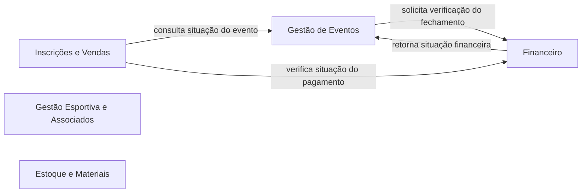

# Trabalho — Do Domínio às Fronteiras: Organizando a Arquitetura do Sistema

**Disciplina:** Desenvolvimento de Sistemas Corporativos  
**Professor:** Everton Coimbra de Araujo  
**Integrantes:** Adriel Ostrovski, Bolivar Torres Neto e Luna Ribeiro  
**Tema:** Sistema de Gestão de Atlética Universitária  
**Data:** 06/10/2026

> **Observação:** as fronteiras apresentadas são hipóteses arquiteturais. As partes com menor evidência continuam marcadas como candidatas e podem ser revistas.

---

# Parte 1 — Retomada do domínio

## 1.1 Problema central

O sistema busca organizar as atividades da atlética, que hoje podem ter informações espalhadas, responsabilidades pouco claras e processos sem acompanhamento adequado.

O escopo é amplo e inclui associados e atletas, modalidades, equipes, treinos, campeonatos, eventos, financeiro, patrocínios, materiais e uniformes.

## 1.2 Principais atores

- Diretoria
- Responsáveis por eventos
- Responsáveis financeiros
- Responsáveis esportivos
- Associados/atletas e participantes

## 1.3 Principal fluxo analisado

O fluxo escolhido para análise detalhada foi a **organização de um evento da atlética do planejamento inicial ao fechamento financeiro**.

Etapas principais:

**decidir realizar → planejar → divulgar → controlar vendas/inscrições → acompanhar organização → realizar o evento → fechar financeiramente → encerrar**

Também foram identificadas variações como remarcação por problema de local ou clima e cancelamento quando uma condição impedir a continuidade.

## 1.4 Conceitos centrais

Evento, EstadoEvento, LocalEvento, Período, Inscrição em Evento, Pagamento, Despesa, Receita, Associado, Modalidade, Equipe, Treino, Campeonato, Patrocinador, Patrocínio, Material e Movimentação de Estoque.

## 1.5 Regras e invariantes relevantes

- Um evento divulgado precisa ter suas informações mínimas de planejamento definidas.
- Um evento não deve avançar de estado sem cumprir as condições necessárias.
- Problemas relevantes de local ou clima podem exigir remarcação ou cancelamento.
- O fechamento financeiro precisa considerar receitas, despesas e pagamentos relacionados ao evento.
- Uma inscrição confirmada precisa atender às condições necessárias para sua confirmação.

## 1.6 Agregados identificados até o momento

O agregado com fronteira mais bem sustentada é **Evento**, com **Evento** como possível Aggregate Root e conceitos diretamente ligados ao seu ciclo, como EstadoEvento, LocalEvento e Período.

Pagamento e Despesa foram tratados como entidades com identidade própria e não precisam estar dentro do mesmo agregado de Evento.

Os demais conceitos ainda não possuem agregados tão bem validados quanto Evento.

## 1.7 Questão de análise

A modelagem anterior fornece pistas para a divisão principalmente porque já revelou:

- responsabilidades diferentes entre diretoria, eventos, financeiro, esporte e estoque;
- regras ligadas ao ciclo de vida de Evento;
- conceitos financeiros com identidade própria;
- mudanças de significado de termos como Evento, Pagamento e Associado;
- dependências que aparecem no fluxo, principalmente entre Eventos, Inscrições e Financeiro.

Isso sugere que a divisão deve seguir **responsabilidades e regras do domínio**, e não simplesmente os módulos ou tabelas existentes.

---

# Parte 2 — Descoberta das áreas de responsabilidade

As áreas abaixo são candidatas porque agrupam responsabilidades que parecem ter motivos de mudança e objetivos próximos.

| Área candidata | Propósito | Principais conceitos | Regras relevantes | Responsabilidades |
|---|---|---|---|---|
| **Gestão de Eventos** | Controlar o ciclo de vida dos eventos | Evento, EstadoEvento, LocalEvento, Período | Informações mínimas para divulgação; transições de estado | Planejar, divulgar, remarcar, cancelar, realizar e encerrar |
| **Inscrições e Vendas** | Controlar participação e vendas de eventos | Inscrição em Evento, participante, venda | Confirmar inscrição somente com condições atendidas | Registrar, confirmar e acompanhar inscrições/vendas |
| **Financeiro** | Controlar movimentações e fechamento financeiro | Pagamento, Despesa, Receita, saldo | Registros financeiros válidos; fechamento baseado nas movimentações | Registrar pagamentos, receitas, despesas e fechar financeiramente |
| **Gestão Esportiva e Associados** | Organizar participação esportiva | Associado, Modalidade, Equipe, Treino, Campeonato | Regras de participação e vínculo ainda pouco detalhadas | Cadastrar associados, organizar modalidades, equipes e atividades esportivas |
| **Estoque e Materiais** | Controlar materiais e uniformes | Material, Movimentação de Estoque, Quantidade | Regras de entrada e retirada ainda pouco detalhadas | Registrar entradas, retiradas e acompanhar quantidades |

## Análise das propostas

### Gestão de Eventos

As responsabilidades têm propósito claro e mudam principalmente quando o processo de organização do evento muda. Os conceitos possuem relação natural e as regras se concentram no ciclo de vida do Evento.

**Conclusão:** área com alta coesão e boa sustentação.

### Inscrições e Vendas

Há um objetivo próprio: controlar a participação e as vendas. Existe uma relação forte com Evento e Pagamento, mas a equipe ainda precisa confirmar se venda de ingresso e inscrição são exatamente o mesmo conceito.

**Conclusão:** área coerente, mas ainda com uma questão de vocabulário em aberto.

### Financeiro

As responsabilidades possuem um propósito comum: controlar valores e registros financeiros. A relação com Eventos existe, mas o Financeiro não precisa conhecer todo o ciclo de vida do Evento para exercer sua responsabilidade.

**Conclusão:** área com boa coesão.

### Gestão Esportiva e Associados

O agrupamento parece natural em uma visão inicial, porém ainda não foi analisado com a mesma profundidade do fluxo de Eventos. Associados e atividades esportivas podem acabar tendo motivos diferentes para mudar.

**Conclusão:** boa candidata a área, mas a fronteira ainda é hipótese.

### Estoque e Materiais

Existe uma responsabilidade clara de controlar materiais e movimentações. Entretanto, as regras reais de estoque ainda não foram detalhadas pela equipe.

**Conclusão:** área plausível, mas de baixa evidência neste momento.

---

# Parte 3 — Investigação dos Bounded Contexts

## 3.1 Gestão de Eventos

**Propósito**  
Controlar o planejamento e o ciclo de vida de um evento.

**Responsabilidades**
- criar e planejar eventos;
- definir informações do evento;
- divulgar;
- acompanhar o andamento;
- remarcar ou cancelar;
- registrar realização;
- encaminhar o encerramento.

**O que não pertence**
- processamento detalhado de pagamentos;
- registro completo de despesas e receitas;
- manutenção de estoque;
- regras internas das modalidades esportivas.

**Vocabulário**  
Evento, EstadoEvento, LocalEvento, Período, divulgação, remarcação, cancelamento, realização e encerramento.

**Regras e invariantes**
- Evento divulgado precisa possuir informações mínimas de planejamento.
- Evento não deve avançar de estado sem cumprir as condições exigidas.

**Agregado relacionado**  
Evento, com EstadoEvento, LocalEvento e Período como conceitos ligados ao ciclo do agregado.

**Justificativa da fronteira**  
Esses conceitos mudam principalmente quando o planejamento e o ciclo do evento mudam. Separá-los do Financeiro evita que o ciclo do Evento dependa dos detalhes internos das movimentações financeiras.

**Grau de certeza:** bem sustentado.

## 3.2 Inscrições e Vendas

**Propósito**  
Controlar inscrições e vendas relacionadas aos eventos.

**Responsabilidades**
- registrar inscrição/venda;
- identificar o participante;
- acompanhar a situação;
- solicitar ou verificar a confirmação necessária.

**O que não pertence**
- planejamento do evento;
- definição do local e da data;
- fechamento financeiro;
- regras internas de pagamentos.

**Vocabulário**  
Inscrição em Evento, participante, venda, confirmação e situação da inscrição.

**Regras e invariantes**
- inscrição confirmada precisa satisfazer as condições necessárias;
- pagamento obrigatório precisa estar em situação válida para a confirmação.

**Agregado relacionado**  
Inscrição em Evento, ainda como candidato.

**Justificativa da fronteira**  
A participação do usuário e o controle da venda possuem objetivo próprio e não precisam conhecer toda a organização do evento nem o processamento financeiro interno.

**Grau de certeza:** hipótese bem sustentada.

## 3.3 Financeiro

**Propósito**  
Controlar movimentações financeiras e o fechamento dos eventos.

**Responsabilidades**
- registrar pagamentos;
- registrar receitas;
- registrar despesas;
- acompanhar pendências;
- realizar fechamento financeiro;
- preservar histórico financeiro.

**O que não pertence**
- planejar ou divulgar eventos;
- decidir local ou data;
- controlar o ciclo de vida completo de inscrições;
- organizar treinos ou estoque.

**Vocabulário**  
Pagamento, Despesa, Receita, Valor Monetário, saldo, pendência e fechamento financeiro.

**Regras e invariantes**
- registros financeiros precisam permanecer identificáveis;
- o fechamento deve considerar as movimentações relevantes do evento;
- não devem existir registros financeiros sem valor válido.

**Agregados relacionados**  
Pagamento e Despesa como entidades do contexto financeiro; uma fronteira de agregado própria ainda pode ser refinada em etapa posterior.

**Justificativa da fronteira**  
Pagamento e Despesa possuem identidade e histórico próprios. O Financeiro possui regras que podem mudar independentemente do ciclo do Evento.

**Grau de certeza:** bem sustentado como área; detalhes internos ainda podem evoluir.

## 3.4 Gestão Esportiva e Associados — candidato

**Propósito**  
Organizar associados e sua participação nas atividades esportivas.

**Responsabilidades**
- manter associados;
- organizar modalidades;
- organizar equipes;
- acompanhar treinos;
- acompanhar campeonatos.

**O que não pertence**
- fechamento financeiro de eventos;
- pagamentos e despesas;
- estoque de materiais.

**Vocabulário**  
Associado, Atleta, Modalidade, Vínculo com Modalidade, Equipe, Treino e Campeonato.

**Regras e invariantes**  
Ainda precisam de validação com os processos reais da atlética.

**Agregados relacionados**  
Nenhum agregado foi confirmado para esta fronteira.

**Justificativa da fronteira**  
Existe um vocabulário esportivo próprio, mas ainda não há evidência suficiente para afirmar que associados e todas as atividades esportivas devem evoluir dentro da mesma fronteira.

**Grau de certeza:** hipótese.

## 3.5 Estoque e Materiais — candidato

**Propósito**  
Controlar materiais esportivos e uniformes.

**Responsabilidades**
- registrar materiais;
- registrar movimentações;
- acompanhar quantidades;
- controlar entradas e retiradas.

**O que não pertence**
- fechamento financeiro;
- planejamento de eventos;
- organização de treinos.

**Vocabulário**  
Material, Movimentação de Estoque, Quantidade e Uniforme.

**Regras e invariantes**  
Ainda precisam de validação.

**Agregados relacionados**  
Material e Movimentação de Estoque continuam como candidatos.

**Justificativa da fronteira**  
Existe uma responsabilidade específica de controle de materiais, mas o fluxo de estoque ainda não foi detalhado o suficiente para fechar a fronteira.

**Grau de certeza:** hipótese.

---

# Parte 4 — Mudanças de significado entre contextos

| Conceito | Contexto A | Significado no Contexto A | Contexto B | Significado no Contexto B |
|---|---|---|---|---|
| **Evento** | Gestão de Eventos | Atividade organizada pela atlética, com planejamento, data, local e ciclo de vida | Financeiro | Referência para relacionar receitas, despesas, pagamentos e fechamento |
| **Pagamento** | Financeiro | Movimentação financeira com valor, situação, data e histórico | Inscrições e Vendas | Condição usada para saber se uma inscrição pode ser confirmada |
| **Associado** | Gestão Esportiva e Associados | Pessoa vinculada à atlética e participante das atividades esportivas | Financeiro | Pessoa relacionada a mensalidades, cobranças e situação de pagamento |

## Mesmo modelo em todos os contextos?

Não necessariamente.

O conceito pode continuar relacionado ao mesmo elemento do domínio, mas cada contexto precisa manter apenas as informações e regras que fazem sentido para sua responsabilidade. Compartilhar o mesmo modelo completo entre contextos criaria dependências desnecessárias.

Por exemplo, Gestão de Eventos precisa saber a situação necessária do fechamento financeiro, mas não precisa conhecer o histórico completo de cada transação.

---

# Parte 5 — Mapa das fronteiras

O diagrama representa as fronteiras arquiteturais propostas e a finalidade básica das relações.

### Leitura do mapa

- **Gestão de Eventos** depende do Financeiro para saber se a condição necessária ao encerramento foi atendida.
- **Inscrições e Vendas** depende de Gestão de Eventos para conhecer a situação do evento.
- **Inscrições e Vendas** depende do Financeiro para verificar a condição de pagamento.
- Gestão Esportiva e Associados e Estoque e Materiais aparecem como fronteiras candidatas, mas ainda não possuem relações arquiteturais fechadas neste trabalho.

---

# Parte 6 — Conhecimento que atravessa as fronteiras

## Relação 1 — Gestão de Eventos → Financeiro

**Quem inicia?**  
Gestão de Eventos.

**Por que é necessária?**  
Antes de encerrar o evento, é necessário saber se o fechamento financeiro foi concluído.

**O que precisa atravessar?**
- identificação do evento;
- situação do fechamento;
- existência de pendências.

**O que não deveria atravessar?**
- dados completos das transações;
- forma de pagamento;
- detalhes de cada despesa;
- histórico financeiro completo.

**A fronteira consumidora precisa conhecer detalhes internos?**  
Não.

**Risco de acoplamento excessivo?**  
Existe se Gestão de Eventos passar a depender das estruturas internas do Financeiro.

**Como reduzir?**  
Manter um contrato mínimo baseado no significado da informação e não na estrutura interna do Financeiro.

## Relação 2 — Inscrições e Vendas → Financeiro

**Quem inicia?**  
Inscrições e Vendas.

**Por que é necessária?**  
Quando o pagamento é obrigatório, a inscrição precisa saber se a condição financeira necessária foi atendida.

**O que precisa atravessar?**
- identificador da inscrição;
- valor ou referência necessária para a cobrança;
- situação do pagamento.

**O que não deveria atravessar?**
- dados internos de transação;
- detalhes do meio de pagamento;
- histórico completo do cliente;
- regras internas do Financeiro.

**A fronteira consumidora precisa conhecer detalhes internos?**  
Não.

**Risco de acoplamento excessivo?**  
Existe se Inscrições e Vendas passar a depender de vários detalhes do processamento financeiro.

**Como reduzir?**  
Trocar apenas o resultado necessário para a confirmação da inscrição.

## Relação 3 — Inscrições e Vendas → Gestão de Eventos

**Quem inicia?**  
Inscrições e Vendas.

**Por que é necessária?**  
A inscrição depende da situação do evento para saber se a participação ainda pode ocorrer.

**O que precisa atravessar?**
- identificação do evento;
- situação atual do evento;
- informação mínima sobre disponibilidade para inscrição.

**O que não deveria atravessar?**
- detalhes do planejamento interno;
- responsáveis do evento;
- orçamento completo;
- histórico de alterações que não afete a inscrição.

**A fronteira consumidora precisa conhecer detalhes internos?**  
Não.

**Risco de acoplamento excessivo?**  
Existe se Inscrições e Vendas passar a manipular diretamente o ciclo do Evento.

**Como reduzir?**  
Consultar apenas o estado e as informações necessárias para a inscrição.

---

# Parte 7 — Comunicação entre fronteiras

| Origem | Destino | Necessidade | Tipo | Justificativa |
|---|---|---|---|---|
| Gestão de Eventos | Financeiro | Verificar condição do fechamento | **Síncrona** | A resposta é necessária naquele momento para decidir se o evento pode ser encerrado. |
| Inscrições e Vendas | Financeiro | Verificar condição do pagamento | **Síncrona** | A inscrição precisa da resposta para saber se pode ser confirmada. |
| Inscrições e Vendas | Gestão de Eventos | Verificar situação do evento | **Síncrona** | A inscrição precisa da situação atual para impedir uma inscrição em evento que não pode mais receber participantes. |

A comunicação assíncrona pode ser considerada futuramente para acontecimentos que não bloqueiem o fluxo principal, mas não existe necessidade de usá-la no caminho crítico analisado.

---

# Parte 8 — Contratos entre fronteiras

## Contrato 1 — Verificar Fechamento Financeiro do Evento

**Origem:** Gestão de Eventos  
**Destino:** Financeiro  
**Objetivo:** saber se o evento possui as condições financeiras necessárias para ser encerrado.

### Informações enviadas

- `eventoId`
- identificação da solicitação de fechamento

### Resultado esperado

- fechamento concluído;
- ou fechamento não concluído, com indicação de pendência.

### Semântica importante

`eventoId` identifica o evento a que a consulta se refere. A situação do fechamento não significa que o evento esteja encerrado; significa apenas que a condição financeira foi ou não atendida.

### Possíveis falhas

- evento inexistente;
- fechamento ainda pendente;
- dados financeiros incompletos;
- indisponibilidade temporária do contexto Financeiro.

### Informações que não devem fazer parte do contrato

- lista completa de pagamentos;
- forma de pagamento;
- dados internos das despesas;
- histórico completo das transações.

## Contrato 2 — Verificar Pagamento da Inscrição

**Origem:** Inscrições e Vendas  
**Destino:** Financeiro  
**Objetivo:** verificar se o pagamento relacionado a uma inscrição atende à condição necessária para sua confirmação.

### Informações enviadas

- `inscricaoId`
- valor relacionado à inscrição
- identificação do evento

### Resultado esperado

- pagamento aprovado/confirmado;
- pagamento pendente;
- ou pagamento recusado.

### Semântica importante

O resultado informa a situação necessária para a inscrição. Inscrições e Vendas não precisa conhecer como o Financeiro chegou ao resultado.

### Possíveis falhas

- pagamento não encontrado;
- valor inconsistente;
- pagamento ainda pendente;
- indisponibilidade do Financeiro.

### Informações que não devem fazer parte do contrato

- dados completos da transação;
- detalhes do meio de pagamento;
- regras internas de conciliação;
- histórico financeiro completo da pessoa.

> Os contratos definem significado e limites de informação. Não estão sendo definidos REST, endpoints, JSON, filas ou outras tecnologias.

---

# Parte 9 — Teste crítico das fronteiras

| Fronteira | Problema encontrado | Revisão |
|---|---|---|
| Gestão de Eventos | Pode acabar recebendo responsabilidades financeiras demais | Manter a fronteira focada no ciclo do Evento e consultar apenas o resultado necessário do Financeiro |
| Inscrições e Vendas | Ainda existe dúvida entre inscrição e venda | Manter como candidata e investigar o significado real desses dois termos |
| Financeiro | Pode ficar amplo ao reunir pagamentos, mensalidades, patrocínios, receitas e despesas | Manter como fronteira provisória, mas revisar caso esses processos passem a ter motivos de mudança claramente diferentes |
| Gestão Esportiva e Associados | Responsabilidades podem ser amplas demais | Não fechar como contexto definitivo; avaliar uma possível separação entre Associados e Gestão Esportiva |
| Estoque e Materiais | Pouca evidência sobre suas regras | Manter como candidato e aprofundar o fluxo de estoque antes de definir uma fronteira final |

## Revisões provocadas pela análise

### Hipótese inicial → problema identificado → decisão de revisão

**Gestão Esportiva e Associados como um único contexto**  
→ as responsabilidades de cadastro de associados e organização esportiva podem mudar por razões diferentes  
→ manter como **candidato**, sem considerar a união definitiva.

**Inscrições e Vendas como contexto já fechado**  
→ ainda existe ambiguidade entre inscrição e venda  
→ manter a fronteira como hipótese até validar o vocabulário com exemplos reais.

A existência dessas revisões não é considerada erro. Ela mostra que a proposta foi criticada e refinada durante a análise.

---

# Parte 10 — Monólito modular ou distribuição?

## Decisão atual: monólito modular

Para o estágio atual do projeto, a organização mais coerente é manter as fronteiras como **módulos internos de um único sistema**.

### Maturidade das fronteiras

Gestão de Eventos e Financeiro estão mais claras. Inscrições e Vendas, Gestão Esportiva e Associados e Estoque ainda possuem hipóteses abertas.

### Tamanho e organização da equipe

O projeto é acadêmico e desenvolvido por uma equipe pequena. Não existe evidência de uma necessidade operacional que justifique várias implantações independentes agora.

### Deploy independente

Não foi identificado um requisito que obrigue Financeiro ou qualquer outro contexto a ser implantado separadamente.

### Escalabilidade independente

Também não há evidência atual de que uma parte do sistema precise escalar de forma independente.

### Complexidade operacional

Uma arquitetura distribuída adicionaria comunicação de rede, tratamento de falhas, observabilidade e problemas de consistência que não são necessários para o estágio atual.

### Frequência de mudanças

As fronteiras ainda estão sendo descobertas. Separar fisicamente os contextos antes de estabilizar o domínio aumentaria o custo de revisão.

### Dependências entre contextos

As dependências existem, mas ainda são simples e podem ser tratadas como contratos internos bem definidos.

### Conclusão

As fronteiras devem existir **conceitualmente e como módulos internos**, sem transformar cada contexto em microserviço.

Uma fronteira de domínio não é automaticamente uma fronteira de deploy.

---

# Parte 11 — Hipótese de evolução arquitetural

## Transição A → B

**O que precisaria mudar no contexto?**  
As fronteiras internas precisariam ficar mais estáveis e os contratos entre elas mais claros.

**Qual problema justificaria a mudança?**  
Crescimento do projeto, aumento de dependências internas ou necessidade de reduzir o acoplamento entre os módulos.

**Quais evidências deveriam existir?**  
Problemas concretos no desenvolvimento, mudanças frequentes entre áreas, dificuldades de teste ou crescimento das dependências.

**Quais riscos seriam introduzidos?**  
Baixo risco, porque a mudança ainda acontece dentro do mesmo sistema.

## Transição B → C

**O que precisaria mudar no contexto?**  
O Financeiro precisaria apresentar necessidades operacionais diferentes do restante do sistema.

**Qual problema justificaria a mudança?**  
Grande volume de transações, integrações financeiras críticas, exigência de disponibilidade independente ou necessidade de evolução em ritmo muito diferente.

**Quais evidências deveriam existir?**  
Métricas de volume, incidentes, gargalos, requisitos de disponibilidade ou necessidade real de deploy independente.

**Quais riscos seriam introduzidos?**  
Maior complexidade operacional, comunicação entre sistemas, falhas de rede e necessidade de tratar consistência entre contextos.

A extração do Financeiro é, portanto, uma **hipótese condicional**, e não uma decisão atual.

---

# Parte 12 — Decisão arquitetural

## Decisão: manter o Financeiro como módulo interno e usar comunicação síncrona no fluxo de fechamento

**Contexto**  
O encerramento de um evento depende da situação do fechamento financeiro, mas o processamento financeiro possui regras e registros próprios.

**Problema ou situação que levou à decisão**  
Colocar todo o Financeiro dentro do agregado ou do contexto de Eventos aumentaria a responsabilidade do Evento e o acoplamento entre regras diferentes.

**Decisão adotada**  
Manter Financeiro como fronteira própria, porém como módulo interno do monólito, e usar comunicação síncrona para verificar a condição necessária ao fechamento do Evento.

**Justificativa**  
A resposta precisa estar disponível no momento em que o Evento tenta ser encerrado. Ao mesmo tempo, Evento não precisa conhecer os detalhes internos das operações financeiras.

**Alternativas consideradas**

1. Colocar Pagamento e Despesa diretamente dentro do agregado Evento.
2. Manter o Financeiro sem fronteira própria.
3. Extrair Financeiro imediatamente como microserviço.
4. Manter Financeiro como módulo interno com contrato explícito.

**Trade-offs**

Ganhamos separação de responsabilidades e menor dependência dos detalhes financeiros. Como custo, continuamos tendo uma dependência entre os contextos e precisamos manter o contrato de comunicação bem definido.

**Condições para revisão**

A decisão pode ser revista caso apareçam necessidades reais de escala, disponibilidade, integração externa ou frequência de mudança independente no Financeiro.

---

# Parte 13 — Impacto sobre os trabalhos anteriores

| Descoberta atual | Documento/modelo afetado | Revisão necessária | Justificativa |
|---|---|---|---|
| Financeiro possui responsabilidade própria | Trabalho 2 / modelo conceitual | Reforçar que Pagamento e Despesa estão fora da fronteira do agregado Evento | Possuem identidade e ciclo de vida financeiros próprios |
| Evento continua sendo o conceito central do fluxo | Trabalhos anteriores | Manter Evento como centro do fluxo e do ciclo de vida | É o conceito mais bem sustentado pela análise |
| Inscrição em Evento ganhou uma fronteira candidata | Modelo conceitual | Tratar Inscrição em Evento como conceito provisório de Inscrições e Vendas | O comportamento de participação tem regras próprias |
| Evento possui relação com Financeiro sem compartilhar os detalhes internos | Modelo conceitual | Interpretar a relação como dependência entre contextos | A relação conceitual não obriga o mesmo agregado |
| Associado e Atleta ainda possuem ambiguidade | Modelo conceitual | Manter Atleta como papel possível de Associado até nova evidência | Não há evidência suficiente de identidade independente |
| Gestão Esportiva e Associados pode estar ampla demais | Áreas e modelo conceitual | Marcar a fronteira como hipótese e avaliar uma possível separação futura | Associados e atividades esportivas podem ter motivos de mudança diferentes |
| Venda e Inscrição ainda não estão totalmente diferenciadas | Modelo conceitual / fluxo | Registrar a ambiguidade no vocabulário | Evita criar um conceito definitivo sem evidência |
| Fechamento financeiro ainda possui regra incompleta | Regras e invariantes | Manter a condição como questão aberta | Não foi definida uma regra formal para dizer que o fechamento terminou |
| Informações de eventos e financeiro precisam atravessar fronteiras | Fluxo principal | Registrar a dependência e seu contrato mínimo | O fluxo só continua válido com essas informações |

## Elementos que permanecem válidos

- o problema central de informações espalhadas;
- a necessidade de clareza de responsabilidades;
- o fluxo de organização de evento como fluxo principal de análise;
- Evento como conceito com ciclo de vida mais bem sustentado;
- Pagamento e Despesa como entidades identificáveis;
- a necessidade de manter hipóteses e questões em aberto explícitas;
- a decisão de não antecipar tecnologia durante a modelagem conceitual.

## Governança

As revisões acima não obrigam a recriação imediata dos trabalhos anteriores. Elas devem ser consideradas nas próximas versões para manter rastreabilidade entre o modelo conceitual, as fronteiras e as decisões arquiteturais.

---

# Parte 14 — Síntese crítica

## 1. Qual foi a principal mudança na compreensão arquitetural?

A principal mudança foi perceber que o sistema pode ser dividido por **responsabilidades e significados**, e não apenas pelos módulos já imaginados. Evento, Inscrições e Vendas e Financeiro participam do mesmo fluxo, mas possuem regras e motivos de mudança diferentes.

## 2. Qual fronteira foi mais difícil de definir? Por quê?

A fronteira de **Gestão Esportiva e Associados**. Ela parece coerente em uma visão inicial, mas ainda não há informação suficiente para saber se associados e atividades esportivas realmente devem evoluir juntos.

## 3. Onde está atualmente o maior risco de acoplamento?

Entre **Gestão de Eventos, Inscrições e Vendas e Financeiro**, principalmente porque o fluxo depende de informações de pagamento, inscrição e fechamento. O risco aumenta se um contexto precisar conhecer detalhes internos dos outros.

## 4. Qual decisão possui maior grau de incerteza?

A existência e o tamanho definitivo dos contextos de **Inscrições e Vendas**, **Gestão Esportiva e Associados** e **Estoque e Materiais**.

## 5. Que evidência futura poderia alterar a arquitetura?

Crescimento forte do número de eventos e usuários, grande volume financeiro, integrações externas críticas, necessidade real de disponibilidade independente ou mudanças frequentes em um contexto sem impacto proporcional nos demais.

## 6. O que a equipe deliberadamente decidiu não distribuir neste momento?

A equipe decidiu **não transformar os Bounded Contexts em microserviços**. As fronteiras existirão inicialmente como módulos internos de um monólito.

## 7. Como os trabalhos anteriores contribuíram para chegar às fronteiras atuais?

O Trabalho 1 ajudou a identificar o problema, os atores e o fluxo principal. A modelagem conceitual seguinte trouxe conceitos, entidades, objetos de valor, regras, invariantes e o ciclo de vida de Evento. As atividades posteriores sobre significado, agregados, comunicação e comportamento ajudaram a perceber que algumas relações não significam que os conceitos pertençam à mesma fronteira.

---

# Conclusão

A organização proposta neste trabalho é uma **hipótese arquitetural fundamentada e evolutiva**.

Neste momento, as fronteiras de **Gestão de Eventos**, **Financeiro** e **Inscrições e Vendas** oferecem a separação mais clara para o fluxo analisado. **Gestão Esportiva e Associados** e **Estoque e Materiais** permanecem como candidatos porque ainda precisam de mais evidências do domínio.

A escolha por um **monólito modular** é coerente com o estágio atual do projeto: mantém responsabilidades separadas sem introduzir a complexidade de uma arquitetura distribuída antes que exista necessidade concreta.

A principal preocupação arquitetural é manter os contratos mínimos e impedir que uma fronteira precise conhecer os detalhes internos da outra. Com o aumento do conhecimento sobre o sistema, essas fronteiras poderão ser confirmadas, divididas, fundidas ou até extraídas, desde que novas decisões sejam sustentadas por evidências do domínio.
