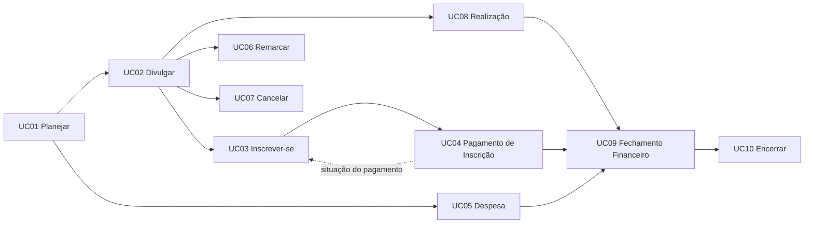
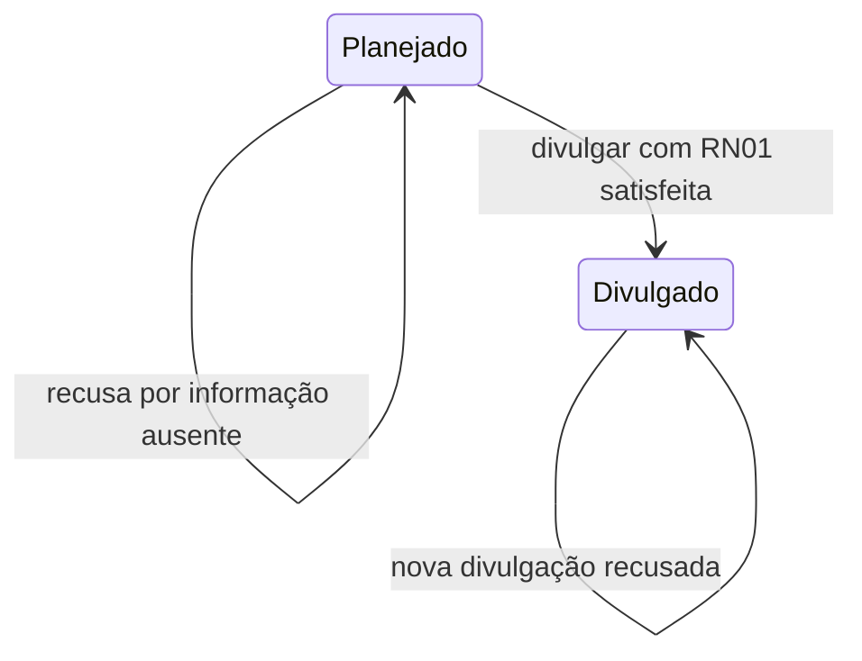
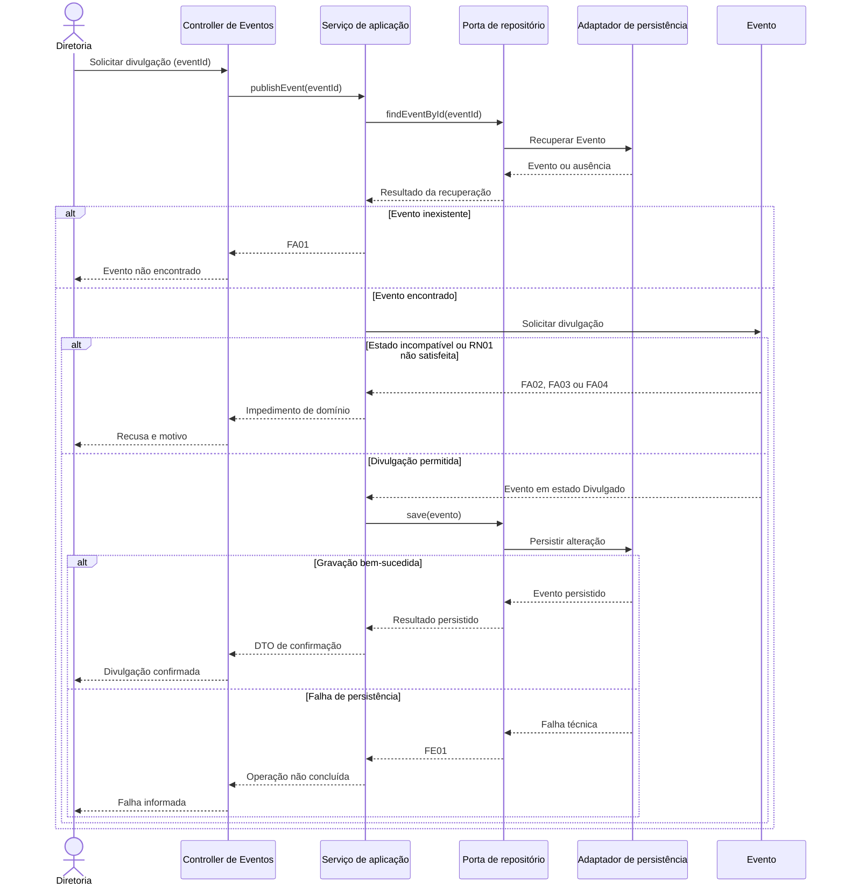
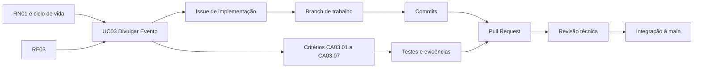

# Do Caso de Uso ao Primeiro Slice — Blueprint de Implementação do Sistema de Gestão de Atlética Universitária

**Disciplina:** Desenvolvimento de Sistemas Corporativos  
**Professor:** Everton Coimbra de Araujo  

**Integrantes:**  
- Adriel Ostrovski
- Bolivar Torres Neto
- Luna Ribeiro

**Tema:** Sistema de Gestão de Atlética Universitária  
**Data do planejamento original:** 27/10/2026  
**Revisão documental:** 23/11/2026

> **Observação:** este documento é um **plano**. Nenhuma implementação, banco, ORM, Docker ou teste automatizado é entregue aqui. Tudo o que não possui evidência nos trabalhos anteriores está marcado como **hipótese**, **decisão provisória** ou **pendência**, para que nada incerto seja lido como regra definitiva.

> **Nota de revisão:** as seções 1 a 9 conservam a numeração histórica dos 14 casos de uso do planejamento original. Nas seções de complementação, o caso de uso escolhido é identificado pelo código atual **UC03 — Divulgar Evento** (antigo UC02). A correspondência completa consta na seção 25.1. As referências ao GitHub são registros posteriores ao planejamento, e não evidências de que a implementação já existia em outubro. As propostas acrescentadas devem ser revisadas pela equipe antes da entrega.

---

# Sumário

1. Retomada do sistema
2. Atores e objetivos
3. Identificação e revisão dos Casos de Uso
4. Verificação dos Casos de Uso
5. Organização por ator e por contexto
6. Especificações funcionais
7. Rastreabilidade com o domínio
8. Dependências entre Casos de Uso
9. Priorização e MVP
10. Escolha do primeiro slice
11. Linguagem ubíqua do slice
12. Regra central e comportamento do domínio
13. Responsabilidades arquiteturais
14. Modelo mínimo necessário
15. Portas e dependências externas
16. Planejamento da interface HTTP
17. DTO, Command e Query
18. Planejamento da persistência
19. Planejamento de ORM, PostgreSQL e Docker
20. Resultados e falhas
21. Fluxo arquitetural planejado
22. Blueprint de implementação
23. Planejamento de validação
24. Governança futura da implementação
25. Revisões descobertas nesta atividade
26. Pendências de governança
27. Reflexão crítica
28. Apêndice — Uso de Inteligência Artificial

---

# 1. Retomada do sistema

## 1.1 Síntese

| Item | Síntese |
|---|---|
| **Nome do sistema** | Sistema de Gestão de Atlética Universitária |
| **Problema central** | As informações da atlética ficam espalhadas, parte das atividades é feita de modo informal e sem registro, e pessoas acabam executando tarefas fora da função original (fatos F02 a F05 da Análise Inicial). |
| **Atores principais** | Diretoria, responsáveis por eventos, responsáveis financeiros, responsáveis esportivos e associados/atletas/participantes. Patrocinadores e outras atléticas existem no ecossistema, mas não acessam o sistema na primeira versão. |
| **Objetivo da solução** | Centralizar as informações da atlética e deixar mais clara a responsabilidade de cada função. |
| **Escopo** | Amplo: associados e atletas, modalidades, equipes, treinos, campeonatos, eventos, financeiro, patrocínios, materiais e uniformes. |
| **Fluxo analisado em profundidade** | Organização de um evento, do planejamento inicial ao fechamento financeiro (decisão D01). |
| **Conceitos do domínio** | Entidades: Atlética, Associado, Modalidade, Equipe, Treino, Evento, Campeonato, Pagamento, Despesa, Patrocinador, Patrocínio (provisória), Material, Movimentação de Estoque (provisória). Objetos de Valor: Valor Monetário, Período, Local do Evento, Quantidade. Estado do Evento como conceito de ciclo de vida. Incertos: Inscrição em Evento e Papel/Função Organizacional. Atleta é tratado como papel do Associado (provisório). |
| **Regras de Negócio conhecidas** | RN01 (divulgação exige informações mínimas), RN02 (confirmação de inscrição exige dados corretos e pagamento obrigatório), RN03 (remarcação por clima/local), RN04 e RN05 (fechamento financeiro), RN06 (cancelamento, critério ainda hipótese). |
| **Decisões arquiteturais assumidas** | Monólito modular, com fronteiras como módulos internos; cinco áreas de responsabilidade (Gestão de Eventos, Inscrições e Vendas e Financeiro mais claras; Gestão Esportiva e Associados e Estoque e Materiais como candidatas); Financeiro como módulo interno com comunicação síncrona no fechamento; contratos mínimos entre fronteiras; ADR-001 (monólito em camadas). Decisão D04: não antecipar tecnologia durante a modelagem. |

## 1.2 De onde este plano parte

Este trabalho não cria um sistema novo. Cada decisão abaixo aponta para o conhecimento já registrado.

| Documento anterior | O que contribui para este plano |
|---|---|
| Análise Inicial (`02-analise-inicial.md`) | Fatos F01–F06, hipóteses H01–H05, questões em aberto Q01–Q03 e decisões D01–D04. |
| Análise Arquitetural (`01-analise-arquitetural.md`) | Atores, módulos, camadas e a ADR-001 (monólito em camadas). |
| Modelo Conceitual de 22/09 (`03-modelagem-conceitual.md`) | Conceitos, identidade, relações, cardinalidades, RN01–RN06, invariantes, ciclo de vida do Evento e pendências de governança. |
| Organização Arquitetural de 06/10 (`04-organizacao-arquitetural.md`) | Bounded Contexts, mapa de fronteiras, contratos 1 e 2, monólito modular e decisão sobre o Financeiro. |

## 1.3 Nota sobre uma versão divergente

O arquivo `organizacao_arquiteturial.md` descreve uma versão alternativa do domínio (Sócio, Plano de Assinatura, Loja, Pedido, Lote, Ingresso com QR Code, atestado médico etc.). Esses conceitos **não aparecem** no Modelo Conceitual de 22/09 nem na Organização Arquitetural de 06/10. Este blueprint segue as versões de **22/09 e 06/10**. A divergência está registrada como pendência na seção 26.

---

# 2. Atores e objetivos

Atores já identificados nos trabalhos anteriores, com seus objetivos relevantes para o fluxo de eventos e para o restante do sistema.

| Ator | Objetivo | Resultado observável |
|---|---|---|
| **Diretoria** | Decidir realizar um evento e conduzi-lo do planejamento ao encerramento. | O evento existe, está em um estado reconhecível (planejado, divulgado, remarcado, cancelado, realizado, encerrado) e seu histórico pode ser consultado. |
| **Diretoria** | Divulgar um evento somente quando ele estiver pronto. | O evento passa a constar como divulgado e fica apto a receber inscrições. |
| **Responsável por eventos** | Acompanhar a organização do evento. | Informações e pendências do evento visíveis (a forma exata de participação depende de Q01). |
| **Participante** (associado, atleta ou, por hipótese, outra pessoa) | Participar de um evento. | Inscrição registrada e, quando exigido, confirmada após pagamento. |
| **Responsável financeiro / Tesoureiro** | Manter confiáveis os registros financeiros do evento. | Pagamentos, despesas e fechamento registrados e consultáveis. |
| **Diretor de Esportes** | Organizar modalidades, equipes e participação esportiva. | Associados vinculados a modalidades e equipes montadas (fluxo ainda pouco analisado). |
| **Responsável pelo estoque** | Controlar materiais e uniformes. | Entradas e retiradas registradas e quantidades conhecidas (fluxo ainda pouco analisado). |

**Sobre atores externos.** Patrocinadores e outras atléticas/organizadores fazem parte do ecossistema, mas, na primeira versão, não interagem diretamente com o sistema. Não são tratados como atores deste plano. Podem passar a ser **atores secundários** caso haja integração futura.

**O que não é ator.** Banco de dados, ORM, cache, logger, bibliotecas e módulos internos (como o próprio Financeiro) não são atores. O Financeiro é um **contexto** que o Caso de Uso consulta, não alguém com objetivo próprio diante do sistema.

**Limite do conhecimento atual.** A divisão exata de responsabilidades entre os cargos é a questão **Q01**, e quem vê ou altera informações financeiras é **Q02**. Ambas continuam abertas. Por isso, neste plano, "Diretoria" é usada como ator que decide e autoriza, sem fechar o modelo de permissões.

---

# 3. Identificação e revisão dos Casos de Uso

Os Casos de Uso abaixo partem das operações do fluxo de eventos (Análise Inicial e Modelo Conceitual) e dos exemplos de casos de uso da Análise Arquitetural. Nenhum nome é de tela, página, endpoint ou operação interna.

**Legenda da situação:** *Mantido* = já existia como operação ou caso de uso com o mesmo sentido; *Revisado* = existia, mas mudou de nome, escopo ou vocabulário; *Novo* = surgiu nesta análise.

| ID | Caso de Uso | Ator principal | Objetivo | Resultado observável | Situação |
|---|---|---|---|---|---|
| UC01 | Planejar Evento | Diretoria | Registrar a decisão de realizar um evento e definir suas informações principais. | Evento existente, em Planejamento ou Planejado, com pendências visíveis. | Mantido |
| UC02 | Divulgar Evento | Diretoria | Tornar o evento oficialmente divulgado e apto a receber inscrições. | Evento em estado Divulgado. | Mantido |
| UC03 | Inscrever-se em Evento | Participante | Registrar participação em um evento e, quando exigido, ter a participação confirmada. | Inscrição registrada, pendente ou confirmada. | Revisado |
| UC04 | Registrar Pagamento de Inscrição | Responsável financeiro | Registrar e confirmar o pagamento ligado a uma inscrição. | Pagamento registrado com situação conhecida. | Revisado |
| UC05 | Registrar Despesa do Evento | Responsável financeiro | Registrar gasto relacionado ao evento. | Despesa registrada e considerada no resultado do evento. | Mantido |
| UC06 | Remarcar Evento | Diretoria | Alterar a data de um evento impedido por clima ou local. | Evento remarcado, com nova data a definir ou definida. | Mantido |
| UC07 | Cancelar Evento | Diretoria | Encerrar a continuidade de um evento que não pode acontecer. | Evento em estado Cancelado. | Mantido |
| UC08 | Registrar Realização do Evento | Diretoria | Informar que o evento aconteceu. | Evento em estado Realizado. | Novo |
| UC09 | Fechar Financeiramente o Evento | Responsável financeiro | Consolidar receitas, despesas, pagamentos e patrocínios do evento. | Situação do fechamento (concluído ou com pendências). | Mantido |
| UC10 | Encerrar Evento | Diretoria | Formalizar o encerramento após realização e fechamento financeiro. | Evento em estado Encerrado. | Revisado |
| UC11 | Cadastrar Associado | Diretoria | Registrar uma pessoa como associada da atlética. | Associado identificável no sistema. | Mantido |
| UC12 | Vincular Associado a Modalidade | Diretor de Esportes | Registrar a participação de um associado em uma modalidade. | Vínculo registrado (o associado atua como atleta). | Revisado |
| UC13 | Registrar Movimentação de Estoque | Responsável pelo estoque | Registrar entrada ou retirada de material. | Quantidade atualizada e histórico preservado. | Revisado |
| UC14 | Registrar Patrocínio | Diretoria | Registrar o acordo de patrocínio de um patrocinador. | Patrocínio registrado com valor e período. | Mantido |

**Por que UC12 e UC03 foram marcados como Revisados.** O Modelo Conceitual de 22/09 mostrou que Atleta pode ser apenas um papel do Associado, então "inscrever atleta" virou "vincular associado a modalidade". Também mostrou que "venda" e "inscrição" não são necessariamente o mesmo conceito, então UC03 mantém um vocabulário provisório.

---

# 4. Verificação dos Casos de Uso

## 4.1 As três perguntas

Para cada candidato: (1) existe um ator com objetivo claro? (2) o resultado é observável pelo ator? (3) existe interação relevante com o sistema?

| ID | 1. Ator com objetivo | 2. Resultado observável | 3. Interação relevante | Conclusão |
|---|---|---|---|---|
| UC01 a UC02 | Sim | Sim | Sim | Mantido como Caso de Uso. |
| UC03 | Sim, com ressalva: ainda não está definido quem pode se inscrever (associado apenas ou público externo). | Sim | Sim | Mantido, com vocabulário provisório. |
| UC04 | Sim | Sim | Sim | Mantido. |
| UC05 | Sim | Sim | Sim | Mantido. |
| UC06 a UC07 | Sim | Sim | Sim | Mantidos. O critério exato de cancelamento (RN06) continua hipótese. |
| UC08 | Sim | Sim: o estado Realizado é visível. | Sim | Mantido. Antes não tinha nenhuma operação associada, apesar de existir como estado. |
| UC09 | Sim | Sim | Sim | Mantido. A condição de "fechamento concluído" ainda é a questão Q03. |
| UC10 | Sim | Sim | Sim | Mantido. Depende do resultado de UC09. |
| UC11 a UC14 | Sim | Sim | Sim | Mantidos, porém com pouca análise de fluxo (escopo fora do evento). |

## 4.2 Itens que, ao serem verificados, não eram Casos de Uso

| Item inicialmente identificado | Classificação inicial | Classificação atual | Justificativa |
|---|---|---|---|
| Validar informações mínimas do evento | Operação do fluxo | **Regra de Negócio** (RN01) e invariante | Não existe ator que queira "validar" como objetivo final. A regra condiciona UC02. |
| Alterar estado do evento | Operação | **Operação interna do domínio** | É comportamento do Evento, acionado por UC02, UC06, UC07, UC08 e UC10. O ator não deseja "mudar estado", deseja divulgar, remarcar etc. |
| Verificar fechamento financeiro | Operação entre contextos | **Capacidade interna / contrato** entre fronteiras (Contrato 1) | O ator humano não a solicita diretamente. É necessária para UC10. |
| Verificar pagamento da inscrição | Operação entre contextos | **Capacidade interna / contrato** (Contrato 2) | Mesmo motivo. Serve a UC03. |
| Painel financeiro | Funcionalidade listada na Camada de Apresentação | **Tela** (detalhe de apresentação) | O objetivo por trás dela (conhecer a situação financeira do evento) é coberto por UC09 e por consultas futuras. |
| Persistir evento | Item da Camada de Persistência | **Detalhe de infraestrutura** | O ator não deseja persistir. Persistir é meio. |
| Acompanhar tarefas | Operação do fluxo | **Em aberto** | Não existe conceito "Tarefa" no modelo. Pode virar Caso de Uso futuro se o conceito for confirmado. |
| Controlar vendas/inscrições | Operação do fluxo | **Dividido** em UC03 e UC04 | Nome amplo demais. Misturava registrar participação com registrar pagamento. |

---

# 5. Organização dos Casos de Uso

## 5.1 Casos de Uso por ator

| Ator | Objetivos (Casos de Uso) |
|---|---|
| Diretoria | UC01 Planejar Evento, UC02 Divulgar Evento, UC06 Remarcar Evento, UC07 Cancelar Evento, UC08 Registrar Realização do Evento, UC10 Encerrar Evento, UC11 Cadastrar Associado, UC14 Registrar Patrocínio |
| Participante | UC03 Inscrever-se em Evento |
| Responsável financeiro | UC04 Registrar Pagamento de Inscrição, UC05 Registrar Despesa do Evento, UC09 Fechar Financeiramente o Evento |
| Diretor de Esportes | UC12 Vincular Associado a Modalidade |
| Responsável pelo estoque | UC13 Registrar Movimentação de Estoque |

## 5.2 Casos de Uso por contexto, com os atores

```mermaid
flowchart TB
    DIR["Diretoria"]
    PAR["Participante"]
    FIN["Responsável financeiro"]
    ESP["Diretor de Esportes"]
    EST["Responsável pelo estoque"]

    DIR --> UC01["UC01 Planejar Evento"]
    DIR --> UC02["UC02 Divulgar Evento"]
    DIR --> UC06["UC06 Remarcar Evento"]
    DIR --> UC07["UC07 Cancelar Evento"]
    DIR --> UC08["UC08 Registrar Realização"]
    DIR --> UC10["UC10 Encerrar Evento"]
    DIR --> UC11["UC11 Cadastrar Associado"]
    DIR --> UC14["UC14 Registrar Patrocínio"]
    PAR --> UC03["UC03 Inscrever-se em Evento"]
    FIN --> UC04["UC04 Registrar Pagamento de Inscrição"]
    FIN --> UC05["UC05 Registrar Despesa do Evento"]
    FIN --> UC09["UC09 Fechar Financeiramente"]
    ESP --> UC12["UC12 Vincular Associado a Modalidade"]
    EST --> UC13["UC13 Registrar Movimentação de Estoque"]

    subgraph CTX_E["Gestão de Eventos"]
        UC01
        UC02
        UC06
        UC07
        UC08
        UC10
    end

    subgraph CTX_I["Inscrições e Vendas (candidato)"]
        UC03
    end

    subgraph CTX_F["Financeiro"]
        UC04
        UC05
        UC09
    end

    subgraph CTX_S["Gestão Esportiva e Associados (candidato)"]
        UC11
        UC12
    end

    subgraph CTX_M["Estoque e Materiais (candidato)"]
        UC13
    end
```

**Incertezas registradas.**

- **UC14 (patrocínio)** ficou fora de qualquer contexto: ainda não se sabe se o Patrocínio se relaciona à atlética, a um evento ou aos dois, e a Organização Arquitetural não lhe deu fronteira. Pode acabar no Financeiro.
- **UC11 (cadastrar associado)** foi colocado em Gestão Esportiva e Associados, fronteira que a própria análise de 06/10 considerou possivelmente ampla demais (cadastro de associados e atividade esportiva podem mudar por razões diferentes).
- **UC03** pertence a um contexto ainda candidato, por causa da dúvida entre inscrição e venda.

---

# 6. Especificações funcionais dos Casos de Uso centrais

Foram especificados quatro Casos de Uso: **UC01** (porque UC02 depende dele), **UC02** (candidato ao primeiro slice), **UC03** (o mais incerto e que cruza fronteiras) e **UC10** (o que mais depende do Financeiro). As pré-condições abaixo não são validação de entrada. Validações de formato ficam nas fronteiras (seção 13). As Regras de Negócio aparecem em um campo próprio e também nos passos em que atuam.

## 6.1 UC01 — Planejar Evento

| Campo | Conteúdo |
|---|---|
| **ID / Nome** | UC01 — Planejar Evento |
| **Objetivo** | Registrar a decisão de realizar um evento e definir suas informações principais até que ele esteja planejado. |
| **Ator principal** | Diretoria |
| **Atores secundários** | Nenhum |

**Pré-condições**
- O solicitante é reconhecido como integrante da Diretoria (o modelo de permissões segue em aberto, Q01/Q02).

**Pós-condições**
- Existe um Evento com identidade própria.
- O Evento está em **Planejamento**, se faltarem informações mínimas, ou em **Planejado**, se todas estiverem definidas.
- O histórico registra a criação.

**Fluxo principal**
1. A Diretoria decide realizar um evento e informa os dados iniciais.
2. O sistema registra um novo Evento no estado Planejamento.
3. A Diretoria define ou atualiza data, local, orçamento, responsáveis e atrações ou atividades.
4. O sistema verifica se as informações mínimas estão todas definidas (RN01 descreve esse conjunto).
5. Estando completas, o Evento passa a Planejado.
6. O sistema apresenta a situação atual e as pendências, se houver.

**Fluxos alternativos**
- **A1. Informações incompletas:** o Evento permanece em Planejamento e as pendências são mostradas. Não é falha.
- **A2. Valor de orçamento inválido:** o valor é recusado, pois todo Valor Monetário precisa ser válido.
- **A3. Alteração de informações principais depois da divulgação:** o comportamento **não está definido** nos trabalhos anteriores. Fica registrado como pendência (seção 25).
- **A4. Falha técnica ao registrar:** nenhum Evento é criado.

**Regras relacionadas:** RN01 (define o que são as informações mínimas); transição Planejamento → Planejado do ciclo de vida do Evento; invariante de Valor Monetário válido.

## 6.2 UC02 — Divulgar Evento

| Campo | Conteúdo |
|---|---|
| **ID / Nome** | UC02 — Divulgar Evento |
| **Objetivo** | Tornar o evento oficialmente divulgado, permitindo que ele avance para vendas e inscrições. |
| **Ator principal** | Diretoria (a decisão D02 atribui à Diretoria o início do fluxo, e o ciclo de vida fala em "divulgação autorizada") |
| **Atores secundários** | Nenhum |

**Pré-condições**
- O Evento existe.
- O Evento está no estado **Planejado**.
- O solicitante é reconhecido como Diretoria (a forma de autorização é pendência).

**Pós-condições**
- O Evento está no estado **Divulgado**.
- As informações mínimas continuam definidas.
- Fica registrado **quando** e **por quem** a divulgação foi feita.
- O Evento está apto para a fase de inscrições (UC03).

**Fluxo principal**
1. A Diretoria solicita a divulgação de um Evento identificado.
2. O sistema obtém o Evento.
3. O Evento verifica que está no estado Planejado.
4. O Evento verifica que data, local, orçamento, responsáveis e atrações ou atividades estão definidos (**RN01**).
5. O Evento passa ao estado Divulgado e registra a divulgação.
6. O sistema preserva o novo estado.
7. O sistema informa à Diretoria que o Evento foi divulgado.

**Fluxos alternativos**
- **A1. Evento inexistente:** nada é alterado e o ator é informado de que o Evento não existe.
- **A2. Evento fora do estado Planejado** (em Planejamento, Remarcado, já Divulgado, Cancelado, Realizado ou Encerrado): a divulgação é impedida pelo estado atual. Em particular, divulgar um Evento já divulgado é um impedimento, não uma repetição silenciosa (decisão da equipe, ver seção 25).
- **A3. Informações mínimas incompletas mesmo no estado Planejado** (por exemplo, uma informação removida depois): a divulgação é recusada, com a lista das pendências.
- **A4. Falha técnica ao obter ou preservar o Evento:** o estado do Evento permanece Planejado.
- **A5. Solicitante sem autoridade para divulgar:** **fora do slice** (depende de Q01/Q02, ver seção 26).

**Regras relacionadas:** RN01; invariante "Evento Divulgado tem informações mínimas definidas"; transição Planejado → Divulgado do ciclo de vida; regra derivada do ciclo de vida: um Evento só pode ser divulgado uma vez.

## 6.3 UC03 — Inscrever-se em Evento

| Campo | Conteúdo |
|---|---|
| **ID / Nome** | UC03 — Inscrever-se em Evento (nome provisório, ver "Inscrição" × "Venda") |
| **Objetivo** | Registrar a participação de uma pessoa em um evento e, quando o pagamento é obrigatório, tê-la confirmada. |
| **Ator principal** | Participante (associado, atleta ou, por hipótese, outra pessoa) |
| **Atores secundários** | Responsável financeiro, que registra o pagamento em UC04 |

**Pré-condições**
- O Evento existe e está em um estado que permite receber inscrições (hipótese: Divulgado ou Em Organização).
- O participante pode ser identificado.

**Pós-condições**
- Existe uma inscrição registrada.
- Se estiver **confirmada**, os dados necessários estão corretos e o pagamento obrigatório foi realizado.

**Fluxo principal**
1. O participante escolhe o evento e informa seus dados.
2. O sistema consulta a situação do evento (Contrato Inscrições → Eventos).
3. O sistema registra a inscrição como pendente.
4. Havendo pagamento obrigatório, o sistema informa o valor a pagar.
5. O pagamento é realizado e registrado por UC04.
6. O sistema verifica a situação do pagamento (Contrato 2).
7. Estando dados e pagamento corretos, a inscrição é confirmada (**RN02**).
8. O participante é informado do resultado.

**Fluxos alternativos**
- **A1. Evento sem condição de receber inscrições** (cancelado, encerrado, ainda não divulgado): a inscrição não é aceita.
- **A2. Dados incorretos:** a inscrição não é confirmada.
- **A3. Pagamento pendente ou recusado:** a inscrição permanece pendente.
- **A4. Evento sem pagamento obrigatório** (hipótese): a confirmação depende apenas dos dados.
- **A5. Financeiro indisponível:** a confirmação não é feita e a inscrição permanece pendente.
- **A6. Inscrição duplicada da mesma pessoa:** **regra desconhecida**, registrada como pendência.

**Regras relacionadas:** RN02; invariante "inscrição confirmada satisfaz dados e pagamento".

## 6.4 UC10 — Encerrar Evento

| Campo | Conteúdo |
|---|---|
| **ID / Nome** | UC10 — Encerrar Evento |
| **Objetivo** | Formalizar o encerramento depois que o evento ocorreu e o fechamento financeiro foi concluído. |
| **Ator principal** | Diretoria |
| **Atores secundários** | Nenhum (o Financeiro é consultado como contexto, não como ator) |

**Pré-condições**
- O Evento existe e está no estado **Realizado**.

**Pós-condições**
- O Evento está no estado **Encerrado** (estado final).

**Fluxo principal**
1. A Diretoria solicita o encerramento do Evento.
2. O sistema obtém o Evento.
3. O Evento verifica que está Realizado.
4. O sistema consulta o Financeiro sobre o fechamento do evento (Contrato 1).
5. O Financeiro informa que o fechamento está concluído.
6. O Evento passa a Encerrado.
7. O sistema preserva o novo estado e informa o resultado.

**Fluxos alternativos**
- **A1. Fechamento pendente:** o Evento continua Realizado e as pendências são informadas (RN05).
- **A2. Evento não está Realizado:** o encerramento é impedido pelo estado atual.
- **A3. Evento inexistente.**
- **A4. Financeiro indisponível:** nada é alterado.

**Regras relacionadas:** RN04, RN05; transição Realizado → Encerrado. A condição que define "fechamento concluído" é a questão aberta **Q03** e fica sob responsabilidade do Financeiro, não do Evento.

---

## 6.5 Requisitos funcionais e critérios de aceite — complementação da revisão

A tabela explicita os comportamentos das quatro especificações centrais acima. A numeração RF abaixo é uma proposta alinhada ao catálogo atual, não uma identificação presente no texto original. As correspondências não transformam especificações em rascunho em regras validadas. A especificação completa dos demais casos de uso deverá ser consolidada no catálogo atual e no documento geral de requisitos.

| RF | Requisito funcional | UC atual | Origem / situação |
|---|---|---|---|
| RF01 | O sistema deve permitir à Diretoria cadastrar um evento com identidade própria e estado inicial de Planejamento. | UC01 | UC01 histórico; rascunho atual. |
| RF02 | O sistema deve permitir definir as informações de planejamento necessárias para que o Evento chegue ao estado Planejado. | UC02 | UC01 histórico; rascunho atual. |
| RF03 | O sistema deve permitir divulgar um Evento Planejado somente se todas as informações da RN01 estiverem definidas, preservando o estado resultante. | UC03 | UC02 histórico; especificação validada no catálogo atual. |
| RF04 | O sistema deve permitir iniciar vendas ou inscrições de um evento divulgado, passando-o para Em Organização. | UC04 | Separação posterior do fluxo de eventos; rascunho. |
| RF05 | O sistema deve permitir registrar a inscrição de um participante em evento com inscrições abertas. | UC05 | UC03 histórico; rascunho. |
| RF06 | O sistema deve permitir confirmar uma inscrição pendente quando os dados estiverem corretos e o pagamento obrigatório tiver sido realizado. | UC06 | UC03 histórico, RN02; rascunho. |
| RF11 | O sistema deve permitir realizar o fechamento financeiro de um evento realizado, preservando o resultado e permitindo seu encerramento quando as condições necessárias estiverem satisfeitas. | UC11 | UC09/UC10 históricos, RN04/RN05; rascunho, Q03 em aberto. |

| Critério de aceite proposto | Condição e resultado verificável | Vínculo |
|---|---|---|
| CA01.01 | Dados iniciais aceitos devem resultar em um Evento identificável, persistido e em Planejamento. | RF01 / UC01 histórico |
| CA01.02 | Se o cadastro falhar tecnicamente, não deve haver confirmação de criação. | RF01 / UC01 histórico |
| CA02.01 | Com informações mínimas completas, o Evento deve chegar a Planejado. | RF02 / UC01 histórico |
| CA02.02 | Dados de planejamento inválidos não devem resultar em Evento Planejado. O salvamento parcial ainda deve ser validado pela equipe. | RF02 / UC01 histórico |
| CA04.01 | Evento Divulgado deve passar a Em Organização ao iniciar vendas/inscrições; outros estados devem ser recusados. | RF04 / evolução do UC03 histórico |
| CA05.01 | Evento em Organização e dados de participante informados devem permitir o registro vinculado ao Evento, inicialmente pendente (proposta a validar). | RF05 / UC03 histórico |
| CA05.02 | Evento inexistente ou em estado incompatível deve impedir o registro. Dados obrigatórios ausentes devem ser informados. | RF05 / UC03 histórico |
| CA06.01 | Inscrição pendente, dados corretos e pagamento obrigatório realizado devem permitir a confirmação. | RF06 / RN02 |
| CA06.02 | Dados incorretos ou pagamento obrigatório pendente/recusado devem impedir a confirmação. | RF06 / RN02 |
| CA11.01 | Evento Realizado e fechamento financeiro concluído devem permitir a transição para Encerrado. | RF11 / UC10 histórico |
| CA11.02 | Evento em estado incompatível ou com fechamento pendente não deve ser encerrado. | RF11 / RN04 e RN05 |

Os critérios específicos de RF03 (CA03.01 a CA03.07) estão na seção 23, junto ao plano de validação do primeiro slice. A definição do que torna o fechamento concluído depende de Q03; a confirmação de inscrições e a abertura de vendas também conservam as dúvidas registradas nos documentos anteriores.

---

# 7. Rastreabilidade com o domínio

| Caso de Uso | Conceitos do domínio | Regras relacionadas | Invariantes | Contexto / responsabilidade |
|---|---|---|---|---|
| UC01 | Evento, Estado do Evento, Período, Local do Evento, Valor Monetário | RN01 (conjunto mínimo) | Valor Monetário válido | Gestão de Eventos |
| UC02 | Evento, Estado do Evento, Período, Local do Evento, Valor Monetário | RN01 | Evento Divulgado tem informações mínimas definidas | Gestão de Eventos |
| UC03 | Evento, Inscrição em Evento (incerta), Pagamento | RN02 | Inscrição confirmada satisfaz dados e pagamento | Inscrições e Vendas (candidato), consultando Eventos e Financeiro |
| UC10 | Evento, Estado do Evento, Pagamento, Despesa | RN04, RN05 | Estado Encerrado só após fechamento concluído (a regra exata é Q03) | Gestão de Eventos, consultando Financeiro |

**Que elementos das análises anteriores justificam estes Casos de Uso?**

- O fluxo de evento (decisão D01) e suas operações (D03) sustentam UC01, UC02 e UC10.
- O ciclo de vida do Evento (estados e transições) sustenta as pré e pós-condições.
- RN01 e RN02 sustentam os fluxos de recusa. RN04 e RN05 sustentam UC10.
- Os contratos 1 e 2 e o mapa de fronteiras da Organização Arquitetural sustentam as consultas entre contextos em UC03 e UC10.

**Algum Caso de Uso revelou lacuna ou problema no modelo anterior?** Sim, quatro:

1. O modelo não tem um conceito de **Orçamento** (só Valor Monetário), mas RN01 exige "orçamento definido".
2. **Responsável** e **Atração ou Atividade** aparecem em RN01 como condições, mas não existem como conceito.
3. O ciclo de vida não diz **o que dispara** a transição Divulgado → Em Organização (ver seção 25, item 3).
4. UC03 mostra uma possível **dependência circular**: a inscrição só confirma após o pagamento (UC04), e o pagamento é registrado em relação a uma inscrição já existente. Pode ser necessário separar "registrar inscrição" de "confirmar inscrição".

---

# 8. Dependências entre Casos de Uso

Uma dependência aqui significa que um comportamento precisa de um estado ou resultado produzido antes. Não implica que um Caso de Uso chame o outro.

| Caso de Uso | Depende de | Tipo | Justificativa |
|---|---|---|---|
| UC02 | UC01 | Estado | Só se divulga um Evento que já está Planejado. |
| UC03 | UC02 | Estado | A inscrição exige um Evento que aceite inscrições (Divulgado ou Em Organização, hipótese). |
| UC04 | UC03 | Informação | O pagamento de inscrição se refere a uma inscrição existente. |
| UC03 (confirmação) | UC04 | Informação | A confirmação depende da situação do pagamento. Ver a circularidade na seção 7. |
| UC05 | UC01 | Estado | A despesa se refere a um Evento existente. |
| UC06 | UC02 | Estado | Remarcação ocorre com o Evento em organização. |
| UC07 | UC02 | Estado | Cancelamento ocorre com o Evento em organização. |
| UC08 | UC02 | Estado | Só se registra como realizado um Evento que estava em organização. |
| UC09 | UC08, UC04, UC05 | Estado e informação | O fechamento considera pagamentos e despesas após a realização. |
| UC10 | UC09 | Resultado | O encerramento exige o fechamento concluído (Contrato 1). |

---

# 9. Priorização e MVP

O MVP reduz **escopo**, não qualidade: o menor conjunto que conduz um evento do planejamento ao encerramento com as regras principais preservadas.

| Caso de Uso | Valor central | Desbloqueia | Dependências | Risco | Pode ser adiado? | Classificação |
|---|---|---|---|---|---|---|
| UC01 Planejar Evento | Origem de todo o fluxo | UC02, UC05 | Nenhuma | Baixo. Conceitos de orçamento e responsável precisam de refinamento. | Não | **Central** |
| UC02 Divulgar Evento | Principal regra de negócio já confirmada (RN01) | UC03, UC06, UC07, UC08 | UC01 | Baixo | Não | **Central** |
| UC03 Inscrever-se em Evento | Participação e vendas, parte do valor para os associados | UC04 | UC02 | **Alto**. Inscrição e venda ainda são incertas. | Não, mas pode ser simplificado | **Central** |
| UC04 Registrar Pagamento | Torna confiável a confirmação | UC09 | UC03 | Médio | Não | **Central** |
| UC05 Registrar Despesa | Sem despesas, o fechamento não é confiável (H04) | UC09 | UC01 | Baixo | Não | **Central** |
| UC09 Fechar Financeiramente | Objetivo final do fluxo analisado | UC10 | UC04, UC05, UC08 | **Alto**. Regra de conclusão em aberto (Q03). | Não | **Central** |
| UC08 Registrar Realização | Completa o ciclo | UC09 | UC02 | Baixo | Sim, por pouco tempo | **Secundário** |
| UC10 Encerrar Evento | Fecha o ciclo de vida | Nada | UC09 | Médio | Sim | **Secundário** |
| UC06 Remarcar Evento | Cobre variação real (RN03) | Nada | UC02 | Médio | Sim | **Secundário** |
| UC07 Cancelar Evento | Cobre variação, mas o critério é hipótese (RN06) | Nada | UC02 | Médio | Sim | **Futuro** |
| UC11 Cadastrar Associado | Valor fora do fluxo de eventos | Possíveis regras de participação | Nenhuma | Médio. Se a inscrição exigir identidade de associado, a prioridade muda. | Sim | **Futuro** |
| UC12 Vincular a Modalidade | Lado esportivo, pouco analisado | Equipes | UC11 | Alto. Cardinalidade Associado–Modalidade sem confirmação. | Sim | **Futuro** |
| UC13 Movimentação de Estoque | Lado de estoque, pouco analisado | Nada | Nenhuma | Alto. Fluxo não detalhado. | Sim | **Futuro** |
| UC14 Registrar Patrocínio | Entrada financeira | Fechamento (RN04) | Indefinida | Alto. Relação com atlética ou evento não definida. | Sim | **Futuro** |

## 9.1 Recorte funcional do primeiro ciclo

A proposta inicial reúne oito casos de uso históricos: planejar, divulgar, inscrever-se (registro e confirmação de participação), registrar pagamento, registrar despesa, registrar realização, fechar financeiramente e encerrar (a inscrição, na análise inicial, agrupava registro e confirmação). No catálogo histórico, correspondem a UC01, UC02, UC03, UC04, UC05, UC08, UC09 e UC10. Embora realização e encerramento tenham sido classificados como secundários na tabela, são necessários para que o ciclo completo possa ser demonstrado. Seu adiamento somente faz sentido enquanto os incrementos anteriores estiverem sendo construídos.

Esse recorte é uma proposta de MVP, não uma afirmação de que esses comportamentos já foram implementados. O primeiro slice será menor que o MVP: permitirá somente divulgar um evento previamente planejado.

---

# 10. Escolha do primeiro slice

O comportamento escolhido é **Divulgar Evento**, identificado como UC02 no planejamento inicial e como **UC03** no catálogo atual do ARENA XVIII. A escolha preserva o objetivo original; a mudança de código decorre da separação entre cadastrar o evento e definir seu planejamento.

| Aspecto | Justificativa |
|---|---|
| Ator | Diretoria, enquanto a definição das permissões por cargo não for concluída (Q01 e Q02). |
| Objetivo | Tornar oficialmente divulgado um evento que já possui planejamento completo. |
| Valor entregue | Impedir que a atlética anuncie um evento antes de estabelecer as condições mínimas para sua realização. |
| Representatividade | O comportamento protege RN01, utiliza o ciclo de vida e atravessa domínio, aplicação, persistência e apresentação. |
| Conceitos participantes | Evento, Estado do Evento, data, local, orçamento, responsáveis e atrações ou atividades. |
| Dependência de negócio | O evento deve existir e estar Planejado. A criação e o planejamento são comportamentos anteriores. |
| Dependência técnica | Uma porta de acesso e armazenamento de Evento. Para validar o primeiro recorte, eventos previamente preparados podem ser utilizados sem implementar os casos de uso anteriores. |

**Entra no slice:** localizar o evento, verificar seu estado, verificar as informações da RN01, executar a transição, persistir o resultado e informar sucesso ou impedimento ao ator.

**Não entra no slice:** cadastrar e planejar eventos pela interface, efetuar a divulgação em redes sociais, abrir vendas, emitir ingressos, confirmar inscrições, registrar pagamentos, realizar fechamento financeiro, gerir estoque e implementar autorização por cargo. A ausência de autorização no recorte técnico não significa autorização irrestrita no sistema definitivo.

O recorte permite testar uma regra relevante sem exigir a implementação de todos os módulos. O evento poderá ser disponibilizado por dados de teste ou mecanismo de preparação controlado; não se deve criar um evento automaticamente quando uma divulgação é solicitada.

# 11. Linguagem ubíqua do slice

| Termo | Significado no sistema | Não confundir com |
|---|---|---|
| Evento | Atividade organizada pela atlética, identificável ao longo de seu ciclo de vida. | Campeonato, inscrição ou publicação em rede social. |
| Planejamento | Estado em que o evento ainda está sendo definido. | Planejado. |
| Planejado | Estado em que o evento está apto a ser avaliado para divulgação. | Divulgado ou Em Organização. |
| Divulgar | Comportamento que torna oficial a divulgação do evento e altera seu estado. | Alterar um campo de estado arbitrariamente, enviar uma mensagem ou abrir inscrições. |
| Divulgado | Estado resultante de uma divulgação permitida. | Em Organização, que pressupõe outro comportamento. |
| Orçamento | Valor previsto para organizar o evento. | Receita, saldo ou despesa efetiva. |
| Responsáveis | Pessoas ou funções atribuídas à organização do evento. | Participantes ou usuários autenticados, sem validação adicional. |
| Atrações ou atividades | Elementos previstos na programação do evento. | Modalidade esportiva, necessariamente. |
| Planejamento completo | Conjunto de informações mínimas exigidas por RN01. | Simples existência do registro do evento. |

Na implementação, nomes técnicos em inglês poderão representar os mesmos conceitos, mantendo correspondência documentada: `Event` representa Evento; `EventStatus` representa Estado do Evento; `publish` representa Divulgar. A escolha de nomes em inglês não altera o significado das regras de negócio.

# 12. Regra central e comportamento do domínio

**RN01:** um evento só poderá ser divulgado quando data, local, orçamento, responsáveis e atrações ou atividades estiverem definidos.

O Evento, como raiz do agregado identificado na Organização Arquitetural, deverá proteger essa regra juntamente com a transição de estado. A aplicação conhece a intenção de divulgar, mas não deve decidir se o evento está apto substituindo as regras do domínio.

| Condição | Resultado esperado |
|---|---|
| Planejado e planejamento completo | Transição para Divulgado. |
| Já Divulgado | Recusa da nova solicitação. |
| Qualquer outro estado | Recusa por estado incompatível. |
| Planejado, mas com informações mínimas ausentes | Recusa, identificando as pendências. |

Não será permitido expor um setter público que aceite qualquer estado sem passar pelas regras do Evento. A operação conceitual `evento.divulgar()` deverá verificar o estado e a completude antes de modificar a entidade. Quando a operação falhar, o estado original deverá ser preservado.

O diagrama representa apenas o recorte de divulgação. Os demais estados continuam pertencendo ao ciclo de vida original. Permanecem abertas as condições exatas de validade de valores de orçamento e datas, além da representação de responsáveis. Não se deve confundir preenchimento obrigatório com regras adicionais ainda não confirmadas.

# 13. Responsabilidades arquiteturais

| Responsabilidade | Papel arquitetural | Componente planejado | Justificativa |
|---|---|---|---|
| Receber solicitação e identificador | Fronteira HTTP | Controller de Eventos (`EventsController`) | Traduz o protocolo para uma intenção de aplicação. |
| Coordenar a divulgação | Aplicação | Serviço de Eventos (`EventsService`) | Localiza a entidade, solicita seu comportamento e coordena o armazenamento. |
| Decidir se a divulgação é permitida | Domínio | Evento (`Event`) | Conhece estado e dados necessários para proteger RN01. |
| Recuperar evento | Aplicação / porta | Interface de repositório de Eventos | A aplicação necessita de um evento existente, mas não precisa conhecer a tecnologia de armazenamento. |
| Persistir alteração | Porta / infraestrutura | Adaptador de repositório | Materializa a gravação sem transferir regras de negócio ao banco. |
| Traduzir sucesso ou falha | Fronteira HTTP | Controller ou filtro de exceções | Converte resultados e erros em respostas adequadas ao protocolo. |
| Compor dependências | Infraestrutura / composição | Módulo de Eventos (`EventsModule`) | Conecta contratos e implementações concretas por injeção de dependência. |

A separação mantém o monólito modular escolhido anteriormente. Não existe necessidade de uma chamada ao Financeiro neste slice: o orçamento é informação do planejamento, e verificar sua existência não equivale a realizar um fechamento financeiro.

# 14. Modelo mínimo necessário

| Elemento | Tratamento no slice |
|---|---|
| Evento | Entidade reutilizada, raiz do agregado, com identidade estável e operação de divulgação. |
| Estado do Evento | Representar os estados necessários e reconhecer todos os estados incompatíveis com a divulgação. |
| Data / período | Informação de planejamento; representação mínima a ser refinada. |
| Local do Evento | Informação obrigatória, sem antecipar cadastro independente de locais. |
| Orçamento / Valor Monetário | Valor obrigatório; validar sua representação sem inventar limites não confirmados. |
| Responsáveis | Informação obrigatória; não fechar o modelo de pessoas, vínculos e permissões. |
| Atrações ou atividades | Informação obrigatória; não criar agregado independente sem evidência. |
| Identificador e estado após divulgação | Informações necessárias para recuperação e confirmação do resultado. |

O comportamento mínimo deverá permitir reconstituir um Evento existente, consultar seu estado, identificar dados mínimos ausentes e solicitar a divulgação. O modelo não precisa conter Pagamento, Inscrição, Despesa, Patrocínio ou Movimentação de Estoque neste recorte. A auditoria completa de quem realizou a divulgação permanece condicionada à definição da identidade e autorização do ator.

# 15. Portas e dependências externas

| Porta / contrato | Necessidade expressa | Operações necessárias | Dependente |
|---|---|---|---|
| Repositório de Eventos | Obter o Evento e conservar seu novo estado. | `findEventById(eventId)` e `save(event)` | Serviço de aplicação. |

A primeira operação retorna um Evento ou a ausência do registro; a segunda retorna o Evento persistido ou sinaliza falha técnica. O contrato deve trabalhar com conceitos do domínio, não com linhas, entidades do ORM ou comandos SQL. Não é necessário oferecer um CRUD completo apenas para divulgar um evento.

O nome técnico `IEventsRepository` e o token de injeção `EVENTS_REPOSITORY` correspondem ao planejamento posteriormente registrado na Issue #14. Nenhuma porta de pagamento, estoque ou divulgação externa é necessária para o comportamento escolhido.

# 16. Planejamento da interface HTTP

A interface HTTP deverá possibilitar a solicitação de divulgação sem expor a alteração genérica de estado. A rota abaixo é uma proposta de contrato, posteriormente registrada como H01 na Issue #17, não uma afirmação de que o endpoint tenha sido validado pela execução neste documento.

| Elemento | Proposta |
|---|---|
| Método | PATCH |
| Rota | `/events/:eventId/publish` |
| Parâmetro | `eventId`, identificador do evento. |
| Corpo | Não necessário para o recorte: as informações de planejamento já pertencem ao Evento armazenado. |
| Sucesso | HTTP 200, confirmação da divulgação, identidade e estado atualizado. |
| Evento inexistente | HTTP 404. |
| Estado impeditivo ou já divulgado | HTTP 409. |
| Planejamento incompleto | HTTP 422, com indicação das informações ausentes. |
| Falha técnica | HTTP 500, sem expor detalhes internos. |

O mapeamento dos erros corresponde à proposta H02. A escolha de PATCH indica alteração específica de um recurso existente. A solicitação não deverá receber um campo `status` arbitrário para ser gravado no Evento. A autenticação e a autorização serão discutidas em incremento próprio; a interface HTTP é apenas um meio de acessar o caso de uso.

# 17. DTO, Command e Query

| Artefato | Necessidade | Responsabilidade e justificativa |
|---|---|---|
| DTO de entrada | Dispensável inicialmente. | O identificador é recebido no parâmetro da rota. Não existe corpo estruturado que justifique outro objeto. |
| DTO de resposta | Necessário. | Transportar somente as informações de confirmação para fora da aplicação, sem expor a entidade completa. A proposta posterior da Issue #14 denomina-o `PublishEventResponseDto`, com `eventId`, `status`, `updatedAt` e `message`. |
| Command | Opcional como objeto explícito. | A intenção é divulgar um Evento identificado. Uma operação `publishEvent(eventId)` no serviço pode expressá-la sem exigir infraestrutura CQRS ou command bus. |
| Query | Não necessária como caso de uso separado. | A recuperação do Evento é uma operação interna necessária à mudança, não um objetivo de consulta solicitado pelo ator. |
| Entidade de domínio | Necessária. | Representa o Evento e protege suas regras e seu comportamento. |

DTO, Command e Entidade têm finalidades diferentes. Nenhum DTO deverá decidir RN01; tampouco será criada uma classe apenas para reproduzir mecanicamente o exemplo CeliLac.

# 18. Planejamento da persistência

O repositório deverá recuperar a identidade, o estado e as informações de planejamento necessárias à avaliação da RN01. A transição bem-sucedida deverá ser preservada para que outra execução possa recuperar o Evento como Divulgado.

Em caso de recusa de negócio, não deverá ocorrer chamada de gravação. Se houver erro de gravação, a aplicação não deverá apresentar sucesso. O adaptador deverá evitar que uma alteração apenas em memória modifique silenciosamente o registro anteriormente armazenado. Em ambiente persistente, atomicidade e tratamento de concorrência precisarão ser considerados para impedir que solicitações concorrentes contornem a regra de divulgação.

O contrato de repositório expressa essas necessidades. Entidade, regra central, serviço de aplicação e testes de domínio deverão permanecer independentes de PostgreSQL e ORM. Mapeamento, conexão, transações, reconstituição da entidade e tratamento de falhas específicas de armazenamento pertencem à infraestrutura.

Para validar inicialmente a arquitetura, um adaptador em memória é uma alternativa (H03 no planejamento posterior). Ele não substitui a persistência definitiva nem comprova que os dados sobrevivem ao reinício do processo.

# 19. Planejamento de ORM, PostgreSQL e Docker

| Tecnologia | Problema técnico que deverá resolver | Limite de responsabilidade |
|---|---|---|
| ORM | Mapear os dados armazenados para estruturas de persistência e auxiliar operações de leitura e escrita. | Adaptador de infraestrutura; o Evento não deverá depender de decorators ou objetos do ORM para decidir RN01. |
| PostgreSQL | Armazenar os eventos de forma durável, preservar identidade e estado entre execuções e fornecer recursos transacionais. | Acesso por meio do adaptador; regras de negócio não podem depender diretamente de consultas SQL. |
| Docker | Tornar o ambiente de execução reproduzível entre integrantes da equipe. | Configuração operacional, sem alterar o significado dos conceitos de domínio. |

No ambiente futuro, a aplicação NestJS e o serviço de banco de dados poderão compor o ambiente reproduzível. A escolha específica do ORM, a configuração de containers, migrations e variáveis de conexão deverão ser tratadas nos incrementos técnicos correspondentes. Nesta atividade não há necessidade de apresentar arquivos Docker, tabelas definitivas ou execução de banco de dados.

# 20. Resultados e falhas

A classificação abaixo parte do significado do resultado para o caso de uso, antes da tradução HTTP.

| Situação | Categoria | Quem identifica | Significado interno | Possível resposta HTTP |
|---|---|---|---|---|
| FP — divulgação realizada | Sucesso | Domínio e aplicação | Transição autorizada e gravada. | 200 |
| FA01 — Evento inexistente | Aplicação | Serviço de aplicação, após consultar a porta | Não há entidade sobre a qual executar a intenção. | 404 |
| FA02 — já divulgado | Domínio | Evento | O comportamento já ocorreu e não pode ser repetido neste estado. | 409 |
| FA03 — estado não permite divulgação | Domínio | Evento | A transição não é admitida pelo ciclo de vida. | 409 |
| FA04 — planejamento incompleto | Domínio | Evento | Informações exigidas pela RN01 estão ausentes. | 422 |
| FE01 — falha na gravação | Infraestrutura | Adaptador, propagada pela aplicação | A operação não foi concluída de forma confiável. | 500 |
| Falha técnica na recuperação | Infraestrutura | Adaptador, propagada pela aplicação | Não foi possível determinar se o Evento existe. Não equivale à ausência do registro. | 500 (proposta) |

A aplicação deverá distinguir evento inexistente de indisponibilidade do armazenamento. As falhas de autorização estão fora do recorte e dependem das definições de Q01 e Q02. O formato definitivo das exceções e mensagens deverá ser confirmado pela equipe.

# 21. Fluxo arquitetural planejado

A sequência demonstra que o Controller não decide a regra de negócio, o serviço coordena e o Evento determina a possibilidade de divulgação. Somente o caminho de sucesso solicita a gravação. A resposta positiva ocorre após sua confirmação, não apenas após a alteração em memória.

# 22. Blueprint de implementação

| Ordem | Passo | Objetivo | Dependência |
|---|---|---|---|
| 1 | Consolidar a especificação funcional | Definir sucesso, recusas, limites e critérios de aceite. | Modelo conceitual e ciclo de vida. |
| 2 | Refinar o domínio mínimo e seus testes | Representar Evento e proteger a transição e RN01. | Passo 1. |
| 3 | Definir contratos de aplicação | Estabelecer porta de recuperação/gravação e resultado de saída. | Passos 1 e 2. |
| 4 | Implementar a coordenação da aplicação | Consultar, solicitar divulgação, persistir e distinguir falhas. | Passos 2 e 3. |
| 5 | Preparar adaptador inicial | Permitir recuperar e gravar eventos de teste sem depender da infraestrutura definitiva. | Passo 3. |
| 6 | Planejar e conectar a interface HTTP | Traduzir a intenção e os resultados, compondo dependências no NestJS. | Passos 4 e 5. |
| 7 | Validar integração e comportamento | Exercitar sucesso, recusas e erro de armazenamento. | Passos 2 a 6. |
| 8 | Registrar resultados e documentação técnica | Relacionar comportamento, decisões e evidências de validação. | Passo 7. |
| 9 | Evoluir persistência e infraestrutura | Substituir o adaptador inicial por persistência durável e preparar ambiente reproduzível. | Contrato estável e validação do recorte inicial. |

A execução deverá ser incremental, com testes acompanhando cada responsabilidade. A ordem não exige que todos os passos sejam implementados nesta atividade. O planejamento posterior do GitHub detalha os oito primeiros passos nas Issues #12 a #19; a persistência definitiva pertence a incrementos próprios.

# 23. Planejamento de validação

Os critérios a seguir tornam verificável o requisito funcional de divulgação, identificado como RF03 na numeração atual do catálogo. Os códigos CA são uma identificação documental proposta nesta revisão, baseada nos fluxos e nos critérios da Issue #12; não representam testes já executados ou aprovados.

| Critério | Dado | Quando | Então | Origem |
|---|---|---|---|---|
| CA03.01 | Evento existente, Planejado e completo | Solicitar divulgação | Estado Divulgado gravado e confirmação retornada. | RN01, FP |
| CA03.02 | Identificador sem Evento correspondente | Solicitar divulgação | Recusa de aplicação e nenhuma gravação. | FA01 |
| CA03.03 | Evento já Divulgado | Solicitar novamente | Recusa, estado inalterado e nenhuma gravação. | FA02 |
| CA03.04 | Evento em outro estado incompatível | Solicitar divulgação | Recusa por estado, sem gravação. | FA03 |
| CA03.05 | Evento Planejado com um ou mais dados mínimos ausentes | Solicitar divulgação | Recusa com indicação das pendências; nenhum novo estado gravado. | RN01, FA04 |
| CA03.06 | Evento apto, mas adaptador falha ao gravar | Solicitar divulgação | Falha informada, sem confirmação de sucesso. | FE01 |
| CA03.07 | Mais de uma condição impeditiva | Solicitar divulgação | Respeitar a precedência: existência, já divulgado, estado apto e completude. | Fluxo da Issue #12 |

**Variações necessárias:** exercitar a falta de cada informação da RN01 individualmente (data, local, orçamento, responsáveis e atrações/atividades), além de combinações de ausências. Testar cada estado incompatível conhecido no modelo. Valores de orçamento zero e datas passadas não serão rejeitados por regras presumidas: os resultados desses casos dependem da decisão da equipe.

| Camada | O que deverá ser verificado |
|---|---|
| Domínio | RN01, transição válida, estados inválidos, identificação de campos ausentes e preservação do estado em caso de recusa. |
| Aplicação | Ausência de Evento, coordenação das chamadas, ordem das verificações, gravação somente no caminho válido e propagação das falhas. |
| HTTP | Identificador recebido corretamente, resposta de sucesso, tradução dos erros, ausência de exposição de detalhes internos. |
| Persistência | Recuperação, atualização, isolamento entre alterações não salvas e estado armazenado; quando houver banco, verificar durabilidade e consistência. |
| Integração | Integração do módulo e execução de ponta a ponta dos principais cenários. |

O planejamento registrado na Issue #12 prevê verificações unitárias e e2e com `pnpm test` e `pnpm test:e2e`. Resultados reais, quando executados, deverão ser anexados às Issues ou aos Pull Requests. Este Blueprint não afirma que os comandos foram executados.

# 24. Governança futura da implementação

A implementação deverá partir de uma Issue vinculada à especificação. A branch isola o trabalho; os commits registram alterações coerentes; o Pull Request relaciona a necessidade, os testes e as decisões; a revisão verifica regras, dependências e resultados antes da integração. A documentação deverá ser revista quando novas descobertas alterarem o entendimento do domínio.

**Registro de evolução posterior:** a Issue principal [#12](https://github.com/ArenaXVIII/arena-xviii-backend/issues/12) identifica o UC03 e contém sete subtarefas, numeradas de #13 a #19. Os detalhes do contrato e da interface foram registrados nas Issues [#14](https://github.com/ArenaXVIII/arena-xviii-backend/issues/14) e [#17](https://github.com/ArenaXVIII/arena-xviii-backend/issues/17). Essa ligação é documental; não comprova, por si só, que todos os critérios foram atendidos. O relatório de governança deverá reunir os commits, branches, PRs e resultados de testes efetivamente verificados.

# 25. Revisões descobertas nesta atividade

| Conhecimento anterior | Descoberta atual | Revisão necessária | Impacto |
|---|---|---|---|
| RN01 exige orçamento definido. | Orçamento aparece na regra, mas não está formalizado como conceito independente. | Refinar sua representação e a distinção entre orçamento e movimentação financeira. | Domínio e validação de divulgação. |
| RN01 exige responsáveis e atrações. | Os conceitos ainda não estão detalhados no modelo. | Representar inicialmente a informação mínima e investigar seus vínculos posteriormente. | Modelo conceitual e autorização. |
| Ciclo de vida prevê Divulgado e Em Organização. | O gatilho de abertura das vendas não estava especificado na análise inicial. | Separar divulgação de início de vendas/inscrições. | Catálogo de casos de uso e dependências. |
| Registro e confirmação de inscrição apareciam como um único objetivo. | Pagamento depende da existência do registro e confirmação depende do pagamento. | Separar registro e confirmação. | Inscrições e Financeiro. |
| Divulgação repetida não tinha resultado explicitado. | O ciclo de vida implica que o estado Divulgado não admite a mesma transição. | Registrar recusa específica; não tratar como atualização silenciosa. | Regra, fluxo alternativo e testes. |
| Planejamento e cadastro eram tratados juntos. | São intenções distintas no catálogo atual. | Separar criação inicial e definição do planejamento. | Numeração dos casos de uso e rastreabilidade. |
| O planejamento inicial previa registrar quem divulgou. | A autorização e a identidade do ator permanecem pendentes; o catálogo atual exige estado persistido como sucesso. | Manter auditoria completa como evolução, não como requisito confirmado deste recorte. | Segurança, auditoria e DTO. |
| Um encerramento separado foi sugerido. | O catálogo atual associa fechamento financeiro à transição para Encerrado. | Conferir a unificação antes de ampliar a implementação financeira. | Evento, Financeiro e RN04/RN05. |
| Versão alternativa incluía assinatura, loja e QR Code. | Não há sustentação desses conceitos nos documentos adotados neste Blueprint. | Preservar a versão divergente apenas como registro histórico, sem importá-la para o escopo. | Fronteiras e requisitos futuros. |

## 25.1 Correspondência entre a numeração histórica e o catálogo atual

As seções 1 a 9 preservam a organização do planejamento de outubro. Na tabela abaixo, a coluna da direita identifica a evolução documentada no repositório. Os códigos da esquerda não devem ser utilizados para abrir novas Issues.

| Caso de uso histórico | Correspondência atual |
|---|---|
| UC01 Planejar Evento | UC01 (cadastro) e UC02 (definição do planejamento) |
| UC02 Divulgar Evento | **UC03 Divulgar Evento** |
| UC03 Inscrever-se em Evento | UC04 (abertura), UC05 (registro) e UC06 (confirmação), conforme o comportamento envolvido |
| UC04 Registrar Pagamento de Inscrição | UC12 Registrar Pagamento |
| UC05 Registrar Despesa do Evento | UC13 Registrar Despesa |
| UC06 Remarcar Evento | UC08 Remarcar Evento |
| UC07 Cancelar Evento | UC09 Cancelar Evento |
| UC08 Registrar Realização do Evento | UC10 Registrar Realização do Evento |
| UC09 Fechar Financeiramente o Evento | UC11 Realizar Fechamento Financeiro do Evento |
| UC10 Encerrar Evento | Transição para Encerrado prevista no UC11; não há UC separado no catálogo atual. |
| UC11 Cadastrar Associado | UC17 Cadastrar Associado |
| UC12 Vincular Associado a Modalidade | UC18 Vincular Associado a Modalidade |
| UC13 Registrar Movimentação de Estoque | UC25 Registrar Movimentação de Estoque |
| UC14 Registrar Patrocínio | UC16 Registrar Patrocínio |

O catálogo atual possui 25 casos de uso. A ampliação representa evolução da especificação, não implementação de 25 funcionalidades. Conforme o catálogo consultado, somente UC03 está marcado como validado e implementado; os demais são rascunhos, incluindo os que exigem modelagem adicional (UC07, UC14, UC18 e UC21).

# 26. Pendências de governança

| Artefato / documento | Alteração necessária | Motivo | Prioridade |
|---|---|---|---|
| Análise Inicial | Investigar Q01 e Q02. | Definir responsabilidades e acesso às informações. | Alta |
| Modelo Conceitual | Refinar orçamento, responsáveis e atrações. | RN01 depende dessas informações. | Alta |
| Modelo Conceitual | Esclarecer inscrição versus venda e confirmação. | Evitar conceitos e regras conflitantes. | Alta |
| Modelo Conceitual / Financeiro | Investigar Q03 e critério de fechamento concluído. | RN04/RN05 e encerramento dependem desse resultado. | Alta |
| Organização Arquitetural | Revisar posição das responsabilidades de inscrição e patrocínio. | Fronteiras ainda candidatas. | Média |
| Catálogo atual | Validar os casos de uso em rascunho e modelar os de baixa sustentação. | Não transformar hipóteses em requisitos confirmados. | Alta |
| Requisitos funcionais e critérios de aceite | Consolidar o catálogo completo em documentos rastreáveis. | Tornar explícitos os resultados esperados, conforme solicitação do professor. | Alta |
| Relatório de governança | Atualizar referências de UC02 histórico para UC03 atual e inserir evidências reais. | Evitar referências contraditórias e placeholders. | Alta |
| Planejamento técnico | Verificar decisões sobre orçamento zero, data passada, HTTP, persistência inicial e autorização. | Propostas técnicas não equivalem a aprovação de negócio. | Alta |
| Documentação divergente | Manter `organizacao_arquiteturial.md` fora da versão de referência. | Conceitos não sustentados pelos documentos adotados. | Média |

# 27. Reflexão crítica

1. **O caso de uso entrega valor real?** Sim. Permite que a Diretoria divulgue somente um evento com planejamento mínimo, reduzindo o risco de anunciar atividades ainda indefinidas.
2. **O comportamento faria sentido sem HTTP?** Sim. A divulgação é uma operação do domínio e pode ser solicitada por outra interface, mantendo o mesmo resultado.
3. **Qual a principal regra?** RN01, combinada com a transição permitida de Planejado para Divulgado.
4. **Quem protege a regra?** O Evento, como raiz do agregado responsável por seu estado.
5. **Quem apenas coordena?** O serviço de aplicação, que obtém o Evento, solicita a operação e preserva o resultado.
6. **Quais dependências externas são necessárias?** Uma porta de acesso e persistência do Evento. Financeiro e canais externos não são necessários ao recorte.
7. **Que artefato se mostrou dispensável?** Uma Query independente ou um DTO de entrada sem corpo de requisição, pois o identificador já expressa a informação necessária para localizar o Evento.
8. **Que responsabilidade poderia estar mal posicionada?** A validação de RN01 no Controller ou no repositório, que deixaria o domínio sem proteção contra outros pontos de entrada.
9. **Qual falha exige mais atenção?** A falha de persistência, porque a mudança em memória não comprova a conclusão do caso de uso e não pode ser confundida com recusa de negócio.
10. **A persistência influenciou indevidamente o modelo?** A proposta evita isso ao definir primeiro a necessidade da porta e somente depois a tecnologia concreta.
11. **O que a análise revelou?** A divulgação depende de informações cuja representação ainda precisa ser refinada, e registro de inscrição não é necessariamente o mesmo comportamento que confirmação.
12. **Que documentação deverá ser revista?** Modelo Conceitual, Organização Arquitetural, catálogo de casos de uso e relatório de governança, conforme as pendências da seção 26.
13. **O Blueprint orienta uma implementação futura?** A proposta fornece um comportamento definido, limites, responsabilidades, contratos, falhas e critérios verificáveis. Ainda depende de revisão da equipe sobre as hipóteses identificadas, sem exigir que todo o sistema esteja modelado para começar o recorte.

# 28. Apêndice — Uso de Inteligência Artificial

**Ferramenta utilizada:** ChatGPT (OpenAI), GPT-6.2, na revisão e complementação deste documento.

**Finalidade:** comparar o arquivo parcial com as etapas do enunciado, organizar as informações existentes, formular a continuação do plano e cruzar a numeração histórica com o catálogo público do repositório.

**Principais contribuições:** identificação das seções ausentes, organização das responsabilidades arquiteturais, elaboração de tabelas de falhas e validação, diagramas Mermaid e registro de rastreabilidade entre requisitos, casos de uso e evidências esperadas.

**Hipóteses reveladas:** critérios de orçamento zero, datas passadas, autorização por função, auditoria, representação dos responsáveis e diferenciação entre venda e inscrição.

**Decisões questionadas:** agrupamento de cadastro e planejamento, registro e confirmação da inscrição, criação de DTO de entrada sem necessidade e encerramento separado do fechamento financeiro.

**Sugestões não incorporadas:** adoção automática de um CRUD genérico, criação de Query para uma recuperação interna, inclusão de QR Code e planos de assinatura sem evidência nos documentos de referência e escolha definitiva de tecnologia de persistência apenas por aparecer nos exemplos da disciplina. Essas alternativas foram excluídas da proposta por não serem necessárias ou sustentadas no recorte.

**Avaliação crítica:** a ferramenta ajudou a estruturar o conteúdo e localizar inconsistências, mas não substitui a validação dos processos reais pela equipe. A revisão documental não comprova resultados de testes, aprovação de permissões, decisões de negócio ou revisão de código. Sugestões técnicas foram sinalizadas como propostas e as referências posteriores foram separadas do planejamento histórico. A verificação final deverá ser feita confrontando o texto com os documentos anteriores, o enunciado, o código e as Issues reais.

**Questão final:** se a IA fosse retirada, a equipe conseguiria explicar e defender o caso de uso, as responsabilidades e as decisões?

O documento oferece justificativas que permitem essa defesa: a regra pertence ao Evento, a aplicação coordena e a infraestrutura resolve a gravação. A capacidade efetiva de cada integrante de explicar as decisões deverá ser confirmada pela leitura e discussão da equipe antes da entrega; não pode ser presumida pela ferramenta.

## Referências da revisão

- Enunciado da disciplina: *Blueprint de Implementação do Primeiro Slice do Sistema*, 25 páginas, etapas 1 a 27 e apêndice de IA.
- Documentos de análise da equipe: `01-analise-arquitetural.md`, `02-analise-inicial.md`, `03-modelagem-conceitual.md` e `04-organizacao-arquitetural.md`.
- [Catálogo de Casos de Uso do ARENA XVIII](https://github.com/ArenaXVIII/arena-xviii-backend/blob/main/docs/casos-de-uso.md).
- [Planejamento de implementação](https://github.com/ArenaXVIII/arena-xviii-backend/blob/main/docs/planejamento/README.md).
- [Issue #12 — UC03](https://github.com/ArenaXVIII/arena-xviii-backend/issues/12), [Issue #14 — contratos](https://github.com/ArenaXVIII/arena-xviii-backend/issues/14) e [Issue #17 — HTTP](https://github.com/ArenaXVIII/arena-xviii-backend/issues/17).

As referências ao repositório foram consultadas em 23/11/2026. Esta revisão complementa o planejamento de 27/10/2026; não pretende reproduzir retrospectivamente uma entrega anterior que não foi localizada.
