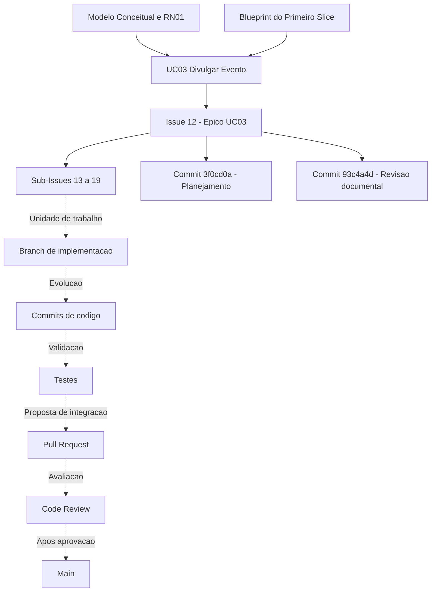
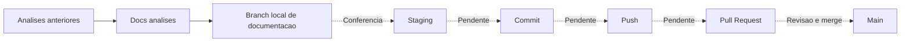

# Preparação e Governança de Repositório para o Primeiro Slice

**Disciplina:** Desenvolvimento de Sistemas Corporativos  
**Professor:** Everton Coimbra de Araujo  
**Sistema:** ARENA XVIII — Sistema de Gestão de Atlética Universitária  
**Instituição:** UTFPR — Câmpus Medianeira  
**Integrantes:** Adriel Ostrovski, Bolivar Torres Neto e Luna Ribeiro  
**Revisão da documentação:** 23/11/2026

> Este relatório atualiza o planejamento original de governança com as evidências disponíveis no repositório e no histórico de trabalho da equipe. Informações não comprovadas permanecem identificadas como pendências. A atualização documental não equivale à conclusão da implementação do primeiro slice.

---

## 1. Identificação do sistema e do primeiro slice

| Elemento | Informação do projeto | Origem na documentação |
|---|---|---|
| Sistema | ARENA XVIII — Administração de Recursos, Esportes, Negócios e Associados da Atlética XVIII de Março. | README e Análise Inicial. |
| Caso de Uso | UC03 — Divulgar Evento. A Diretoria solicita a divulgação de um evento planejado. | Catálogo atual de casos de uso e Issue #12. |
| Regra central | RN01: a divulgação depende da definição de data, local, orçamento, responsáveis e atrações ou atividades. | Modelo Conceitual e visão geral. |
| Conceito principal | Evento e seu estado; transição de Planejado para Divulgado. | Modelo Conceitual e Blueprint. |
| Limites do slice | Localização do evento, validação de estado e planejamento, transição, persistência e retorno do resultado. Não inclui cadastro, planejamento do evento, inscrições, pagamentos, canais externos de divulgação ou autorização por função. | Especificação do UC03 e Issue #12. |

**Revisão de identificação:** no Blueprint original, Divulgar Evento era identificado como UC02. No catálogo atual, o planejamento do evento foi separado e a divulgação passou a ser UC03. A mudança é de organização do catálogo, não do objetivo central da funcionalidade. Neste relatório, utiliza-se a identificação atual; as referências históricas devem ser interpretadas conforme a versão de origem.

A escolha desse slice permite verificar a proteção de uma regra de negócio relevante e a comunicação entre as camadas de domínio, aplicação, infraestrutura e apresentação sem implementar todo o sistema simultaneamente.

---

## 2. Organization e repositório

- **Organization:** [ArenaXVIII](https://github.com/ArenaXVIII)
- **Repositório:** [arena-xviii-backend](https://github.com/ArenaXVIII/arena-xviii-backend)
- **URL de clonagem:** `https://github.com/ArenaXVIII/arena-xviii-backend.git`
- **Branch principal:** `main`
- **Visibilidade:** pública, conforme consulta ao GitHub.

**Justificativa:** manter o repositório na organização permite que o código, o histórico, as Issues e a documentação sejam tratados como ativos compartilhados do projeto, em vez de dependerem exclusivamente de uma conta pessoal. As permissões devem ser distribuídas de acordo com as responsabilidades de cada integrante.

A preparação do ambiente utiliza a estrutura NestJS/TypeScript e o gerenciador pnpm documentados no README. A existência de uma base executável é indicada pela documentação técnica do projeto, mas a execução dos testes não foi repetida para esta revisão do relatório.

---

## 3. README e documentação inicial

| Arquivo ou diretório | Referência | Finalidade |
|---|---|---|
| `README.md` | [Consultar README](https://github.com/ArenaXVIII/arena-xviii-backend/blob/main/README.md) | Contexto, equipe, tecnologias, execução e desenvolvimento incremental. |
| `docs/visao-geral.md` | [Visão geral](https://github.com/ArenaXVIII/arena-xviii-backend/blob/main/docs/visao-geral.md) | Conhecimento do domínio, regras e ciclo de vida. |
| `docs/casos-de-uso.md` | [Casos de uso](https://github.com/ArenaXVIII/arena-xviii-backend/blob/main/docs/casos-de-uso.md) | Catálogo e especificações funcionais. |
| `docs/planejamento/` | [Planejamento](https://github.com/ArenaXVIII/arena-xviii-backend/tree/main/docs/planejamento) | Decomposição de trabalho, rastreabilidade e evidências. |
| `.gitignore` | [Consultar arquivo](https://github.com/ArenaXVIII/arena-xviii-backend/blob/main/.gitignore) | Exclusão de arquivos locais e gerados que não devem ser versionados. |
| `.env.example` | [Consultar arquivo](https://github.com/ArenaXVIII/arena-xviii-backend/blob/main/.env.example) | Exemplo de configuração do ambiente, sem segredos reais. |
| `docs/analises/` | Diretório preparado localmente na branch `docs/documentacao-pre-implementacao` | Reunião dos trabalhos anteriores à implementação. Publicação pendente nesta revisão. |

O README oferece o ponto de entrada para compreender o sistema e executar a aplicação. Os documentos de domínio e de casos de uso explicam o motivo das funcionalidades, enquanto o planejamento detalha a evolução técnica. A inclusão dos trabalhos anteriores complementa a rastreabilidade entre a análise acadêmica e o código.

Arquivos de ambiente com senhas, tokens ou credenciais reais não devem ser versionados. Antes de integrar alterações, deve-se conferir o conteúdo preparado para commit.

---

## 4. Registro das operações Git e commits

### 4.1 Operações e evidências

| Ação | Evidência ou referência | O que demonstra |
|---|---|---|
| Clonagem do repositório | `git clone https://github.com/ArenaXVIII/arena-xviii-backend.git` | Obtenção de uma cópia local com histórico e remoto configurados. |
| Verificação local | `git status`: branch `main`, atualizada em relação a `origin/main`, sem alterações locais. | Estado observado na cópia recém-clonada. |
| Atualização de referências | `git fetch --all --prune` e `git branch -a` | Consulta às branches remotas existentes. |
| Isolamento da documentação | `git switch -c docs/documentacao-pre-implementacao` | Criação de uma branch local para reunir os documentos, sem alterar diretamente a main. |
| Inclusão dos documentos | `git status` indicou `docs/analises/` como não rastreada. | Os arquivos foram copiados para o projeto, mas ainda não registrados em commit. |
| Staging da documentação | `git add docs/analises/` | Operação prevista após conferência dos arquivos; ainda não comprovada. |
| Commit e publicação da revisão | `git commit` e `git push` | Etapas pendentes para os novos documentos. |

### 4.2 Commits publicados e verificáveis

| Commit | Mensagem registrada | Evidência de evolução |
|---|---|---|
| [`3f0cd0a`](https://github.com/ArenaXVIII/arena-xviii-backend/commit/3f0cd0a59574637db7c889aa7ce4650971805c0c) | `docs: planejamento técnico e rastreabilidade no GitHub` | Registro dos artefatos de planejamento do UC03, incluindo matriz de rastreabilidade e evidências das Issues. |
| [`93c4a4d`](https://github.com/ArenaXVIII/arena-xviii-backend/commit/93c4a4d29dd13fa197b8796f50bb5b000d388b70) | `docs: registra encerramento do planejamento duplicado do UC03` | Registro da revisão documental relacionada ao planejamento duplicado. |

Os dois commits estão vinculados na atividade da Issue #12. O histórico mais amplo pode ser consultado na opção **Commits** do repositório. Esses registros demonstram evolução documental publicada; não comprovam, isoladamente, a aprovação de testes ou a conclusão do caso de uso.

**Diferença entre operações:** editar modifica os arquivos locais; `git add` seleciona alterações para o próximo registro; `git commit` cria uma versão no histórico local; `git push` publica os commits na branch remota. A integração à main depende de um processo separado de revisão e merge.

---

## 5. Membros, Teams e permissões

Os integrantes identificados no README são Adriel Ostrovski, Bolivar Torres Neto e Luna Ribeiro. A Issue #12 foi aberta e atribuída a Luna Ribeiro, o que constitui evidência de participação no planejamento do primeiro slice.

| Membro ou papel | Responsabilidade no projeto | Acesso recomendado | Situação |
|---|---|---|---|
| Adriel Ostrovski | Desenvolvimento e colaboração na documentação. | Write, conforme necessidade. | Integrante identificado; nível real não confirmado. |
| Bolivar Torres Neto | Desenvolvimento e organização da documentação acadêmica. | Write, conforme necessidade. | Integrante identificado; nível real não confirmado. |
| Luna Ribeiro | Desenvolvimento e planejamento do UC03. | Write, conforme necessidade. | Integrante e responsável pela Issue #12 identificados; nível real não confirmado. |
| Responsável pela administração da organização | Gerenciar repositório, regras e acessos. | Maintain/Admin apenas quando necessário. | Identidade e atribuições administrativas a confirmar. |
| Professor / Orientador | Acompanhamento e avaliação. | Leitura; Triage somente se necessário para acompanhamento de Issues. | Acesso efetivamente concedido não confirmado. |

O princípio do menor privilégio orienta a distribuição de permissões. A existência de uma organização pública e dos integrantes no README não comprova as permissões individuais nem a configuração de Teams. Essas informações devem ser verificadas por um integrante autorizado nas configurações da organização e do repositório.

---

## 6. Issue e critérios de aceitação

**Issue principal:** [#12 — UC03 Divulgar Evento](https://github.com/ArenaXVIII/arena-xviii-backend/issues/12).

O épico foi aberto em 03/11/2026 e organiza o trabalho do primeiro slice em sete unidades menores, permitindo separar responsabilidades, dependências e verificações.

| Sub-Issue | Unidade de trabalho |
|---|---|
| [#13 — SUB-01](https://github.com/ArenaXVIII/arena-xviii-backend/issues/13) | Modelagem da entidade Evento e transição de divulgação. |
| [#14 — SUB-02](https://github.com/ArenaXVIII/arena-xviii-backend/issues/14) | Contratos de aplicação e porta de repositório. |
| [#15 — SUB-03](https://github.com/ArenaXVIII/arena-xviii-backend/issues/15) | Serviço de aplicação para divulgação. |
| [#16 — SUB-04](https://github.com/ArenaXVIII/arena-xviii-backend/issues/16) | Adaptador de persistência de eventos. |
| [#17 — SUB-05](https://github.com/ArenaXVIII/arena-xviii-backend/issues/17) | Interface HTTP e módulo de eventos. |
| [#18 — SUB-06](https://github.com/ArenaXVIII/arena-xviii-backend/issues/18) | Testes de integração ponta a ponta. |
| [#19 — SUB-07](https://github.com/ArenaXVIII/arena-xviii-backend/issues/19) | Documentação técnica do slice. |

### 6.1 Critérios de aceitação do UC03

Os identificadores CA-UC03 abaixo organizam os critérios já estabelecidos no épico, para facilitar a referência cruzada. Não representam novos requisitos de negócio.

| ID | Cenário | Resultado esperado | Rastreabilidade |
|---|---|---|---|
| CA-UC03-01 | Evento planejado e informações obrigatórias completas. | Divulgação efetivada e novo estado persistido. | FP; RN01; RN-UC03-01 e RN-UC03-03 |
| CA-UC03-02 | Evento não localizado. | Operação rejeitada sem gravar alterações. | FA01 |
| CA-UC03-03 | Evento que já foi divulgado. | Nova divulgação impedida e nenhuma gravação efetuada. | FA02; RN-UC03-02 |
| CA-UC03-04 | Evento em outro estado que não permite divulgação. | Transição recusada, preservando o estado original. | FA03; RN-UC03-01 |
| CA-UC03-05 | Planejamento com informações obrigatórias ausentes. | Recusa com indicação das pendências, sem persistência da transição. | FA04; RN01 |
| CA-UC03-06 | Falha durante a gravação do evento. | Falha comunicada ao solicitante; não informar sucesso indevido. | FE01; RN-UC03-03 |
| CA-UC03-07 | Solicitação de divulgação submetida às verificações. | Avaliação de existência, divulgação anterior, estado Planejado e completude da RN01, nessa sequência. | FP; FA01–FA04 |
| CA-UC03-08 | Validação técnica do slice. | Testes unitários e e2e aprovados, com evidências registradas. | SUB-06; condição de conclusão do épico |
| CA-UC03-09 | Revisão da entrega. | Documentação técnica atualizada e coerente com o comportamento entregue. | SUB-07 |

**Situação:** os critérios estão registrados na Issue, mas sua aprovação não foi presumida. Na consulta utilizada para esta revisão, o épico aparecia aberto. Para considerá-lo concluído, a equipe deve relacionar os critérios às evidências de teste, PRs e sub-Issues concluídas.

A Issue representa a unidade de trabalho e acompanha sua execução. A especificação funcional continua sendo a referência do comportamento esperado; portanto, os critérios também devem permanecer acessíveis na documentação dos casos de uso.

---

## 7. Branch e propósito

A consulta local com `git branch -a`, após atualização das referências remotas, apresentou branches relacionadas à implementação e revisão do projeto. Entre elas:

| Branch | Propósito indicado pelo nome |
|---|---|
| `origin/docs/uc03-team-review` | Revisão documental do UC03. |
| `origin/feat/enum-exception` | Evolução de enumerações e exceções. |
| `origin/feat/modules-event` | Estruturação do módulo de eventos. |
| `origin/feature/uc03-events-http` | Interface HTTP do UC03. |
| `origin/feature/material-08-integracao-persistencia` | Incremento de integração de persistência. |
| `origin/feature/uc03-material-09-postgres-typeorm` | Incremento relacionado a PostgreSQL e TypeORM. |
| `origin/test/26-uc01-sub06-event-registration-e2e` | Testes e2e relacionados ao UC01. |
| `docs/documentacao-pre-implementacao` | Branch local criada para organizar os trabalhos acadêmicos anteriores à implementação. |

A lista remota pode ser consultada em [Branches](https://github.com/ArenaXVIII/arena-xviii-backend/branches). O propósito das branches acima foi inferido de seus nomes; a relação formal com uma Issue e os respectivos commits deve ser verificada antes de registrar uma integração específica.

A branch `feature/uc03-events-http`, por exemplo, possui finalidade compatível com a SUB-05, mas não se afirma aqui que exista vínculo formal no GitHub sem confirmação. As branches de persistência representam incrementos que podem evoluir de maneira independente da documentação acadêmica.

**Convenção proposta:** usar prefixos como `feature/`, `fix/`, `test/` e `docs/`, seguidos do identificador ou objetivo da mudança. A branch deve partir de uma main atualizada e conter alterações relacionadas a uma unidade de trabalho.

---

## 8. Planejamento e evidências de Pull Request

A página [Pull requests](https://github.com/ArenaXVIII/arena-xviii-backend/pulls) apresentava sete PRs fechados e nenhum aberto na consulta pública utilizada nesta revisão. Não foi possível consultar os detalhes de cada PR fechado; por isso, não se presume que todos tenham sido integrados ou aprovados. O vínculo específico entre PRs, sub-Issues, testes e revisões permanece a confirmar.

### 8.1 Estrutura de um Pull Request

| Campo | Conteúdo esperado |
|---|---|
| Título | Identificar a unidade de trabalho e o objetivo da alteração. |
| Contexto | Informar a Issue ou sub-Issue correspondente e o comportamento esperado. |
| Mudanças | Descrever componentes modificados e decisões arquiteturais relevantes. |
| Validação | Informar comandos executados, resultados e cenários cobertos. |
| Riscos e limites | Explicitar dependências, hipóteses e pendências. |
| Revisão | Solicitar avaliação de outro integrante antes da integração. |

Para um PR de implementação do UC03, a descrição deve indicar a relação com a Issue #12 e, quando aplicável, com a sub-Issue efetivamente atendida. Não se deve fechar o épico automaticamente quando apenas uma parte do slice for concluída.

### 8.2 Pull Request da documentação anterior à implementação

| Item | Proposta |
|---|---|
| Branch de origem | `docs/documentacao-pre-implementacao` |
| Branch de destino | `main` |
| Título | `docs: organiza documentação anterior à implementação` |
| Escopo | Inclusão dos trabalhos acadêmicos, com atualização das referências e complementação da documentação funcional. |
| Validação | Conferir arquivos Markdown, links, diagramas Mermaid e coerência entre RF, UC, RN e CA. |
| Situação | Planejado; a branch local ainda não foi publicada na evidência apresentada. |

Um push publica uma branch no remoto, mas não integra automaticamente suas alterações à main. O Pull Request permite avaliar a diferença entre branches e revisar a mudança antes do merge.

---

## 9. Planejamento do Code Review

| Dimensão | Questão de revisão |
|---|---|
| Domínio | A regra RN01 e a transição de estado são protegidas pelo comportamento do Evento? |
| Aplicação | O serviço coordena a operação sem assumir regras internas da entidade? |
| Arquitetura | Os contratos e adaptadores preservam as fronteiras entre domínio, aplicação, infraestrutura e HTTP? |
| Qualidade | Os nomes e as mensagens refletem o vocabulário do projeto? |
| Validação | Os fluxos principal, alternativos e de exceção possuem testes correspondentes? |
| Persistência | Operações rejeitadas não gravam uma mudança indevida de estado? |
| Documentação | O identificador UC03, a RN01 e os critérios de aceitação estão coerentes com as fontes atuais? |
| Segurança | O PR evita incluir segredos e configurações pessoais? |

**Exemplo de comentário técnico (simulação):** caso a RN01 seja validada exclusivamente no Controller, solicitar que a regra seja protegida pelo Evento, de modo que outras interfaces de entrada também respeitem a invariante.

**Resposta esperada:** o autor deve avaliar o comentário, justificar ou corrigir a decisão, incluir a alteração na mesma branch e solicitar nova revisão. O exemplo acima é uma proposta de revisão, não uma interação efetivamente publicada no GitHub.

As revisões reais devem ser documentadas com links para os PRs, comentários e respostas correspondentes. Não foi possível confirmar esses registros na consulta pública realizada; a equipe deve complementá-los com as evidências disponíveis em sua conta.

---

## 10. Rastreabilidade em Mermaid

As relações contínuas representam referências documentais identificadas; as pontilhadas representam o fluxo de governança esperado, cuja evidência específica deve ser registrada conforme a execução. Os commits de planejamento não substituem os commits de implementação e teste.

A [matriz de rastreabilidade](https://github.com/ArenaXVIII/arena-xviii-backend/blob/main/docs/planejamento/01-05-matriz-rastreabilidade.md) e a Issue principal apoiam a navegação entre a necessidade do domínio e o trabalho planejado.

A atualização dos documentos acadêmicos segue uma unidade própria de evolução, separada da implementação do UC03.

---

## 11. Revisões e pendências de governança

| Artefato ou decisão | Revisão identificada | Justificativa e impacto | Situação |
|---|---|---|---|
| Identificação do primeiro slice | UC02 histórico passou a UC03 no catálogo atual. | Evitar inconsistência nas referências da documentação e das Issues. | Confirmado no README e Issue #12. |
| Organização arquitetural | Preservar o modelo de 06/10, registrando a existência de uma versão alternativa. | Conceitos como planos de assinatura e QR Code não devem ser incorporados sem validação do domínio. | Divergência registrada no Blueprint original. |
| Venda e inscrição | Manter a distinção como questão a validar. | Pode alterar o comportamento e os contratos de futuros slices. | Pendente de decisão de negócio. |
| Orçamento, responsáveis e atrações | Representação técnica deve preservar o significado da RN01. | O modelo conceitual exige essas informações, ainda que sua representação possa evoluir. | Conferir decisões registradas no código e planejamento. |
| Hipóteses do UC03 | Confirmar decisões de interface, persistência, tratamento de falhas e autorização; avaliar orçamento zero e data passada. | A Issue #12 registra essas questões. A evolução técnica pode ter resolvido parte delas. | Conferir evidências antes de marcar como resolvidas. |
| Permissões e Teams | Conferir as atribuições reais e regras de proteção da main. | Acesso público não comprova permissões nem políticas de integração. | Pendente de consulta autorizada. |
| PRs e Code Review | Relacionar PRs efetivamente integrados, revisores e comentários. | Garantir rastreabilidade e contribuição individual. | Pendente de comprovação específica. |
| Testes | Registrar resultados reais de `pnpm test` e `pnpm test:e2e`. | A existência de testes ou critérios não comprova sua aprovação. | Pendente de evidências de execução nesta revisão. |
| Documentação anterior à implementação | Incluir a pasta `docs/analises` e revisar referências. | Preservar as etapas de análise, modelagem e planejamento. | Branch local preparada. |
| Requisitos funcionais e critérios de aceite | Consolidar os RF e os CA de todos os casos de uso. | Tornar o comportamento esperado explícito e verificável, conforme devolutiva do professor. | Complementação geral pendente; CA do UC03 registrados na seção 6. |

### Checklist de governança

- [x] Repositório sob a organização ArenaXVIII.
- [x] README, `.gitignore` e `.env.example` identificados.
- [x] Cópia local válida e branch principal identificada.
- [x] Issue principal do primeiro slice e sete sub-Issues identificadas.
- [x] Critérios de aceite do UC03 documentados.
- [x] Commits reais de planejamento com referências ao épico identificados.
- [x] Branch local de organização da documentação criada.
- [ ] Confirmar permissões, Teams e regras de proteção da main.
- [ ] Relacionar PRs, reviews, commits de implementação e testes com evidências específicas.
- [ ] Completar a documentação geral de RF e CA.
- [ ] Revisar, registrar e publicar os documentos da branch local.

---

## 12. Reflexão crítica

**1. O que a organização do repositório revelou?**  
A separação entre documentação, domínio e implementação permite acompanhar a evolução do projeto sem depender apenas do código final. A decomposição do UC03 em sub-Issues demonstra como uma necessidade de negócio pode ser transformada em unidades de desenvolvimento. A ausência de parte dos trabalhos anteriores na entrega também revelou a necessidade de preservar o histórico da análise.

**2. Qual é a ligação verificável entre Caso de Uso, Issue e Branch?**  
O UC03 está relacionado diretamente ao épico #12, às sub-Issues #13 a #19 e aos commits de planejamento identificados. As branches remotas possuem finalidades compatíveis com diferentes etapas, mas o vínculo formal de cada branch e PR deve ser confirmado. Essa distinção evita confundir planejamento com execução comprovada.

**3. Por que um commit com mensagem clara é mais útil?**  
Uma mensagem que identifica a finalidade da mudança permite compreender a evolução do projeto, localizar decisões e recuperar versões anteriores. Commits genéricos ou artificiais dificultam a revisão e a análise de contribuição.

**4. Qual é o risco de manter alterações sem revisão na main?**  
Mudanças sem revisão podem introduzir regressões, quebrar testes ou deslocar regras de domínio para camadas inadequadas. A utilização de branches específicas e Pull Requests permite discutir e corrigir alterações antes de integrá-las.

**5. O que a equipe precisará praticar em Pull Requests e Code Review?**  
A equipe deve relacionar cada mudança à sua unidade de trabalho, descrever como ela foi validada, oferecer comentários técnicos fundamentados e registrar as respostas e correções realizadas. A revisão não deve ser apenas uma aprovação formal.

**6. O que precisa estar pronto para a continuidade assíncrona?**  
O README deve permitir a preparação do ambiente; os documentos de análise devem explicar o domínio; as especificações devem apresentar requisitos, regras e critérios de aceite; e o planejamento deve conectar cada alteração às Issues e aos testes. As branches, commits e PRs completam o histórico que permite a outro integrante continuar o trabalho.

---

### Referências e base da revisão

- Material da disciplina: *Governança da Implementação com Git e GitHub* (DSC-2909-01).
- Material da disciplina: *Guia Prático — Criação do Repositório do Projeto em uma Organização* (DSC-2909-02).
- Relatório original de preparação e governança do primeiro slice.
- Análise Arquitetural, Análise Inicial, Modelagem Conceitual, Organização Arquitetural e Blueprint do Primeiro Slice da equipe.
- [Repositório ARENA XVIII](https://github.com/ArenaXVIII/arena-xviii-backend), [Issue #12](https://github.com/ArenaXVIII/arena-xviii-backend/issues/12), histórico de commits vinculado ao épico e [Pull requests](https://github.com/ArenaXVIII/arena-xviii-backend/pulls).
- Saídas dos comandos Git locais fornecidas durante a organização da documentação em 23/11/2026.

**Uso de inteligência artificial:** a revisão do relatório contou com apoio de IA para organização textual, conferência de referências públicas, atualização da rastreabilidade e identificação de pendências. Informações não verificáveis não foram registradas como atividades concluídas. A equipe deve revisar o documento e confirmar as evidências internas antes da entrega.
