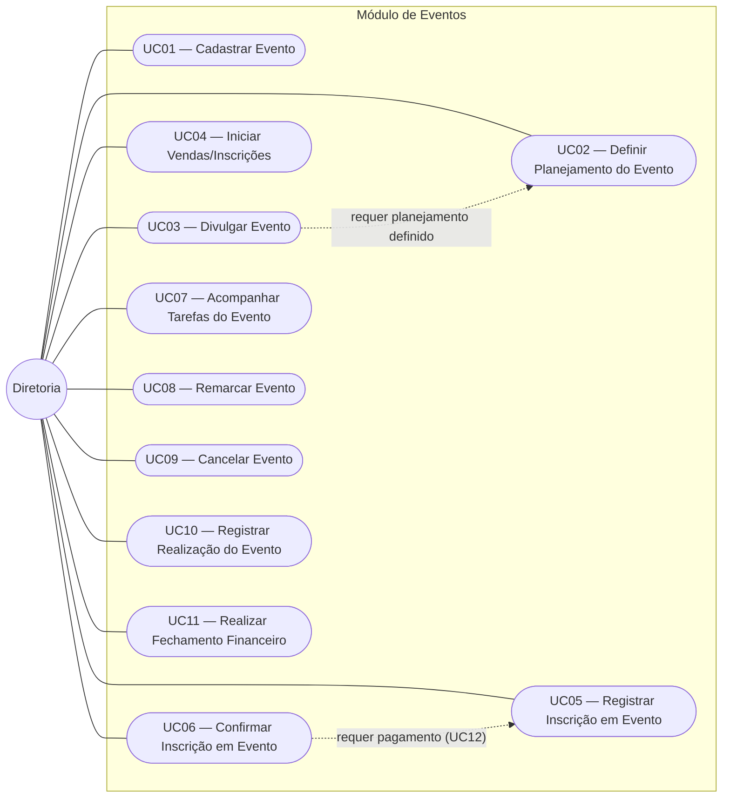
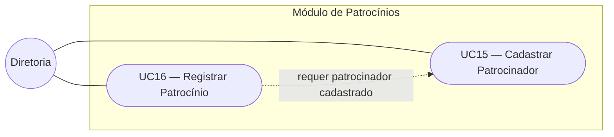
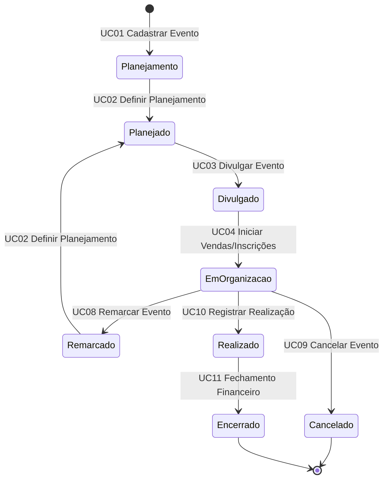

# Casos de Uso — ARENA XVIII

Este documento apresenta o catálogo de casos de uso do sistema ARENA XVIII, derivado do modelo conceitual descrito em [`visao-geral.md`](visao-geral.md). Cada caso de uso indica sua origem na documentação e o grau de sustentação atual, mantendo a mesma postura do modelo conceitual: o que foi confirmado no fluxo analisado é diferenciado do que ainda é hipótese.

---

## 1. Convenções

- **Código:** `UCnn`, numerado sequencialmente por módulo. O módulo de Eventos vem primeiro por ser o fluxo analisado com maior profundidade.
- **Sustentação:**
  - **Alta:** derivado diretamente do fluxo de eventos, de uma regra de negócio confirmada ou de uma Entidade com grau de certeza alto.
  - **Média:** derivado de conceito provisório ou de regra confirmada apenas parcialmente.
  - **Baixa:** derivado de hipótese ou de processo ainda não detalhado.
- **Status da especificação:**
  - **Validada:** revisada pela equipe e pronta para planejamento e implementação.
  - **Rascunho:** derivada do modelo conceitual, aguardando validação da equipe antes do planejamento.
  - **Rascunho — requer modelagem:** depende de conceitos ainda não modelados ou de hipóteses de alta prioridade; recomenda-se atualizar o modelo conceitual antes do planejamento.
- **Origem das regras:** cada regra indica sua origem no modelo conceitual (`visao-geral.md`). Regras marcadas como **Proposta técnica — validar** não constam no modelo conceitual e precisam ser confirmadas pela equipe.
- **Regras específicas:** seguem o padrão `RN-UCnn-xx`. As regras do modelo conceitual mantêm sua numeração original (RN01 a RN06).
- **Ator:** a **Diretoria** aparece como ator principal de forma provisória. As funções organizacionais (tesouraria, diretoria de esportes, técnicos etc.) ainda não foram definidas e constam nas Pendências de Governança do modelo conceitual.

---

## 2. Visão geral por módulo

---

## 3. Catálogo de casos de uso

### 3.1 Eventos

| Código | Caso de uso | Origem nos docs | Sustentação |
|---|---|---|---|
| UC01 | Cadastrar Evento | Operação "criar e planejar o evento"; estado inicial Planejamento | Alta |
| UC02 | Definir Planejamento do Evento | Operação "definir data, local, orçamento e responsáveis"; transição Planejamento → Planejado | Alta |
| UC03 | Divulgar Evento | RN01; transição Planejado → Divulgado | Alta |
| UC04 | Iniciar Vendas/Inscrições | Transição Divulgado → Em Organização | Alta |
| UC05 | Registrar Inscrição em Evento | Operação "controlar vendas ou inscrições" | Média — conceito Inscrição em Evento ainda incerto |
| UC06 | Confirmar Inscrição em Evento | RN02 (dados corretos e pagamento obrigatório realizado) | Média |
| UC07 | Acompanhar Tarefas do Evento | Operação "acompanhar tarefas" | Baixa — Tarefa não foi modelada |
| UC08 | Remarcar Evento | RN03; transição Em Organização → Remarcado | Alta |
| UC09 | Cancelar Evento | RN06; transição Em Organização → Cancelado | Média — critério de cancelamento é hipótese |
| UC10 | Registrar Realização do Evento | Transição Em Organização → Realizado | Alta |
| UC11 | Realizar Fechamento Financeiro do Evento | RN04, RN05; transição Realizado → Encerrado | Média — regra de conclusão do fechamento em aberto |

### 3.2 Financeiro

| Código | Caso de uso | Origem nos docs | Sustentação |
|---|---|---|---|
| UC12 | Registrar Pagamento | Operação "registrar despesas e pagamentos"; Evento registra Pagamento | Alta |
| UC13 | Registrar Despesa | Operação "registrar despesas e pagamentos"; Evento gera Despesa | Alta |
| UC14 | Controlar Mensalidades | Citado no objetivo geral do README | Baixa — não aparece no modelo conceitual |

### 3.3 Patrocínios

| Código | Caso de uso | Origem nos docs | Sustentação |
|---|---|---|---|
| UC15 | Cadastrar Patrocinador | Módulo de patrocínios; Patrocinador é Entidade | Alta |
| UC16 | Registrar Patrocínio | Patrocinador estabelece Patrocínio | Média — Patrocínio é Entidade provisória |

### 3.4 Associados

| Código | Caso de uso | Origem nos docs | Sustentação |
|---|---|---|---|
| UC17 | Cadastrar Associado | Módulo Gestão de Associados; Associado é Entidade | Alta |
| UC18 | Vincular Associado a Modalidade | Associado participa de Modalidade | Baixa — cardinalidade N:N é hipótese |

### 3.5 Esportes

| Código | Caso de uso | Origem nos docs | Sustentação |
|---|---|---|---|
| UC19 | Cadastrar Modalidade | Atlética oferece Modalidade | Alta |
| UC20 | Cadastrar Equipe | Modalidade organiza Equipe | Média |
| UC21 | Registrar Treino | Equipe realiza Treino | Baixa — fluxo de treinos não foi detalhado |
| UC22 | Cadastrar Campeonato | Módulo Eventos e Campeonatos; Campeonato é Entidade | Alta |
| UC23 | Inscrever Equipe em Campeonato | Equipe participa de Campeonato | Média |

### 3.6 Estoque

| Código | Caso de uso | Origem nos docs | Sustentação |
|---|---|---|---|
| UC24 | Cadastrar Material | Atlética controla Material | Alta |
| UC25 | Registrar Movimentação de Estoque | Material recebe Movimentação de Estoque | Média — Movimentação é Entidade provisória |

---

## 4. Casos de uso no ciclo de vida do Evento

O diagrama abaixo reproduz o ciclo de vida do Evento do modelo conceitual, indicando qual caso de uso provoca cada transição.

Enquanto o evento está **Em Organização**, ocorrem também UC05, UC06, UC07, UC12 e UC13, que não alteram o estado do Evento.

---

## 5. Especificações dos casos de uso

As especificações abaixo seguem o mesmo formato do UC03, primeiro slice arquitetural do projeto. Com exceção do UC03, todas estão em **Rascunho** e precisam ser validadas pela equipe antes do planejamento da implementação, com atenção especial às regras marcadas como *Proposta técnica — validar* e às dúvidas em aberto.

| Código | Caso de uso | Módulo | Sustentação | Status da especificação |
|---|---|---|---|---|
| UC01 | Cadastrar Evento | Eventos | Alta | Rascunho |
| UC02 | Definir Planejamento do Evento | Eventos | Alta | Rascunho |
| UC03 | Divulgar Evento | Eventos | Alta | Validada (implementada — primeiro slice arquitetural) |
| UC04 | Iniciar Vendas/Inscrições | Eventos | Alta | Rascunho |
| UC05 | Registrar Inscrição em Evento | Eventos | Média | Rascunho |
| UC06 | Confirmar Inscrição em Evento | Eventos | Média | Rascunho |
| UC07 | Acompanhar Tarefas do Evento | Eventos | Baixa | Rascunho — requer modelagem |
| UC08 | Remarcar Evento | Eventos | Alta | Rascunho |
| UC09 | Cancelar Evento | Eventos | Média | Rascunho |
| UC10 | Registrar Realização do Evento | Eventos | Alta | Rascunho |
| UC11 | Realizar Fechamento Financeiro do Evento | Eventos | Média | Rascunho |
| UC12 | Registrar Pagamento | Financeiro | Alta | Rascunho |
| UC13 | Registrar Despesa | Financeiro | Alta | Rascunho |
| UC14 | Controlar Mensalidades | Financeiro | Baixa | Rascunho — requer modelagem |
| UC15 | Cadastrar Patrocinador | Patrocínios | Alta | Rascunho |
| UC16 | Registrar Patrocínio | Patrocínios | Média | Rascunho |
| UC17 | Cadastrar Associado | Associados | Alta | Rascunho |
| UC18 | Vincular Associado a Modalidade | Associados | Baixa | Rascunho — requer modelagem |
| UC19 | Cadastrar Modalidade | Esportes | Alta | Rascunho |
| UC20 | Cadastrar Equipe | Esportes | Média | Rascunho |
| UC21 | Registrar Treino | Esportes | Baixa | Rascunho — requer modelagem |
| UC22 | Cadastrar Campeonato | Esportes | Alta | Rascunho |
| UC23 | Inscrever Equipe em Campeonato | Esportes | Média | Rascunho |
| UC24 | Cadastrar Material | Estoque | Alta | Rascunho |
| UC25 | Registrar Movimentação de Estoque | Estoque | Média | Rascunho |

---

### 5.1 UC01 — Cadastrar Evento

#### Especificação

| Item | Descrição |
|---|---|
| **Código** | UC01 |
| **Nome** | Cadastrar Evento |
| **Módulo** | Eventos |
| **Ator principal** | Diretoria (provisório) |
| **Sustentação** | Alta |
| **Status da especificação** | Rascunho |
| **Objetivo** | Registrar um novo evento da atlética, que passa a existir no estado Planejamento enquanto suas informações principais são definidas. |
| **Pré-condição** | Nenhuma. |
| **Pós-condição (sucesso)** | O evento existe, está no estado Planejamento e foi persistido. |
| **Pós-condição (falha)** | Nenhum evento é criado. |

#### Regras de negócio

| Código | Regra | Origem |
|---|---|---|
| RN-UC01-01 | Todo evento cadastrado inicia no estado Planejamento | Ciclo de vida do Evento (seção 11) |
| RN-UC01-02 | O evento deve possuir um nome não vazio | *Proposta técnica — validar* |
| RN-UC01-03 | O evento só é persistido quando todas as condições forem atendidas | Padrão adotado no UC03 |

#### Fluxo principal (FP)

1. O ator solicita o cadastro de um evento informando seu nome.
2. O sistema verifica que o nome foi informado.
3. O sistema cria o evento no estado Planejamento.
4. O sistema persiste o evento.
5. O sistema retorna a confirmação do cadastro com o identificador do evento.

#### Fluxos alternativos e de exceção

| Código | Situação | Passo | Resultado |
|---|---|---|---|
| FA01 | Nome não informado ou vazio | 2 | Operação rejeitada, nada é persistido |
| FE01 | Falha na persistência | 4 | Operação não concluída, falha informada ao ator |

#### Dúvidas em aberto

- Quais informações são obrigatórias no cadastro, além do nome? O modelo conceitual cita apenas que, em Planejamento, as informações principais ainda estão sendo definidas.
- Data, local, orçamento e responsáveis podem ser informados já no cadastro ou apenas no UC02?

---

### 5.2 UC02 — Definir Planejamento do Evento

#### Especificação

| Item | Descrição |
|---|---|
| **Código** | UC02 |
| **Nome** | Definir Planejamento do Evento |
| **Módulo** | Eventos |
| **Ator principal** | Diretoria (provisório) |
| **Sustentação** | Alta |
| **Status da especificação** | Rascunho |
| **Objetivo** | Definir as informações principais do evento (data, local, orçamento, responsáveis e atrações ou atividades), levando-o ao estado Planejado. Também é utilizado para definir a nova data de um evento remarcado. |
| **Pré-condição** | O evento existe e está no estado Planejamento ou Remarcado. |
| **Pós-condição (sucesso)** | O evento possui as informações principais definidas, está no estado Planejado e a alteração foi persistida. |
| **Pós-condição (falha)** | O evento permanece inalterado. |

#### Regras de negócio

| Código | Regra | Origem |
|---|---|---|
| RN-UC02-01 | Somente eventos nos estados Planejamento ou Remarcado podem ter o planejamento definido | Ciclo de vida do Evento (seção 11) |
| RN-UC02-02 | O evento só passa a Planejado quando data, local, orçamento, responsáveis e atrações ou atividades estiverem definidos | Definição do estado Planejado (seção 11) e RN01 |
| RN-UC02-03 | Para um evento Remarcado, a transição para Planejado exige a definição de uma nova data | Ciclo de vida do Evento (seção 11) — "nova data definida" |
| RN-UC02-04 | O orçamento deve ser um Valor Monetário válido | Objeto de Valor Valor Monetário (seção 5) |
| RN-UC02-05 | A alteração só é persistida quando todas as condições forem atendidas | Padrão adotado no UC03 |

#### Fluxo principal (FP)

1. O ator informa o identificador do evento e as informações de planejamento.
2. O sistema localiza o evento.
3. O sistema verifica que o evento está em Planejamento ou Remarcado.
4. O sistema verifica que todas as informações principais foram informadas e são válidas.
5. O sistema registra as informações e altera o estado para Planejado.
6. O sistema persiste a alteração.
7. O sistema retorna a confirmação.

#### Fluxos alternativos e de exceção

| Código | Situação | Passo | Resultado |
|---|---|---|---|
| FA01 | Evento não encontrado | 2 | Operação rejeitada, nada é persistido |
| FA02 | Evento em estado diferente de Planejamento ou Remarcado | 3 | Operação rejeitada, nada é persistido |
| FA03 | Informações principais ausentes ou inválidas | 4 | Operação rejeitada informando os campos ausentes ou inválidos, nada é persistido |
| FA04 | Evento Remarcado sem nova data diferente da anterior | 4 | Operação rejeitada, nada é persistido (*Proposta técnica — validar*) |
| FE01 | Falha na persistência | 6 | Operação não concluída, falha informada ao ator |

#### Dúvidas em aberto

- O planejamento pode ser salvo parcialmente, mantendo o evento em Planejamento, ou só é aceito completo?
- Quais dados identificam um responsável? Responsáveis são Associados? (relação Papel/Função Organizacional em aberto).
- A data anterior de um evento remarcado deve ser preservada no histórico de alterações?

---

### 5.3 UC03 — Divulgar Evento

O UC03 foi escolhido como primeiro slice porque deriva da RN01, apontada no modelo conceitual como a regra de maior impacto sobre o modelo, e porque define uma transição central do ciclo de vida do Evento.

#### Especificação

| Item | Descrição |
|---|---|
| **Código** | UC03 |
| **Nome** | Divulgar Evento |
| **Módulo** | Eventos |
| **Sustentação** | Alta |
| **Status da especificação** | Validada (implementada — primeiro slice arquitetural) |
| **Ator principal** | Diretoria (provisório) |
| **Pré-condição** | O evento existe e está no estado Planejado |
| **Pós-condição (sucesso)** | O evento está no estado Divulgado e a alteração foi persistida |
| **Pós-condição (falha)** | O evento permanece inalterado |

#### Regras de negócio

| Código | Regra | Origem |
|---|---|---|
| RN01 | Um evento só pode ser divulgado quando data, local, orçamento, responsáveis e atrações ou atividades estiverem definidos | Modelo conceitual, RN01 |
| RN-UC03-01 | Somente eventos no estado Planejado podem ser divulgados | Ciclo de vida do Evento |
| RN-UC03-02 | Um evento já divulgado não pode ser divulgado novamente | Ciclo de vida do Evento |
| RN-UC03-03 | A alteração de estado só é persistida quando todas as condições forem atendidas | Invariante do Evento (seção 10 do modelo conceitual) |

#### Fluxos

**Fluxo principal (FP)**

1. O ator solicita a divulgação de um evento informando seu identificador.
2. O sistema localiza o evento.
3. O sistema verifica que o evento está no estado Planejado.
4. O sistema verifica que as informações exigidas pela RN01 estão definidas.
5. O sistema altera o estado do evento para Divulgado.
6. O sistema persiste a alteração.
7. O sistema retorna a confirmação da divulgação.

**Fluxos alternativos e de exceção**

| Código | Situação | Passo | Resultado |
|---|---|---|---|
| FA01 | Evento não encontrado | 2 | Operação rejeitada, nada é persistido |
| FA02 | Evento já divulgado | 3 | Operação rejeitada, nada é persistido |
| FA03 | Evento em estado diferente de Planejado | 3 | Operação rejeitada, nada é persistido |
| FA04 | Informações de planejamento incompletas | 4 | Operação rejeitada informando os campos ausentes, nada é persistido |
| FE01 | Falha na persistência | 6 | Operação não concluída, falha informada ao ator |

---

### 5.4 UC04 — Iniciar Vendas/Inscrições

#### Especificação

| Item | Descrição |
|---|---|
| **Código** | UC04 |
| **Nome** | Iniciar Vendas/Inscrições |
| **Módulo** | Eventos |
| **Ator principal** | Diretoria (provisório) |
| **Sustentação** | Alta |
| **Status da especificação** | Rascunho |
| **Objetivo** | Iniciar as vendas ou inscrições de um evento divulgado, levando-o ao estado Em Organização. |
| **Pré-condição** | O evento existe e está no estado Divulgado. |
| **Pós-condição (sucesso)** | O evento está no estado Em Organização e a alteração foi persistida. |
| **Pós-condição (falha)** | O evento permanece inalterado. |

#### Regras de negócio

| Código | Regra | Origem |
|---|---|---|
| RN-UC04-01 | Somente eventos no estado Divulgado podem iniciar vendas ou inscrições | Ciclo de vida do Evento (seção 11) |
| RN-UC04-02 | A alteração só é persistida quando todas as condições forem atendidas | Padrão adotado no UC03 |

#### Fluxo principal (FP)

1. O ator solicita o início das vendas/inscrições informando o identificador do evento.
2. O sistema localiza o evento.
3. O sistema verifica que o evento está no estado Divulgado.
4. O sistema altera o estado para Em Organização.
5. O sistema persiste a alteração.
6. O sistema retorna a confirmação.

#### Fluxos alternativos e de exceção

| Código | Situação | Passo | Resultado |
|---|---|---|---|
| FA01 | Evento não encontrado | 2 | Operação rejeitada, nada é persistido |
| FA02 | Evento em estado diferente de Divulgado | 3 | Operação rejeitada, nada é persistido |
| FE01 | Falha na persistência | 5 | Operação não concluída, falha informada ao ator |

#### Dúvidas em aberto

- O evento utiliza venda de ingressos, inscrições ou ambos? (seção 6.2 do modelo conceitual).
- É necessário definir preço, limite de vagas ou prazo ao iniciar as vendas/inscrições?

---

### 5.5 UC05 — Registrar Inscrição em Evento

#### Especificação

| Item | Descrição |
|---|---|
| **Código** | UC05 |
| **Nome** | Registrar Inscrição em Evento |
| **Módulo** | Eventos |
| **Ator principal** | Diretoria (provisório) |
| **Sustentação** | Média |
| **Status da especificação** | Rascunho |
| **Objetivo** | Registrar a inscrição ou compra de um participante em um evento que está com vendas/inscrições abertas. |
| **Pré-condição** | O evento existe e está no estado Em Organização. |
| **Pós-condição (sucesso)** | A inscrição está registrada, vinculada ao evento, aguardando confirmação, e foi persistida. |
| **Pós-condição (falha)** | Nenhuma inscrição é criada. |

#### Regras de negócio

| Código | Regra | Origem |
|---|---|---|
| RN-UC05-01 | Somente eventos no estado Em Organização aceitam inscrições | Definição do estado Em Organização (seção 11) |
| RN-UC05-02 | A inscrição deve conter os dados do participante | Operação "controlar vendas/inscrições" (seção 6.2) |
| RN-UC05-03 | Toda inscrição pertence a um único evento | Cardinalidade Evento recebe Inscrição 1 : 0..* (seção 8) |
| RN-UC05-04 | A inscrição é registrada como pendente até ser confirmada (UC06) | RN02 — *Proposta técnica — validar* |

#### Fluxo principal (FP)

1. O ator informa o identificador do evento e os dados do participante.
2. O sistema localiza o evento.
3. O sistema verifica que o evento está Em Organização.
4. O sistema verifica que os dados do participante foram informados.
5. O sistema cria a inscrição como pendente, vinculada ao evento.
6. O sistema persiste a inscrição.
7. O sistema retorna a confirmação do registro.

#### Fluxos alternativos e de exceção

| Código | Situação | Passo | Resultado |
|---|---|---|---|
| FA01 | Evento não encontrado | 2 | Operação rejeitada, nada é persistido |
| FA02 | Evento em estado diferente de Em Organização | 3 | Operação rejeitada, nada é persistido |
| FA03 | Dados do participante ausentes | 4 | Operação rejeitada informando os dados ausentes, nada é persistido |
| FE01 | Falha na persistência | 6 | Operação não concluída, falha informada ao ator |

#### Dúvidas em aberto

- Inscrição e venda de ingresso são o mesmo conceito? (pendência de alta prioridade).
- Quais dados do participante são necessários? O participante precisa ser um Associado?
- Existe limite de vagas ou de ingressos?

---

### 5.6 UC06 — Confirmar Inscrição em Evento

#### Especificação

| Item | Descrição |
|---|---|
| **Código** | UC06 |
| **Nome** | Confirmar Inscrição em Evento |
| **Módulo** | Eventos |
| **Ator principal** | Diretoria (provisório) |
| **Sustentação** | Média |
| **Status da especificação** | Rascunho |
| **Objetivo** | Confirmar uma inscrição registrada, desde que seus dados estejam corretos e o pagamento obrigatório tenha sido realizado. |
| **Pré-condição** | A inscrição existe e está pendente. |
| **Pós-condição (sucesso)** | A inscrição está confirmada e a alteração foi persistida. |
| **Pós-condição (falha)** | A inscrição permanece inalterada. |

#### Regras de negócio

| Código | Regra | Origem |
|---|---|---|
| RN02 | Uma venda ou inscrição só pode ser confirmada quando os dados necessários estiverem corretos e o pagamento obrigatório tiver sido realizado | Modelo conceitual, RN02 |
| RN-UC06-01 | Uma inscrição já confirmada não pode ser confirmada novamente | *Proposta técnica — validar* |
| RN-UC06-02 | A alteração só é persistida quando todas as condições forem atendidas | Invariante da Inscrição (seção 10) |

#### Fluxo principal (FP)

1. O ator solicita a confirmação informando o identificador da inscrição.
2. O sistema localiza a inscrição.
3. O sistema verifica que a inscrição está pendente.
4. O sistema verifica que os dados do participante estão completos.
5. O sistema verifica que o pagamento obrigatório foi realizado (UC12).
6. O sistema altera a inscrição para confirmada.
7. O sistema persiste a alteração.
8. O sistema retorna a confirmação.

#### Fluxos alternativos e de exceção

| Código | Situação | Passo | Resultado |
|---|---|---|---|
| FA01 | Inscrição não encontrada | 2 | Operação rejeitada, nada é persistido |
| FA02 | Inscrição já confirmada | 3 | Operação rejeitada, nada é persistido |
| FA03 | Dados do participante incompletos | 4 | Operação rejeitada, nada é persistido |
| FA04 | Pagamento obrigatório não realizado | 5 | Operação rejeitada, nada é persistido |
| FE01 | Falha na persistência | 7 | Operação não concluída, falha informada ao ator |

#### Dúvidas em aberto

- Em quais eventos o pagamento é obrigatório? Existem eventos gratuitos? (seção 6.2).
- O que define que os dados estão "corretos"?
- Uma inscrição pode ser cancelada ou recusada?

---

### 5.7 UC07 — Acompanhar Tarefas do Evento

#### Especificação

| Item | Descrição |
|---|---|
| **Código** | UC07 |
| **Nome** | Acompanhar Tarefas do Evento |
| **Módulo** | Eventos |
| **Ator principal** | Diretoria (provisório) |
| **Sustentação** | Baixa |
| **Status da especificação** | Rascunho — requer modelagem |
| **Objetivo** | Registrar e acompanhar as tarefas de organização de um evento. |
| **Pré-condição** | O evento existe e está no estado Em Organização. |
| **Pós-condição (sucesso)** | A tarefa está registrada ou atualizada e foi persistida. |
| **Pós-condição (falha)** | Nenhuma alteração é persistida. |

#### Regras de negócio

| Código | Regra | Origem |
|---|---|---|
| RN-UC07-01 | Tarefas só podem ser registradas para eventos Em Organização | Definição do estado Em Organização: "tarefas estão sendo acompanhadas" (seção 11) |
| RN-UC07-02 | Toda tarefa pertence a um evento | *Proposta técnica — validar* |
| RN-UC07-03 | A tarefa deve possuir uma descrição não vazia | *Proposta técnica — validar* |

#### Fluxo principal (FP)

1. O ator informa o identificador do evento e a descrição da tarefa.
2. O sistema localiza o evento.
3. O sistema verifica que o evento está Em Organização.
4. O sistema verifica que a descrição foi informada.
5. O sistema registra a tarefa vinculada ao evento.
6. O sistema persiste a tarefa.
7. O sistema retorna a confirmação.

#### Fluxos alternativos e de exceção

| Código | Situação | Passo | Resultado |
|---|---|---|---|
| FA01 | Evento não encontrado | 2 | Operação rejeitada, nada é persistido |
| FA02 | Evento em estado diferente de Em Organização | 3 | Operação rejeitada, nada é persistido |
| FA03 | Descrição não informada | 4 | Operação rejeitada, nada é persistido |
| FE01 | Falha na persistência | 6 | Operação não concluída, falha informada ao ator |

#### Dúvidas em aberto

- Tarefa não foi modelada no modelo conceitual: é uma Entidade? Quais estados possui?
- Tarefas têm responsável e prazo?
- **Recomendação:** modelar Tarefa no modelo conceitual antes de planejar a implementação deste caso de uso.

---

### 5.8 UC08 — Remarcar Evento

#### Especificação

| Item | Descrição |
|---|---|
| **Código** | UC08 |
| **Nome** | Remarcar Evento |
| **Módulo** | Eventos |
| **Ator principal** | Diretoria (provisório) |
| **Sustentação** | Alta |
| **Status da especificação** | Rascunho |
| **Objetivo** | Registrar a remarcação de um evento em organização quando problemas com clima ou local impedirem sua realização na data prevista, levando-o ao estado Remarcado. A definição da nova data ocorre no UC02. |
| **Pré-condição** | O evento existe e está no estado Em Organização. |
| **Pós-condição (sucesso)** | O evento está no estado Remarcado, com o motivo registrado, e a alteração foi persistida. |
| **Pós-condição (falha)** | O evento permanece inalterado. |

#### Regras de negócio

| Código | Regra | Origem |
|---|---|---|
| RN03 | Um evento pode ser remarcado quando problemas com clima ou local impedirem sua realização na data prevista | Modelo conceitual, RN03 |
| RN-UC08-01 | Somente eventos no estado Em Organização podem ser remarcados | Ciclo de vida do Evento (seção 11) |
| RN-UC08-02 | A remarcação exige um motivo, que deve corresponder a problema de clima ou de local | Derivado da RN03 |
| RN-UC08-03 | A alteração só é persistida quando todas as condições forem atendidas | Padrão adotado no UC03 |

#### Fluxo principal (FP)

1. O ator solicita a remarcação informando o identificador do evento e o motivo.
2. O sistema localiza o evento.
3. O sistema verifica que o evento está Em Organização.
4. O sistema verifica que o motivo foi informado e corresponde a clima ou local.
5. O sistema altera o estado para Remarcado e registra o motivo.
6. O sistema persiste a alteração.
7. O sistema retorna a confirmação.

#### Fluxos alternativos e de exceção

| Código | Situação | Passo | Resultado |
|---|---|---|---|
| FA01 | Evento não encontrado | 2 | Operação rejeitada, nada é persistido |
| FA02 | Evento em estado diferente de Em Organização | 3 | Operação rejeitada, nada é persistido |
| FA03 | Motivo não informado ou diferente de clima ou local | 4 | Operação rejeitada, nada é persistido |
| FE01 | Falha na persistência | 6 | Operação não concluída, falha informada ao ator |

#### Dúvidas em aberto

- Um evento Divulgado pode ser remarcado? O ciclo de vida só prevê a partir de Em Organização.
- Existem outros motivos aceitos além de clima e local?
- A data anterior deve ser preservada no histórico de alterações?
- Os inscritos devem ser notificados?

---

### 5.9 UC09 — Cancelar Evento

#### Especificação

| Item | Descrição |
|---|---|
| **Código** | UC09 |
| **Nome** | Cancelar Evento |
| **Módulo** | Eventos |
| **Ator principal** | Diretoria (provisório) |
| **Sustentação** | Média |
| **Status da especificação** | Rascunho |
| **Objetivo** | Cancelar um evento em organização quando uma condição impedir sua continuidade, levando-o ao estado final Cancelado. |
| **Pré-condição** | O evento existe e está no estado Em Organização. |
| **Pós-condição (sucesso)** | O evento está no estado Cancelado, com o motivo registrado, e a alteração foi persistida. |
| **Pós-condição (falha)** | O evento permanece inalterado. |

#### Regras de negócio

| Código | Regra | Origem |
|---|---|---|
| RN06 | Um evento pode ser cancelado quando falta de orçamento, problema grave de local, vendas insuficientes ou cancelamento de fornecedor/atração impedirem sua continuidade | Modelo conceitual, RN06 (hipótese quanto ao critério exato) |
| RN-UC09-01 | Somente eventos no estado Em Organização podem ser cancelados | Ciclo de vida do Evento (seção 11) |
| RN-UC09-02 | O cancelamento exige um motivo | Derivado da RN06 |
| RN-UC09-03 | Cancelado é um estado final: o evento não pode mais mudar de estado | Ciclo de vida do Evento (seção 11) — Cancelado → [*] |
| RN-UC09-04 | A alteração só é persistida quando todas as condições forem atendidas | Padrão adotado no UC03 |

#### Fluxo principal (FP)

1. O ator solicita o cancelamento informando o identificador do evento e o motivo.
2. O sistema localiza o evento.
3. O sistema verifica que o evento está Em Organização.
4. O sistema verifica que o motivo foi informado.
5. O sistema altera o estado para Cancelado e registra o motivo.
6. O sistema persiste a alteração.
7. O sistema retorna a confirmação.

#### Fluxos alternativos e de exceção

| Código | Situação | Passo | Resultado |
|---|---|---|---|
| FA01 | Evento não encontrado | 2 | Operação rejeitada, nada é persistido |
| FA02 | Evento em estado diferente de Em Organização | 3 | Operação rejeitada, nada é persistido |
| FA03 | Motivo não informado | 4 | Operação rejeitada, nada é persistido |
| FE01 | Falha na persistência | 6 | Operação não concluída, falha informada ao ator |

#### Dúvidas em aberto

- O motivo deve ser um dos quatro previstos na RN06 ou é texto livre? (critério é hipótese).
- Eventos em Planejamento, Planejado ou Divulgado podem ser cancelados?
- O que acontece com inscrições e pagamentos já registrados?

---

### 5.10 UC10 — Registrar Realização do Evento

#### Especificação

| Item | Descrição |
|---|---|
| **Código** | UC10 |
| **Nome** | Registrar Realização do Evento |
| **Módulo** | Eventos |
| **Ator principal** | Diretoria (provisório) |
| **Sustentação** | Alta |
| **Status da especificação** | Rascunho |
| **Objetivo** | Registrar que o evento ocorreu, levando-o ao estado Realizado, no qual aguarda o fechamento financeiro. |
| **Pré-condição** | O evento existe e está no estado Em Organização. |
| **Pós-condição (sucesso)** | O evento está no estado Realizado e a alteração foi persistida. |
| **Pós-condição (falha)** | O evento permanece inalterado. |

#### Regras de negócio

| Código | Regra | Origem |
|---|---|---|
| RN-UC10-01 | Somente eventos no estado Em Organização podem ser registrados como realizados | Ciclo de vida do Evento (seção 11) |
| RN-UC10-02 | A realização só pode ser registrada a partir da data do evento | *Proposta técnica — validar* |
| RN-UC10-03 | A alteração só é persistida quando todas as condições forem atendidas | Padrão adotado no UC03 |

#### Fluxo principal (FP)

1. O ator solicita o registro da realização informando o identificador do evento.
2. O sistema localiza o evento.
3. O sistema verifica que o evento está Em Organização.
4. O sistema verifica que a data do evento já foi alcançada.
5. O sistema altera o estado para Realizado.
6. O sistema persiste a alteração.
7. O sistema retorna a confirmação.

#### Fluxos alternativos e de exceção

| Código | Situação | Passo | Resultado |
|---|---|---|---|
| FA01 | Evento não encontrado | 2 | Operação rejeitada, nada é persistido |
| FA02 | Evento em estado diferente de Em Organização | 3 | Operação rejeitada, nada é persistido |
| FA03 | Data do evento ainda não alcançada | 4 | Operação rejeitada, nada é persistido (*Proposta técnica — validar*) |
| FE01 | Falha na persistência | 6 | Operação não concluída, falha informada ao ator |

#### Dúvidas em aberto

- A "revisão geral" citada no fluxo de organização deve ocorrer antes do registro da realização?
- Há informações a registrar sobre a realização (público, ocorrências)?

---

### 5.11 UC11 — Realizar Fechamento Financeiro do Evento

#### Especificação

| Item | Descrição |
|---|---|
| **Código** | UC11 |
| **Nome** | Realizar Fechamento Financeiro do Evento |
| **Módulo** | Eventos |
| **Ator principal** | Diretoria (provisório) |
| **Sustentação** | Média |
| **Status da especificação** | Rascunho |
| **Objetivo** | Apurar o resultado financeiro de um evento realizado, considerando suas entradas e saídas, e encerrá-lo. |
| **Pré-condição** | O evento existe e está no estado Realizado. |
| **Pós-condição (sucesso)** | O resultado financeiro está apurado e registrado, o evento está no estado Encerrado e a alteração foi persistida. |
| **Pós-condição (falha)** | O evento permanece inalterado. |

#### Regras de negócio

| Código | Regra | Origem |
|---|---|---|
| RN04 | O fechamento financeiro deve considerar vendas, receitas, despesas, pagamentos e patrocínios ou outras entradas relacionadas ao evento | Modelo conceitual, RN04 |
| RN05 | Despesas não registradas, pagamentos pendentes ou informações financeiras incompletas podem impedir a conclusão confiável do fechamento | Modelo conceitual, RN05 |
| RN-UC11-01 | Somente eventos no estado Realizado podem ser encerrados | Ciclo de vida do Evento (seção 11) |
| RN-UC11-02 | O fechamento é bloqueado enquanto houver pagamentos pendentes | Derivado da RN05 |
| RN-UC11-03 | O resultado financeiro é a diferença entre as entradas e as despesas do evento | *Proposta técnica — validar* |

#### Fluxo principal (FP)

1. O ator solicita o fechamento financeiro informando o identificador do evento.
2. O sistema localiza o evento.
3. O sistema verifica que o evento está Realizado.
4. O sistema verifica que não há pagamentos pendentes vinculados ao evento.
5. O sistema apura o resultado financeiro a partir de pagamentos, despesas e patrocínios.
6. O sistema registra o resultado e altera o estado para Encerrado.
7. O sistema persiste a alteração.
8. O sistema retorna o resultado financeiro apurado.

#### Fluxos alternativos e de exceção

| Código | Situação | Passo | Resultado |
|---|---|---|---|
| FA01 | Evento não encontrado | 2 | Operação rejeitada, nada é persistido |
| FA02 | Evento em estado diferente de Realizado | 3 | Operação rejeitada, nada é persistido |
| FA03 | Existem pagamentos pendentes | 4 | Operação rejeitada informando as pendências, nada é persistido |
| FE01 | Falha na persistência | 7 | Operação não concluída, falha informada ao ator |

#### Dúvidas em aberto

- Qual a regra exata para considerar o fechamento concluído? (pendência de alta prioridade).
- Como o sistema identifica "despesas não registradas"?
- Patrocínios vinculados à atlética (e não ao evento) entram no fechamento?

---

### 5.12 UC12 — Registrar Pagamento

#### Especificação

| Item | Descrição |
|---|---|
| **Código** | UC12 |
| **Nome** | Registrar Pagamento |
| **Módulo** | Financeiro |
| **Ator principal** | Diretoria (provisório) |
| **Sustentação** | Alta |
| **Status da especificação** | Rascunho |
| **Objetivo** | Registrar um pagamento relacionado a um evento, preservando-o individualmente para o acompanhamento e o fechamento financeiro. |
| **Pré-condição** | O evento existe. |
| **Pós-condição (sucesso)** | O pagamento está registrado, vinculado ao evento, e foi persistido. |
| **Pós-condição (falha)** | Nenhum pagamento é criado. |

#### Regras de negócio

| Código | Regra | Origem |
|---|---|---|
| RN-UC12-01 | Todo pagamento deve possuir um Valor Monetário válido | Invariante possível de Pagamento (seção 10) |
| RN-UC12-02 | Todo pagamento pertence a um único evento | Cardinalidade Evento registra Pagamento 1 : 0..* (seção 8) |
| RN-UC12-03 | Um pagamento pode estar pendente ou realizado | RN05 cita pagamentos pendentes — *Proposta técnica — validar* |
| RN-UC12-04 | Pagamentos não podem ser registrados para eventos Encerrados ou Cancelados | *Proposta técnica — validar* |

#### Fluxo principal (FP)

1. O ator informa o identificador do evento, o valor e a situação do pagamento.
2. O sistema localiza o evento.
3. O sistema verifica que o evento aceita registros financeiros.
4. O sistema verifica que o valor é válido.
5. O sistema registra o pagamento vinculado ao evento.
6. O sistema persiste o pagamento.
7. O sistema retorna a confirmação.

#### Fluxos alternativos e de exceção

| Código | Situação | Passo | Resultado |
|---|---|---|---|
| FA01 | Evento não encontrado | 2 | Operação rejeitada, nada é persistido |
| FA02 | Evento Encerrado ou Cancelado | 3 | Operação rejeitada, nada é persistido (*Proposta técnica — validar*) |
| FA03 | Valor ausente ou inválido | 4 | Operação rejeitada, nada é persistido |
| FE01 | Falha na persistência | 6 | Operação não concluída, falha informada ao ator |

#### Dúvidas em aberto

- O pagamento é sempre vinculado a uma inscrição? (relação com RN02).
- Pagamentos de mensalidades (UC14) usam a mesma Entidade?
- Quais formas de pagamento existem?

---

### 5.13 UC13 — Registrar Despesa

#### Especificação

| Item | Descrição |
|---|---|
| **Código** | UC13 |
| **Nome** | Registrar Despesa |
| **Módulo** | Financeiro |
| **Ator principal** | Diretoria (provisório) |
| **Sustentação** | Alta |
| **Status da especificação** | Rascunho |
| **Objetivo** | Registrar um gasto gerado pela organização ou realização de um evento, para que seja considerado no fechamento financeiro. |
| **Pré-condição** | O evento existe. |
| **Pós-condição (sucesso)** | A despesa está registrada, vinculada ao evento, e foi persistida. |
| **Pós-condição (falha)** | Nenhuma despesa é criada. |

#### Regras de negócio

| Código | Regra | Origem |
|---|---|---|
| RN-UC13-01 | Toda despesa deve possuir um Valor Monetário válido | Invariante possível de Despesa (seção 10) |
| RN-UC13-02 | Toda despesa pertence a um único evento | Cardinalidade Evento gera Despesa 1 : 0..* (seção 8) |
| RN-UC13-03 | A despesa deve possuir uma descrição não vazia | Despesas iguais precisam ser distinguidas (seção 4) — *Proposta técnica — validar* |
| RN-UC13-04 | Despesas não podem ser registradas para eventos Encerrados | *Proposta técnica — validar* |

#### Fluxo principal (FP)

1. O ator informa o identificador do evento, a descrição e o valor da despesa.
2. O sistema localiza o evento.
3. O sistema verifica que o evento não está Encerrado.
4. O sistema verifica que descrição e valor são válidos.
5. O sistema registra a despesa vinculada ao evento.
6. O sistema persiste a despesa.
7. O sistema retorna a confirmação.

#### Fluxos alternativos e de exceção

| Código | Situação | Passo | Resultado |
|---|---|---|---|
| FA01 | Evento não encontrado | 2 | Operação rejeitada, nada é persistido |
| FA02 | Evento Encerrado | 3 | Operação rejeitada, nada é persistido (*Proposta técnica — validar*) |
| FA03 | Descrição ou valor ausente ou inválido | 4 | Operação rejeitada, nada é persistido |
| FE01 | Falha na persistência | 6 | Operação não concluída, falha informada ao ator |

#### Dúvidas em aberto

- Existem despesas da atlética não vinculadas a evento?
- É necessário anexar comprovante?

---

### 5.14 UC14 — Controlar Mensalidades

#### Especificação

| Item | Descrição |
|---|---|
| **Código** | UC14 |
| **Nome** | Controlar Mensalidades |
| **Módulo** | Financeiro |
| **Ator principal** | Diretoria (provisório) |
| **Sustentação** | Baixa |
| **Status da especificação** | Rascunho — requer modelagem |
| **Objetivo** | Registrar o pagamento de mensalidades dos associados. |
| **Pré-condição** | O associado existe. |
| **Pós-condição (sucesso)** | O pagamento da mensalidade está registrado e foi persistido. |
| **Pós-condição (falha)** | Nenhum registro é criado. |

#### Regras de negócio

| Código | Regra | Origem |
|---|---|---|
| RN-UC14-01 | Toda mensalidade pertence a um associado | *Proposta técnica — validar* |
| RN-UC14-02 | A mensalidade deve possuir um Valor Monetário válido | Objeto de Valor Valor Monetário (seção 5) |
| RN-UC14-03 | Um associado não pode ter duas mensalidades registradas para a mesma competência (mês/ano) | *Proposta técnica — validar* |

#### Fluxo principal (FP)

1. O ator informa o associado, a competência e o valor.
2. O sistema localiza o associado.
3. O sistema verifica que o valor é válido.
4. O sistema verifica que não há mensalidade registrada para a mesma competência.
5. O sistema registra a mensalidade.
6. O sistema persiste o registro.
7. O sistema retorna a confirmação.

#### Fluxos alternativos e de exceção

| Código | Situação | Passo | Resultado |
|---|---|---|---|
| FA01 | Associado não encontrado | 2 | Operação rejeitada, nada é persistido |
| FA02 | Valor ausente ou inválido | 3 | Operação rejeitada, nada é persistido |
| FA03 | Mensalidade já registrada para a competência | 4 | Operação rejeitada, nada é persistido |
| FE01 | Falha na persistência | 6 | Operação não concluída, falha informada ao ator |

#### Dúvidas em aberto

- Mensalidades não aparecem no modelo conceitual, apenas no README: todo associado paga mensalidade?
- Qual o valor e a periodicidade?
- Inadimplência gera alguma consequência (ex.: impedir inscrição)?
- **Recomendação:** incluir Mensalidade no modelo conceitual antes de planejar a implementação.

---

### 5.15 UC15 — Cadastrar Patrocinador

#### Especificação

| Item | Descrição |
|---|---|
| **Código** | UC15 |
| **Nome** | Cadastrar Patrocinador |
| **Módulo** | Patrocínios |
| **Ator principal** | Diretoria (provisório) |
| **Sustentação** | Alta |
| **Status da especificação** | Rascunho |
| **Objetivo** | Registrar uma empresa ou organização parceira que poderá estabelecer patrocínios com a atlética. |
| **Pré-condição** | Nenhuma. |
| **Pós-condição (sucesso)** | O patrocinador está cadastrado e foi persistido. |
| **Pós-condição (falha)** | Nenhum patrocinador é criado. |

#### Regras de negócio

| Código | Regra | Origem |
|---|---|---|
| RN-UC15-01 | O patrocinador deve possuir um nome não vazio | Patrocinador é organização identificável (seção 5) — *Proposta técnica — validar* |
| RN-UC15-02 | Não podem existir dois patrocinadores com o mesmo identificador (ex.: CNPJ) | *Proposta técnica — validar* |

#### Fluxo principal (FP)

1. O ator informa os dados do patrocinador.
2. O sistema verifica que o nome foi informado.
3. O sistema verifica que não há patrocinador com o mesmo identificador.
4. O sistema cria o patrocinador.
5. O sistema persiste o patrocinador.
6. O sistema retorna a confirmação.

#### Fluxos alternativos e de exceção

| Código | Situação | Passo | Resultado |
|---|---|---|---|
| FA01 | Nome não informado | 2 | Operação rejeitada, nada é persistido |
| FA02 | Patrocinador já cadastrado | 3 | Operação rejeitada, nada é persistido |
| FE01 | Falha na persistência | 5 | Operação não concluída, falha informada ao ator |

#### Dúvidas em aberto

- Quais dados identificam o patrocinador? Pessoas físicas podem ser patrocinadoras?

---

### 5.16 UC16 — Registrar Patrocínio

#### Especificação

| Item | Descrição |
|---|---|
| **Código** | UC16 |
| **Nome** | Registrar Patrocínio |
| **Módulo** | Patrocínios |
| **Ator principal** | Diretoria (provisório) |
| **Sustentação** | Média |
| **Status da especificação** | Rascunho |
| **Objetivo** | Registrar um acordo de patrocínio firmado por um patrocinador, com valor e período definidos. |
| **Pré-condição** | O patrocinador existe. |
| **Pós-condição (sucesso)** | O patrocínio está registrado, vinculado ao patrocinador, e foi persistido. |
| **Pós-condição (falha)** | Nenhum patrocínio é criado. |

#### Regras de negócio

| Código | Regra | Origem |
|---|---|---|
| RN-UC16-01 | Todo patrocínio pertence a um patrocinador | Patrocinador estabelece Patrocínio 1 : 0..* (seção 8) |
| RN-UC16-02 | O patrocínio deve possuir um Valor Monetário válido | Patrocínio define Valor Monetário (seção 12) |
| RN-UC16-03 | O patrocínio deve possuir um Período válido (início anterior ou igual ao fim) | Período usado em patrocínios (seção 5) |

#### Fluxo principal (FP)

1. O ator informa o patrocinador, o valor e o período do patrocínio.
2. O sistema localiza o patrocinador.
3. O sistema verifica que o valor é válido.
4. O sistema verifica que o período é válido.
5. O sistema registra o patrocínio.
6. O sistema persiste o patrocínio.
7. O sistema retorna a confirmação.

#### Fluxos alternativos e de exceção

| Código | Situação | Passo | Resultado |
|---|---|---|---|
| FA01 | Patrocinador não encontrado | 2 | Operação rejeitada, nada é persistido |
| FA02 | Valor ausente ou inválido | 3 | Operação rejeitada, nada é persistido |
| FA03 | Período ausente ou inválido | 4 | Operação rejeitada, nada é persistido |
| FE01 | Falha na persistência | 6 | Operação não concluída, falha informada ao ator |

#### Dúvidas em aberto

- O patrocínio se vincula à atlética, a um evento específico ou aos dois? (pendência de média prioridade).
- Existem patrocínios sem valor monetário (ex.: permuta de produtos)?

---

### 5.17 UC17 — Cadastrar Associado

#### Especificação

| Item | Descrição |
|---|---|
| **Código** | UC17 |
| **Nome** | Cadastrar Associado |
| **Módulo** | Associados |
| **Ator principal** | Diretoria (provisório) |
| **Sustentação** | Alta |
| **Status da especificação** | Rascunho |
| **Objetivo** | Registrar uma pessoa como associada da atlética, de forma que permaneça reconhecível ao longo do tempo. |
| **Pré-condição** | Nenhuma. |
| **Pós-condição (sucesso)** | O associado está cadastrado e foi persistido. |
| **Pós-condição (falha)** | Nenhum associado é criado. |

#### Regras de negócio

| Código | Regra | Origem |
|---|---|---|
| RN-UC17-01 | O associado deve possuir um nome não vazio | *Proposta técnica — validar* |
| RN-UC17-02 | Não podem existir dois associados com o mesmo identificador (ex.: RA ou CPF) | Associado precisa ser reconhecível ao longo do tempo (seção 4) — *Proposta técnica — validar* |

#### Fluxo principal (FP)

1. O ator informa os dados do associado.
2. O sistema verifica que os dados obrigatórios foram informados.
3. O sistema verifica que não há associado com o mesmo identificador.
4. O sistema cria o associado.
5. O sistema persiste o associado.
6. O sistema retorna a confirmação.

#### Fluxos alternativos e de exceção

| Código | Situação | Passo | Resultado |
|---|---|---|---|
| FA01 | Dados obrigatórios ausentes | 2 | Operação rejeitada, nada é persistido |
| FA02 | Associado já cadastrado | 3 | Operação rejeitada, nada é persistido |
| FE01 | Falha na persistência | 5 | Operação não concluída, falha informada ao ator |

#### Dúvidas em aberto

- Quais dados identificam um associado (RA, CPF, e-mail)?
- Existem atletas que não são associados? (seção 6.1).
- O associado possui situação (ativo/inativo)?

---

### 5.18 UC18 — Vincular Associado a Modalidade

#### Especificação

| Item | Descrição |
|---|---|
| **Código** | UC18 |
| **Nome** | Vincular Associado a Modalidade |
| **Módulo** | Associados |
| **Ator principal** | Diretoria (provisório) |
| **Sustentação** | Baixa |
| **Status da especificação** | Rascunho — requer modelagem |
| **Objetivo** | Registrar a participação de um associado em uma modalidade esportiva, na qual ele assume o papel de atleta. |
| **Pré-condição** | O associado e a modalidade existem. |
| **Pós-condição (sucesso)** | O vínculo está registrado e foi persistido. |
| **Pós-condição (falha)** | Nenhum vínculo é criado. |

#### Regras de negócio

| Código | Regra | Origem |
|---|---|---|
| RN-UC18-01 | O vínculo exige um associado e uma modalidade existentes | Associado participa de Modalidade (seção 7) |
| RN-UC18-02 | Um associado não pode ser vinculado duas vezes à mesma modalidade | *Proposta técnica — validar* |
| RN-UC18-03 | Um associado pode participar de mais de uma modalidade | Cardinalidade N:N — hipótese (seção 8) |

#### Fluxo principal (FP)

1. O ator informa o associado e a modalidade.
2. O sistema localiza o associado.
3. O sistema localiza a modalidade.
4. O sistema verifica que o vínculo ainda não existe.
5. O sistema registra o vínculo.
6. O sistema persiste o vínculo.
7. O sistema retorna a confirmação.

#### Fluxos alternativos e de exceção

| Código | Situação | Passo | Resultado |
|---|---|---|---|
| FA01 | Associado não encontrado | 2 | Operação rejeitada, nada é persistido |
| FA02 | Modalidade não encontrada | 3 | Operação rejeitada, nada é persistido |
| FA03 | Vínculo já existente | 4 | Operação rejeitada, nada é persistido |
| FE01 | Falha na persistência | 6 | Operação não concluída, falha informada ao ator |

#### Dúvidas em aberto

- A cardinalidade N:N não foi confirmada (pendência de alta prioridade).
- Atleta é papel do Associado ou Entidade própria? (seção 6.1).
- **Recomendação:** confirmar a cardinalidade antes de planejar a implementação.

---

### 5.19 UC19 — Cadastrar Modalidade

#### Especificação

| Item | Descrição |
|---|---|
| **Código** | UC19 |
| **Nome** | Cadastrar Modalidade |
| **Módulo** | Esportes |
| **Ator principal** | Diretoria (provisório) |
| **Sustentação** | Alta |
| **Status da especificação** | Rascunho |
| **Objetivo** | Registrar uma modalidade esportiva oferecida pela atlética. |
| **Pré-condição** | Nenhuma. |
| **Pós-condição (sucesso)** | A modalidade está cadastrada e foi persistida. |
| **Pós-condição (falha)** | Nenhuma modalidade é criada. |

#### Regras de negócio

| Código | Regra | Origem |
|---|---|---|
| RN-UC19-01 | A modalidade deve possuir um nome não vazio | *Proposta técnica — validar* |
| RN-UC19-02 | Não podem existir duas modalidades com o mesmo nome | *Proposta técnica — validar* |

#### Fluxo principal (FP)

1. O ator informa o nome da modalidade.
2. O sistema verifica que o nome foi informado.
3. O sistema verifica que não há modalidade com o mesmo nome.
4. O sistema cria a modalidade.
5. O sistema persiste a modalidade.
6. O sistema retorna a confirmação.

#### Fluxos alternativos e de exceção

| Código | Situação | Passo | Resultado |
|---|---|---|---|
| FA01 | Nome não informado | 2 | Operação rejeitada, nada é persistido |
| FA02 | Modalidade já cadastrada | 3 | Operação rejeitada, nada é persistido |
| FE01 | Falha na persistência | 5 | Operação não concluída, falha informada ao ator |

#### Dúvidas em aberto

- Uma mesma modalidade pode existir em categorias diferentes (ex.: futsal masculino e feminino)?

---

### 5.20 UC20 — Cadastrar Equipe

#### Especificação

| Item | Descrição |
|---|---|
| **Código** | UC20 |
| **Nome** | Cadastrar Equipe |
| **Módulo** | Esportes |
| **Ator principal** | Diretoria (provisório) |
| **Sustentação** | Média |
| **Status da especificação** | Rascunho |
| **Objetivo** | Registrar uma equipe formada dentro de uma modalidade. |
| **Pré-condição** | A modalidade existe. |
| **Pós-condição (sucesso)** | A equipe está cadastrada, vinculada à modalidade, e foi persistida. |
| **Pós-condição (falha)** | Nenhuma equipe é criada. |

#### Regras de negócio

| Código | Regra | Origem |
|---|---|---|
| RN-UC20-01 | Toda equipe pertence a uma modalidade | Modalidade organiza Equipe 1 : 0..* — hipótese (seção 8) |
| RN-UC20-02 | A equipe deve possuir um nome não vazio | *Proposta técnica — validar* |

#### Fluxo principal (FP)

1. O ator informa a modalidade e o nome da equipe.
2. O sistema localiza a modalidade.
3. O sistema verifica que o nome foi informado.
4. O sistema cria a equipe vinculada à modalidade.
5. O sistema persiste a equipe.
6. O sistema retorna a confirmação.

#### Fluxos alternativos e de exceção

| Código | Situação | Passo | Resultado |
|---|---|---|---|
| FA01 | Modalidade não encontrada | 2 | Operação rejeitada, nada é persistido |
| FA02 | Nome não informado | 3 | Operação rejeitada, nada é persistido |
| FE01 | Falha na persistência | 5 | Operação não concluída, falha informada ao ator |

#### Dúvidas em aberto

- Como os atletas são incluídos na equipe? Devem estar vinculados à modalidade (UC18)?
- Existe número mínimo ou máximo de integrantes?

---

### 5.21 UC21 — Registrar Treino

#### Especificação

| Item | Descrição |
|---|---|
| **Código** | UC21 |
| **Nome** | Registrar Treino |
| **Módulo** | Esportes |
| **Ator principal** | Diretoria (provisório) |
| **Sustentação** | Baixa |
| **Status da especificação** | Rascunho — requer modelagem |
| **Objetivo** | Registrar uma ocorrência de treino de uma equipe. |
| **Pré-condição** | A equipe existe. |
| **Pós-condição (sucesso)** | O treino está registrado, vinculado à equipe, e foi persistido. |
| **Pós-condição (falha)** | Nenhum treino é criado. |

#### Regras de negócio

| Código | Regra | Origem |
|---|---|---|
| RN-UC21-01 | Todo treino pertence a uma equipe | Equipe realiza Treino 1 : 0..* — hipótese (seção 8) |
| RN-UC21-02 | O treino deve possuir data e horário | Cada ocorrência é um acontecimento específico (seção 4) — *Proposta técnica — validar* |

#### Fluxo principal (FP)

1. O ator informa a equipe, a data e o horário do treino.
2. O sistema localiza a equipe.
3. O sistema verifica que data e horário foram informados.
4. O sistema registra o treino vinculado à equipe.
5. O sistema persiste o treino.
6. O sistema retorna a confirmação.

#### Fluxos alternativos e de exceção

| Código | Situação | Passo | Resultado |
|---|---|---|---|
| FA01 | Equipe não encontrada | 2 | Operação rejeitada, nada é persistido |
| FA02 | Data ou horário não informados | 3 | Operação rejeitada, nada é persistido |
| FE01 | Falha na persistência | 5 | Operação não concluída, falha informada ao ator |

#### Dúvidas em aberto

- O fluxo de treinos não foi detalhado (pendência de média prioridade).
- Há registro de presença dos atletas? Local do treino?
- **Recomendação:** detalhar o fluxo de treinos antes de planejar a implementação.

---

### 5.22 UC22 — Cadastrar Campeonato

#### Especificação

| Item | Descrição |
|---|---|
| **Código** | UC22 |
| **Nome** | Cadastrar Campeonato |
| **Módulo** | Esportes |
| **Ator principal** | Diretoria (provisório) |
| **Sustentação** | Alta |
| **Status da especificação** | Rascunho |
| **Objetivo** | Registrar uma competição específica da qual equipes da atlética podem participar. |
| **Pré-condição** | Nenhuma. |
| **Pós-condição (sucesso)** | O campeonato está cadastrado e foi persistido. |
| **Pós-condição (falha)** | Nenhum campeonato é criado. |

#### Regras de negócio

| Código | Regra | Origem |
|---|---|---|
| RN-UC22-01 | O campeonato deve possuir um nome não vazio | *Proposta técnica — validar* |
| RN-UC22-02 | O campeonato deve possuir um Período válido (início anterior ou igual ao fim) | Período usado em campeonatos (seção 5) |

#### Fluxo principal (FP)

1. O ator informa o nome e o período do campeonato.
2. O sistema verifica que o nome foi informado.
3. O sistema verifica que o período é válido.
4. O sistema cria o campeonato.
5. O sistema persiste o campeonato.
6. O sistema retorna a confirmação.

#### Fluxos alternativos e de exceção

| Código | Situação | Passo | Resultado |
|---|---|---|---|
| FA01 | Nome não informado | 2 | Operação rejeitada, nada é persistido |
| FA02 | Período ausente ou inválido | 3 | Operação rejeitada, nada é persistido |
| FE01 | Falha na persistência | 5 | Operação não concluída, falha informada ao ator |

#### Dúvidas em aberto

- O campeonato pertence a uma modalidade?
- O campeonato possui ciclo de vida próprio (inscrições abertas, em andamento, encerrado)?

---

### 5.23 UC23 — Inscrever Equipe em Campeonato

#### Especificação

| Item | Descrição |
|---|---|
| **Código** | UC23 |
| **Nome** | Inscrever Equipe em Campeonato |
| **Módulo** | Esportes |
| **Ator principal** | Diretoria (provisório) |
| **Sustentação** | Média |
| **Status da especificação** | Rascunho |
| **Objetivo** | Registrar a participação de uma equipe da atlética em um campeonato. |
| **Pré-condição** | A equipe e o campeonato existem. |
| **Pós-condição (sucesso)** | A participação está registrada e foi persistida. |
| **Pós-condição (falha)** | Nenhuma participação é criada. |

#### Regras de negócio

| Código | Regra | Origem |
|---|---|---|
| RN-UC23-01 | A inscrição exige uma equipe e um campeonato existentes | Equipe participa de Campeonato (seção 7) |
| RN-UC23-02 | Uma equipe não pode ser inscrita duas vezes no mesmo campeonato | *Proposta técnica — validar* |
| RN-UC23-03 | Uma equipe pode participar de vários campeonatos e um campeonato pode reunir várias equipes | Cardinalidade N:N — hipótese (seção 8) |

#### Fluxo principal (FP)

1. O ator informa a equipe e o campeonato.
2. O sistema localiza a equipe.
3. O sistema localiza o campeonato.
4. O sistema verifica que a equipe ainda não está inscrita no campeonato.
5. O sistema registra a participação.
6. O sistema persiste a participação.
7. O sistema retorna a confirmação.

#### Fluxos alternativos e de exceção

| Código | Situação | Passo | Resultado |
|---|---|---|---|
| FA01 | Equipe não encontrada | 2 | Operação rejeitada, nada é persistido |
| FA02 | Campeonato não encontrado | 3 | Operação rejeitada, nada é persistido |
| FA03 | Equipe já inscrita no campeonato | 4 | Operação rejeitada, nada é persistido |
| FE01 | Falha na persistência | 6 | Operação não concluída, falha informada ao ator |

#### Dúvidas em aberto

- A modalidade da equipe precisa ser a mesma do campeonato?
- Existe prazo de inscrição?

---

### 5.24 UC24 — Cadastrar Material

#### Especificação

| Item | Descrição |
|---|---|
| **Código** | UC24 |
| **Nome** | Cadastrar Material |
| **Módulo** | Estoque |
| **Ator principal** | Diretoria (provisório) |
| **Sustentação** | Alta |
| **Status da especificação** | Rascunho |
| **Objetivo** | Registrar um material esportivo ou uniforme controlado pela atlética. |
| **Pré-condição** | Nenhuma. |
| **Pós-condição (sucesso)** | O material está cadastrado, com quantidade inicial, e foi persistido. |
| **Pós-condição (falha)** | Nenhum material é criado. |

#### Regras de negócio

| Código | Regra | Origem |
|---|---|---|
| RN-UC24-01 | O material deve possuir um nome não vazio | *Proposta técnica — validar* |
| RN-UC24-02 | A quantidade do material não pode ser negativa | Objeto de Valor Quantidade (seção 5) — *Proposta técnica — validar* |
| RN-UC24-03 | O material é controlado por quantidade | Hipótese do modelo conceitual (seção 19) |

#### Fluxo principal (FP)

1. O ator informa o nome e a quantidade inicial do material.
2. O sistema verifica que o nome foi informado.
3. O sistema verifica que a quantidade é válida.
4. O sistema cria o material.
5. O sistema persiste o material.
6. O sistema retorna a confirmação.

#### Fluxos alternativos e de exceção

| Código | Situação | Passo | Resultado |
|---|---|---|---|
| FA01 | Nome não informado | 2 | Operação rejeitada, nada é persistido |
| FA02 | Quantidade ausente ou negativa | 3 | Operação rejeitada, nada é persistido |
| FE01 | Falha na persistência | 5 | Operação não concluída, falha informada ao ator |

#### Dúvidas em aberto

- Todos os materiais são controlados só por quantidade ou alguns precisam de identificação individual? (pendência de média prioridade).
- Uniformes têm tamanho? Cada tamanho é um material diferente?

---

### 5.25 UC25 — Registrar Movimentação de Estoque

#### Especificação

| Item | Descrição |
|---|---|
| **Código** | UC25 |
| **Nome** | Registrar Movimentação de Estoque |
| **Módulo** | Estoque |
| **Ator principal** | Diretoria (provisório) |
| **Sustentação** | Média |
| **Status da especificação** | Rascunho |
| **Objetivo** | Registrar uma entrada ou retirada de material, atualizando sua quantidade e preservando o histórico. |
| **Pré-condição** | O material existe. |
| **Pós-condição (sucesso)** | A movimentação está registrada, a quantidade do material foi atualizada e ambos foram persistidos. |
| **Pós-condição (falha)** | Nenhuma alteração é persistida. |

#### Regras de negócio

| Código | Regra | Origem |
|---|---|---|
| RN-UC25-01 | Toda movimentação está relacionada a um material | Invariante possível de Movimentação (seção 10) |
| RN-UC25-02 | A movimentação é do tipo entrada ou retirada | Definição de Movimentação de Estoque (seção 3) |
| RN-UC25-03 | A quantidade movimentada deve ser maior que zero | Objeto de Valor Quantidade (seção 5) — *Proposta técnica — validar* |
| RN-UC25-04 | Uma retirada não pode ser maior que a quantidade disponível | *Proposta técnica — validar* |

#### Fluxo principal (FP)

1. O ator informa o material, o tipo de movimentação e a quantidade.
2. O sistema localiza o material.
3. O sistema verifica que o tipo e a quantidade são válidos.
4. Em caso de retirada, o sistema verifica que há quantidade disponível.
5. O sistema registra a movimentação e atualiza a quantidade do material.
6. O sistema persiste a movimentação e o material.
7. O sistema retorna a confirmação com a nova quantidade.

#### Fluxos alternativos e de exceção

| Código | Situação | Passo | Resultado |
|---|---|---|---|
| FA01 | Material não encontrado | 2 | Operação rejeitada, nada é persistido |
| FA02 | Tipo inválido ou quantidade menor ou igual a zero | 3 | Operação rejeitada, nada é persistido |
| FA03 | Retirada maior que a quantidade disponível | 4 | Operação rejeitada, nada é persistido |
| FE01 | Falha na persistência | 6 | Operação não concluída, falha informada ao ator |

#### Dúvidas em aberto

- A retirada precisa registrar quem retirou ou para qual atividade/evento?
- Há devolução de material emprestado?

---

## 6. Pendências relacionadas aos casos de uso

| Pendência | Casos de uso afetados | Origem |
|---|---|---|
| Funções organizacionais e permissões não definidas | Todos (ator principal provisório) | Pendências de Governança |
| Venda de ingresso x Inscrição em Evento | UC05, UC06 | Seção 6.2 do modelo conceitual |
| Regra exata de conclusão do fechamento financeiro | UC11 | Pendências de Governança |
| Vínculo do Patrocínio (atlética, evento ou ambos) | UC16 | Pendências de Governança |
| Cardinalidade Associado–Modalidade | UC18 | Pendências de Governança |
| Fluxo de treinos não detalhado | UC21 | Pendências de Governança |
| Controle de materiais por quantidade ou por item | UC24, UC25 | Pendências de Governança |
| Tarefas do evento não modeladas | UC07 | Fluxo de organização do evento |
| Mensalidades ausentes do modelo conceitual | UC14 | README |
