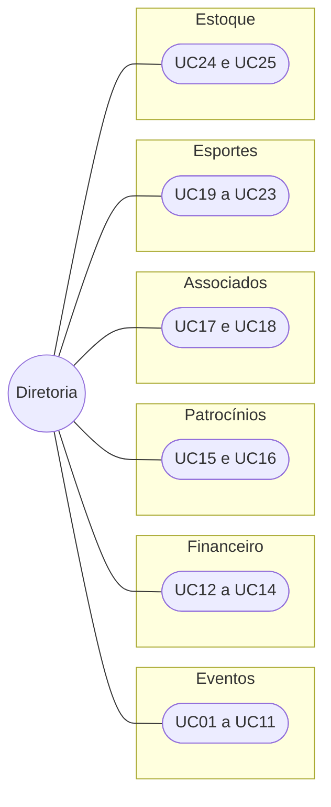
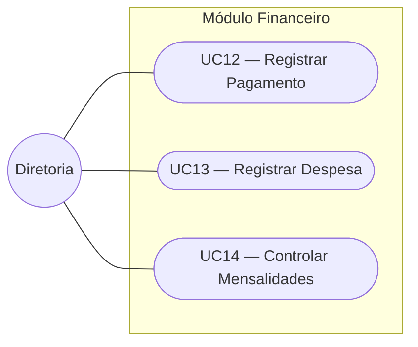
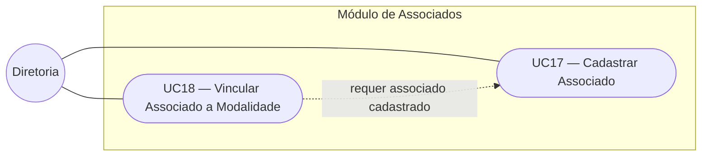
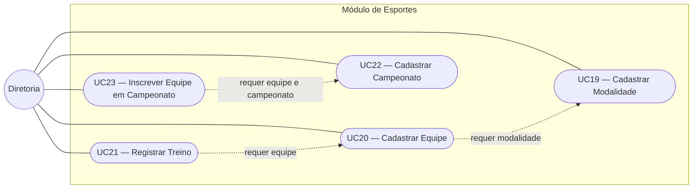
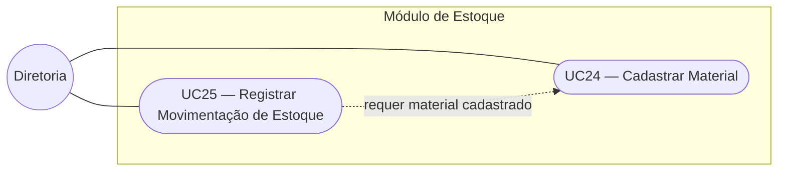
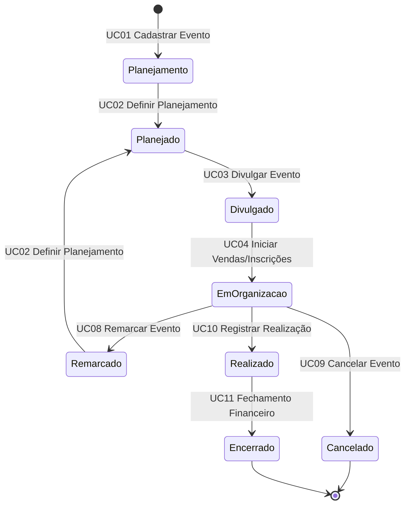
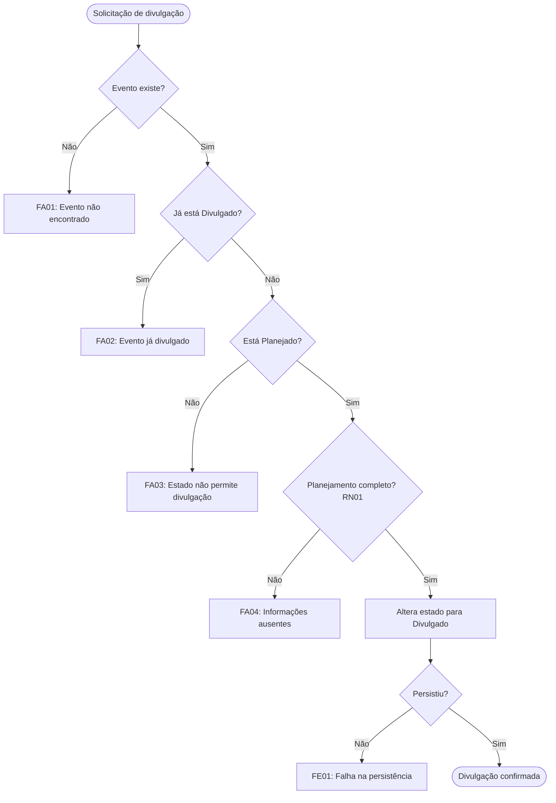

# Casos de Uso — ARENA XVIII

Este documento apresenta o catálogo de casos de uso do sistema ARENA XVIII, derivado do modelo conceitual descrito em [`visao-geral.md`](visao-geral.md). Cada caso de uso indica sua origem na documentação e o grau de sustentação atual, mantendo a mesma postura do modelo conceitual: o que foi confirmado no fluxo analisado é diferenciado do que ainda é hipótese.

---

## 1. Convenções

- **Código:** `UCnn`, numerado sequencialmente por módulo. O módulo de Eventos vem primeiro por ser o fluxo analisado com maior profundidade.
- **Sustentação:**
  - **Alta:** derivado diretamente do fluxo de eventos, de uma regra de negócio confirmada ou de uma Entidade com grau de certeza alto.
  - **Média:** derivado de conceito provisório ou de regra confirmada apenas parcialmente.
  - **Baixa:** derivado de hipótese ou de processo ainda não detalhado.
- **Ator:** a **Diretoria** aparece como ator principal de forma provisória. As funções organizacionais (tesouraria, diretoria de esportes, técnicos etc.) ainda não foram definidas e constam nas Pendências de Governança do modelo conceitual.

---

## 2. Visão geral por módulo

---

## 3. Catálogo de casos de uso

### 3.1 Eventos

| Código | Caso de uso | Origem nos docs | Sustentação |
|---|---|---|---|
| UC01 | Cadastrar Evento | Operação "criar e planejar o evento"; estado inicial Planejamento | Alta |
| UC02 | Definir Planejamento do Evento | Operação "definir data, local, orçamento e responsáveis"; transição Planejamento → Planejado | Alta |
| UC03 | Divulgar Evento | RN01; transição Planejado → Divulgado | Alta |
| UC04 | Iniciar Vendas/Inscrições | Transição Divulgado → Em Organização | Alta |
| UC05 | Registrar Inscrição em Evento | Operação "controlar vendas ou inscrições" | Média — conceito Inscrição em Evento ainda incerto |
| UC06 | Confirmar Inscrição em Evento | RN02 (dados corretos e pagamento obrigatório realizado) | Média |
| UC07 | Acompanhar Tarefas do Evento | Operação "acompanhar tarefas" | Baixa — Tarefa não foi modelada |
| UC08 | Remarcar Evento | RN03; transição Em Organização → Remarcado | Alta |
| UC09 | Cancelar Evento | RN06; transição Em Organização → Cancelado | Média — critério de cancelamento é hipótese |
| UC10 | Registrar Realização do Evento | Transição Em Organização → Realizado | Alta |
| UC11 | Realizar Fechamento Financeiro do Evento | RN04, RN05; transição Realizado → Encerrado | Média — regra de conclusão do fechamento em aberto |

### 3.2 Financeiro

| Código | Caso de uso | Origem nos docs | Sustentação |
|---|---|---|---|
| UC12 | Registrar Pagamento | Operação "registrar despesas e pagamentos"; Evento registra Pagamento | Alta |
| UC13 | Registrar Despesa | Operação "registrar despesas e pagamentos"; Evento gera Despesa | Alta |
| UC14 | Controlar Mensalidades | Citado no objetivo geral do README | Baixa — não aparece no modelo conceitual |

### 3.3 Patrocínios

| Código | Caso de uso | Origem nos docs | Sustentação |
|---|---|---|---|
| UC15 | Cadastrar Patrocinador | Módulo de patrocínios; Patrocinador é Entidade | Alta |
| UC16 | Registrar Patrocínio | Patrocinador estabelece Patrocínio | Média — Patrocínio é Entidade provisória |

### 3.4 Associados

| Código | Caso de uso | Origem nos docs | Sustentação |
|---|---|---|---|
| UC17 | Cadastrar Associado | Módulo Gestão de Associados; Associado é Entidade | Alta |
| UC18 | Vincular Associado a Modalidade | Associado participa de Modalidade | Baixa — cardinalidade N:N é hipótese |

### 3.5 Esportes

| Código | Caso de uso | Origem nos docs | Sustentação |
|---|---|---|---|
| UC19 | Cadastrar Modalidade | Atlética oferece Modalidade | Alta |
| UC20 | Cadastrar Equipe | Modalidade organiza Equipe | Média |
| UC21 | Registrar Treino | Equipe realiza Treino | Baixa — fluxo de treinos não foi detalhado |
| UC22 | Cadastrar Campeonato | Módulo Eventos e Campeonatos; Campeonato é Entidade | Alta |
| UC23 | Inscrever Equipe em Campeonato | Equipe participa de Campeonato | Média |

### 3.6 Estoque

| Código | Caso de uso | Origem nos docs | Sustentação |
|---|---|---|---|
| UC24 | Cadastrar Material | Atlética controla Material | Alta |
| UC25 | Registrar Movimentação de Estoque | Material recebe Movimentação de Estoque | Média — Movimentação é Entidade provisória |

---

## 4. Casos de uso no ciclo de vida do Evento

O diagrama abaixo reproduz o ciclo de vida do Evento do modelo conceitual, indicando qual caso de uso provoca cada transição.

Enquanto o evento está **Em Organização**, ocorrem também UC05, UC06, UC07, UC12 e UC13, que não alteram o estado do Evento.

---

## 5. Primeiro slice arquitetural — UC03 Divulgar Evento

O UC03 foi escolhido como primeiro slice porque deriva da RN01, apontada no modelo conceitual como a regra de maior impacto sobre o modelo, e porque define uma transição central do ciclo de vida do Evento.

### 5.1 Especificação

| Item | Descrição |
|---|---|
| **Código** | UC03 |
| **Nome** | Divulgar Evento |
| **Módulo** | Eventos |
| **Ator principal** | Diretoria (provisório) |
| **Pré-condição** | O evento existe e está no estado Planejado |
| **Pós-condição (sucesso)** | O evento está no estado Divulgado e a alteração foi persistida |
| **Pós-condição (falha)** | O evento permanece inalterado |

### 5.2 Regras de negócio

| Código | Regra | Origem |
|---|---|---|
| RN01 | Um evento só pode ser divulgado quando data, local, orçamento, responsáveis e atrações ou atividades estiverem definidos | Modelo conceitual, RN01 |
| RN-UC03-01 | Somente eventos no estado Planejado podem ser divulgados | Ciclo de vida do Evento |
| RN-UC03-02 | Um evento já divulgado não pode ser divulgado novamente | Ciclo de vida do Evento |
| RN-UC03-03 | A alteração de estado só é persistida quando todas as condições forem atendidas | Invariante do Evento (seção 10 do modelo conceitual) |

### 5.3 Fluxos

**Fluxo principal (FP)**

1. O ator solicita a divulgação de um evento informando seu identificador.
2. O sistema localiza o evento.
3. O sistema verifica que o evento está no estado Planejado.
4. O sistema verifica que as informações exigidas pela RN01 estão definidas.
5. O sistema altera o estado do evento para Divulgado.
6. O sistema persiste a alteração.
7. O sistema retorna a confirmação da divulgação.

**Fluxos alternativos e de exceção**

| Código | Situação | Passo | Resultado |
|---|---|---|---|
| FA01 | Evento não encontrado | 2 | Operação rejeitada, nada é persistido |
| FA02 | Evento já divulgado | 3 | Operação rejeitada, nada é persistido |
| FA03 | Evento em estado diferente de Planejado | 3 | Operação rejeitada, nada é persistido |
| FA04 | Informações de planejamento incompletas | 4 | Operação rejeitada informando os campos ausentes, nada é persistido |
| FE01 | Falha na persistência | 6 | Operação não concluída, falha informada ao ator |

---

## 6. Pendências relacionadas aos casos de uso

| Pendência | Casos de uso afetados | Origem |
|---|---|---|
| Funções organizacionais e permissões não definidas | Todos (ator principal provisório) | Pendências de Governança |
| Venda de ingresso x Inscrição em Evento | UC05, UC06 | Seção 6.2 do modelo conceitual |
| Regra exata de conclusão do fechamento financeiro | UC11 | Pendências de Governança |
| Vínculo do Patrocínio (atlética, evento ou ambos) | UC16 | Pendências de Governança |
| Cardinalidade Associado–Modalidade | UC18 | Pendências de Governança |
| Fluxo de treinos não detalhado | UC21 | Pendências de Governança |
| Controle de materiais por quantidade ou por item | UC24, UC25 | Pendências de Governança |
| Tarefas do evento não modeladas | UC07 | Fluxo de organização do evento |
| Mensalidades ausentes do modelo conceitual | UC14 | README |
