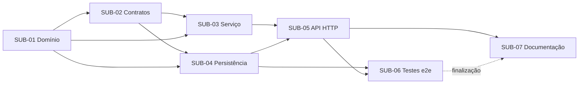

# Artefato 6 — Matriz de Dependências

**Caso de uso:** UC03 — Divulgar Evento

## 1. Matriz

| Atividade | Depende de | Justificativa técnica | Condição de desbloqueio | Execução em paralelo |
|---|---|---|---|---|
| SUB-01 | — | Unidade-base: a entidade e as regras de domínio não dependem de outras camadas | Decisões D01 e D02 registradas (necessárias para concluir, não para iniciar) | Sim, com o início de SUB-07 (levantamento) |
| SUB-02 | SUB-01 | Os contratos referenciam os tipos `Event` e `EventStatus` | Assinatura pública de `Event` estável (PR de SUB-01 em `In Review` ou `Done`) | Não |
| SUB-03 | SUB-01, SUB-02 | O serviço usa `Event.publish()`, a porta do repositório e o DTO | SUB-01 e SUB-02 em `Done` | **Sim, com SUB-04** |
| SUB-04 | SUB-01, SUB-02 | O adaptador implementa `IEventsRepository` e armazena `Event` | SUB-01 e SUB-02 em `Done`; decisão H03 confirmada | **Sim, com SUB-03** |
| SUB-05 | SUB-03, SUB-04 | O controller delega ao serviço; o módulo injeta o adaptador concreto | SUB-03 e SUB-04 em `Done`; decisões H01 e H02 confirmadas | Sim, com o rascunho de SUB-07 |
| SUB-06 | SUB-04, SUB-05 | Os testes e2e exigem a aplicação completa e os eventos carregados no adaptador | SUB-05 em `Done` | Sim, com a finalização de SUB-07 |
| SUB-07 | SUB-05 (contrato); SUB-06 (finalização) | A documentação do endpoint deve refletir o comportamento verificado | Contrato da API definido (SUB-05); e2e aprovado (SUB-06) para o fechamento | Parcial: a redação pode começar cedo, mas a conclusão vem por último |

## 2. Grafo de dependências

## 3. Caminho crítico

**SUB-01 → SUB-02 → SUB-03 / SUB-04 → SUB-05 → SUB-06 → SUB-07**

- Não há dependências circulares.
- O ganho de paralelismo está em SUB-03 ∥ SUB-04.
- Os bloqueios externos ao código são as decisões H01–H05 e D01–D02. Recomenda-se resolvê-los antes de mover SUB-04 e SUB-05 para `Ready`.
