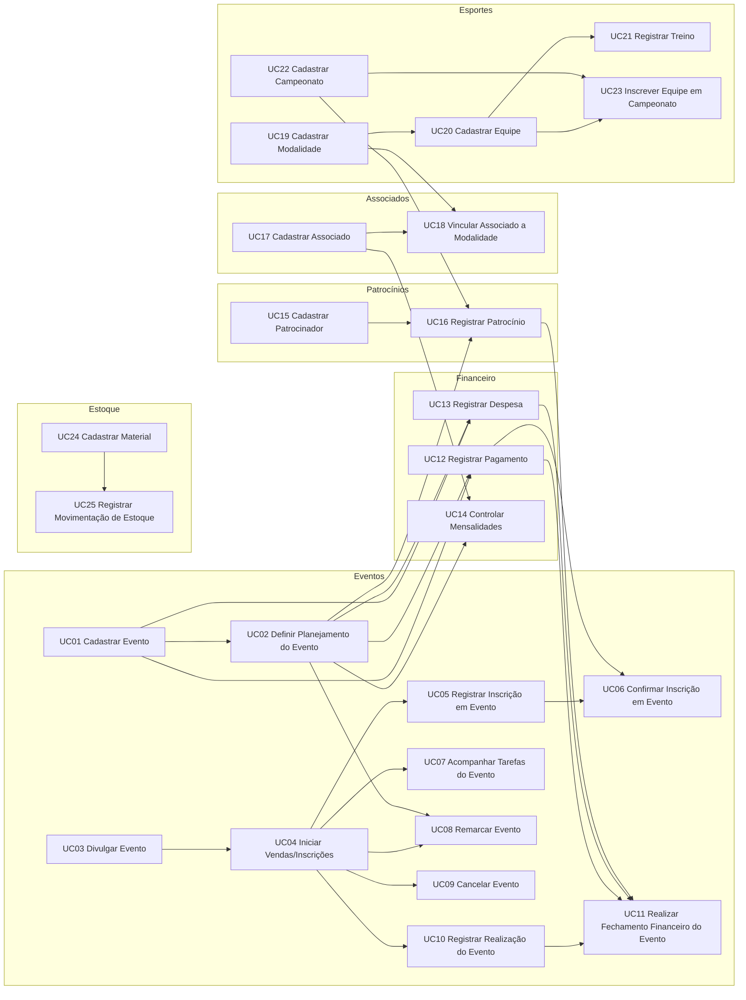

# Planejamento Técnico — Índice dos Casos de Uso

Planejamento de implementação dos casos de uso do ARENA XVIII, gerado a partir de `docs/casos-de-uso.md` conforme a metodologia "Do Caso de Uso ao Planejamento da Implementação" (12 artefatos por caso de uso).

- **UC03 — Divulgar Evento** (primeiro slice): artefatos na raiz desta pasta (`01-01` a `01-13`); épico **#12** no GitHub.
- **Demais casos de uso:** um diretório por caso (`UC01/`, `UC02/`, `UC04/` … `UC25/`), cada um com os artefatos `01-01` a `01-12`.

> **Status das especificações:** exceto o UC03, todas as especificações estão em **Rascunho** e devem ser validadas pela equipe antes da implementação. Por isso, todos os itens planejados iniciam em `Backlog`. Os casos UC07, UC14, UC18 e UC21 estão em **Rascunho — requer modelagem**: a própria especificação recomenda atualizar o modelo conceitual antes de implementá-los.

## 1. Visão geral

| Caso de uso | Módulo | Sustentação | Especificação | Sub-Issues | Depende de | Onda | Pasta |
|---|---|---|---|---|---|---|---|
| **UC01** — Cadastrar Evento | Eventos | Alta | Rascunho | 7 | — | 1 | [UC01/](./UC01/) |
| **UC02** — Definir Planejamento do Evento | Eventos | Alta | Rascunho | 7 | UC01 | 2 | [UC02/](./UC02/) |
| **UC03** — Divulgar Evento | Eventos | Alta | Validada | 7 | — | 1 | [raiz](./01-01-analise-tecnica.md) |
| **UC04** — Iniciar Vendas/Inscrições | Eventos | Alta | Rascunho | 6 | UC03 | 2 | [UC04/](./UC04/) |
| **UC05** — Registrar Inscrição em Evento | Eventos | Média | Rascunho | 7 | UC04 | 3 | [UC05/](./UC05/) |
| **UC06** — Confirmar Inscrição em Evento | Eventos | Média | Rascunho | 7 | UC05, UC12 | 4 | [UC06/](./UC06/) |
| **UC07** — Acompanhar Tarefas do Evento | Eventos | Baixa | Rascunho — requer modelagem | 7 | UC04 | 3 | [UC07/](./UC07/) |
| **UC08** — Remarcar Evento | Eventos | Alta | Rascunho | 6 | UC04, UC02 | 3 | [UC08/](./UC08/) |
| **UC09** — Cancelar Evento | Eventos | Média | Rascunho | 6 | UC04 | 3 | [UC09/](./UC09/) |
| **UC10** — Registrar Realização do Evento | Eventos | Alta | Rascunho | 6 | UC04 | 3 | [UC10/](./UC10/) |
| **UC11** — Realizar Fechamento Financeiro do Evento | Eventos | Média | Rascunho | 7 | UC10, UC12, UC13, UC16 | 4 | [UC11/](./UC11/) |
| **UC12** — Registrar Pagamento | Financeiro | Alta | Rascunho | 7 | UC01, UC02 | 3 | [UC12/](./UC12/) |
| **UC13** — Registrar Despesa | Financeiro | Alta | Rascunho | 7 | UC01, UC02 | 3 | [UC13/](./UC13/) |
| **UC14** — Controlar Mensalidades | Financeiro | Baixa | Rascunho — requer modelagem | 7 | UC17, UC02 | 3 | [UC14/](./UC14/) |
| **UC15** — Cadastrar Patrocinador | Patrocínios | Alta | Rascunho | 7 | — | 1 | [UC15/](./UC15/) |
| **UC16** — Registrar Patrocínio | Patrocínios | Média | Rascunho | 7 | UC15, UC02, UC22 | 3 | [UC16/](./UC16/) |
| **UC17** — Cadastrar Associado | Associados | Alta | Rascunho | 7 | — | 1 | [UC17/](./UC17/) |
| **UC18** — Vincular Associado a Modalidade | Associados | Baixa | Rascunho — requer modelagem | 7 | UC17, UC19 | 2 | [UC18/](./UC18/) |
| **UC19** — Cadastrar Modalidade | Esportes | Alta | Rascunho | 7 | — | 1 | [UC19/](./UC19/) |
| **UC20** — Cadastrar Equipe | Esportes | Média | Rascunho | 7 | UC19 | 2 | [UC20/](./UC20/) |
| **UC21** — Registrar Treino | Esportes | Baixa | Rascunho — requer modelagem | 7 | UC20 | 3 | [UC21/](./UC21/) |
| **UC22** — Cadastrar Campeonato | Esportes | Alta | Rascunho | 8 | — | 1 | [UC22/](./UC22/) |
| **UC23** — Inscrever Equipe em Campeonato | Esportes | Média | Rascunho | 7 | UC20, UC22 | 3 | [UC23/](./UC23/) |
| **UC24** — Cadastrar Material | Estoque | Alta | Rascunho | 8 | — | 1 | [UC24/](./UC24/) |
| **UC25** — Registrar Movimentação de Estoque | Estoque | Média | Rascunho | 7 | UC24 | 2 | [UC25/](./UC25/) |

**Totais:** 25 épicos e 173 Sub-Issues (UC03: 1 épico e 7 Sub-Issues já criados no GitHub; demais: 24 épicos e 166 Sub-Issues planejados).

## 2. Ordem sugerida de implementação (ondas)

Cada onda reúne casos de uso cujas dependências estão nas ondas anteriores. Casos da mesma onda podem ser implementados em paralelo.

- **Onda 1:** UC01, UC03, UC15, UC17, UC19, UC22, UC24
- **Onda 2:** UC02, UC04, UC18 ⚠️, UC20, UC25
- **Onda 3:** UC05, UC07 ⚠️, UC08, UC09, UC10, UC12, UC13, UC14 ⚠️, UC16, UC21 ⚠️, UC23
- **Onda 4:** UC06, UC11

⚠️ = requer modelagem antes da implementação.

## 3. Dependências entre casos de uso

## 4. Elementos compartilhados entre casos de uso

| Elemento | Planejado em | Reutilizado por |
|---|---|---|
| Infraestrutura do módulo de Eventos (`Event`, `EventsService`, adaptador, `EventsModule`) | UC03 (#13 a #17) | UC01, UC02, UC04 a UC11 |
| Objeto de Valor Valor Monetário (`Money`) | UC02 | UC12, UC13, UC14, UC16 |
| Objeto de Valor Período (`Period`) | UC22 | UC16 |
| Objeto de Valor Quantidade (`Quantity`) | UC24 | UC25 |
| `FinancialModule` | UC12 | UC13, UC14 |
| `SponsorshipsModule` | UC15 | UC16 |
| `MembersModule` | UC17 | UC18 |
| `SportsModule` | UC19 | UC20 a UC23 |
| `InventoryModule` | UC24 | UC25 |

## 5. Catálogo de labels

| Label | Cor | Descrição |
|---|---|---|
| `type:epic` | `#3E4B9E` | Issue principal de caso de uso |
| `type:feature` | `#0E8A16` | Implementação de funcionalidade |
| `type:test` | `#FBCA04` | Testes automatizados de integração/e2e |
| `type:documentation` | `#0075CA` | Documentação técnica |
| `layer:domain` | `#C2E0C6` | Camada de domínio |
| `layer:application` | `#BFD4F2` | Camada de aplicação |
| `layer:infra` | `#D4C5F9` | Camada de infraestrutura |
| `layer:api` | `#F9D0C4` | Camada de interface HTTP |
| `priority:high` | `#B60205` | Prioridade alta |
| `priority:medium` | `#D93F0B` | Prioridade média |
| `priority:low` | `#E4E669` | Prioridade baixa |
| `module:eventos` | `#1D76DB` | Módulo de Eventos |
| `module:financeiro` | `#1D76DB` | Módulo Financeiro |
| `module:patrocinios` | `#1D76DB` | Módulo de Patrocínios |
| `module:associados` | `#1D76DB` | Módulo de Associados |
| `module:esportes` | `#1D76DB` | Módulo de Esportes |
| `module:estoque` | `#1D76DB` | Módulo de Estoque |
| `spec:rascunho` | `#EDEDED` | Especificação em Rascunho, aguardando validação da equipe |
| `spec:requer-modelagem` | `#FF9F1C` | Especificação depende de modelagem conceitual pendente |
| `uc:UC01` | `#5319E7` | UC01 — Cadastrar Evento |
| `uc:UC02` | `#5319E7` | UC02 — Definir Planejamento do Evento |
| `uc:UC03` | `#5319E7` | UC03 — Divulgar Evento |
| `uc:UC04` | `#5319E7` | UC04 — Iniciar Vendas/Inscrições |
| `uc:UC05` | `#5319E7` | UC05 — Registrar Inscrição em Evento |
| `uc:UC06` | `#5319E7` | UC06 — Confirmar Inscrição em Evento |
| `uc:UC07` | `#5319E7` | UC07 — Acompanhar Tarefas do Evento |
| `uc:UC08` | `#5319E7` | UC08 — Remarcar Evento |
| `uc:UC09` | `#5319E7` | UC09 — Cancelar Evento |
| `uc:UC10` | `#5319E7` | UC10 — Registrar Realização do Evento |
| `uc:UC11` | `#5319E7` | UC11 — Realizar Fechamento Financeiro do Evento |
| `uc:UC12` | `#5319E7` | UC12 — Registrar Pagamento |
| `uc:UC13` | `#5319E7` | UC13 — Registrar Despesa |
| `uc:UC14` | `#5319E7` | UC14 — Controlar Mensalidades |
| `uc:UC15` | `#5319E7` | UC15 — Cadastrar Patrocinador |
| `uc:UC16` | `#5319E7` | UC16 — Registrar Patrocínio |
| `uc:UC17` | `#5319E7` | UC17 — Cadastrar Associado |
| `uc:UC18` | `#5319E7` | UC18 — Vincular Associado a Modalidade |
| `uc:UC19` | `#5319E7` | UC19 — Cadastrar Modalidade |
| `uc:UC20` | `#5319E7` | UC20 — Cadastrar Equipe |
| `uc:UC21` | `#5319E7` | UC21 — Registrar Treino |
| `uc:UC22` | `#5319E7` | UC22 — Cadastrar Campeonato |
| `uc:UC23` | `#5319E7` | UC23 — Inscrever Equipe em Campeonato |
| `uc:UC24` | `#5319E7` | UC24 — Cadastrar Material |
| `uc:UC25` | `#5319E7` | UC25 — Registrar Movimentação de Estoque |

## 6. Decisões transversais pendentes

| Decisão | Casos de uso afetados |
|---|---|
| Funções organizacionais e permissões (ator provisório) | Todos |
| Rotas e códigos HTTP propostos (H01/H02 de cada caso) | Todos |
| Persistência em memória como adaptador inicial | Todos com nova entidade |
| Venda de ingresso × Inscrição em Evento | UC04, UC05, UC06 |
| Vínculo entre Pagamento e Inscrição | UC06, UC12 |
| Regra de conclusão do fechamento financeiro | UC11 |
| Vínculo do Patrocínio (atlética, evento ou ambos) | UC11, UC16 |
| Modelagem de Tarefa, Mensalidade, cardinalidade Associado–Modalidade e fluxo de treinos | UC07, UC14, UC18, UC21 |
| Controle de materiais por quantidade ou por item | UC24, UC25 |
