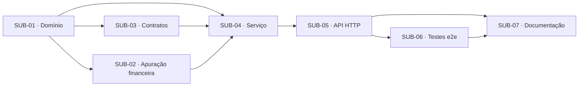

# Artefato 6 — Matriz de Dependências

**Caso de uso:** UC11 — Realizar Fechamento Financeiro do Evento

## 1. Matriz

| Atividade | Depende de | Dependências externas | Justificativa técnica | Condição de desbloqueio | Paralelo |
|---|---|---|---|---|---|
| SUB-01 | — | #13 (UC03 · SUB-01 — entidade `Event` e `EventStatus`) | Regras de domínio são a base das demais camadas | Especificação validada | Não |
| SUB-02 | SUB-01 | UC12 · SUB-02 (porta de repositório de pagamentos); UC13 · SUB-02 (porta de repositório de despesas); UC16 · SUB-02 (porta de repositório de patrocínios) | Usa a entidade e os dados financeiros do evento | SUB-01 em `Done` | Sim, com SUB-03 |
| SUB-03 | SUB-01 | #14 (UC03 · SUB-02 — porta `IEventsRepository` e contrato de erro de FE01) | Contratos referenciam tipos do domínio | SUB-01 em `Done` | Sim, com SUB-02 |
| SUB-04 | SUB-01, SUB-03, SUB-02 | #15 (UC03 · SUB-03 — `EventsService`) | Orquestra domínio e contratos | SUB-01, SUB-03, SUB-02 em `Done` | Não |
| SUB-05 | SUB-04 | #17 (UC03 · SUB-05 — `EventsController` e `EventsModule`) | Delega ao serviço e injeta o adaptador concreto | SUB-04 em `Done` | Não |
| SUB-06 | SUB-05 | #16 (UC03 · SUB-04 — adaptador de persistência de eventos) | Exige a aplicação completa | SUB-05 em `Done` | Não |
| SUB-07 | SUB-05, SUB-06 | — | Documenta o contrato verificado | SUB-05, SUB-06 em `Done` | Parcial (redação antecipada) |

## 2. Grafo de dependências

## 3. Dependências entre casos de uso

| Caso de uso | Motivo |
|---|---|
| UC10 | o evento precisa estar Realizado |
| UC12 | pagamentos do evento |
| UC13 | despesas do evento |
| UC16 | patrocínios (vínculo pendente) |

## 4. Caminho crítico

**SUB-01 → SUB-03 → SUB-04 → SUB-05 → SUB-06 → SUB-07**

- Não há dependências circulares.
- Bloqueios não técnicos: validação da especificação, propostas técnicas e dúvidas em aberto.
