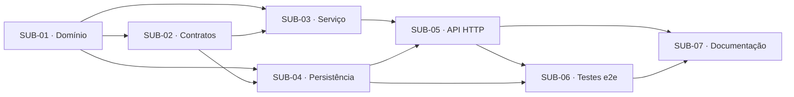

# Artefato 6 — Matriz de Dependências

**Caso de uso:** UC16 — Registrar Patrocínio

## 1. Matriz

| Atividade | Depende de | Dependências externas | Justificativa técnica | Condição de desbloqueio | Paralelo |
|---|---|---|---|---|---|
| SUB-01 | — | UC02 · SUB-01 (Objeto de Valor Valor Monetário); UC22 · SUB-01 (Objeto de Valor Período) | Regras de domínio são a base das demais camadas | Especificação validada | Não |
| SUB-02 | SUB-01 | — | Contratos referenciam tipos do domínio | SUB-01 em `Done` | Não |
| SUB-03 | SUB-01, SUB-02 | UC15 · SUB-02 (porta de repositório de patrocinador) | Orquestra domínio e contratos | SUB-01, SUB-02 em `Done` | Sim, com SUB-04 |
| SUB-04 | SUB-01, SUB-02 | — | Implementa a porta de repositório e armazena a entidade | SUB-01, SUB-02 em `Done` | Sim, com SUB-03 |
| SUB-05 | SUB-03, SUB-04 | UC15 · SUB-05 (criação do `SponsorshipsModule`) | Delega ao serviço e injeta o adaptador concreto | SUB-03, SUB-04 em `Done` | Não |
| SUB-06 | SUB-05, SUB-04 | UC15 · SUB-04 (adaptador de persistência de patrocinador) | Exige a aplicação completa | SUB-05, SUB-04 em `Done` | Não |
| SUB-07 | SUB-05, SUB-06 | — | Documenta o contrato verificado | SUB-05, SUB-06 em `Done` | Parcial (redação antecipada) |

## 2. Grafo de dependências

## 3. Dependências entre casos de uso

| Caso de uso | Motivo |
|---|---|
| UC15 | o patrocinador precisa existir |
| UC02 | Objeto de Valor Valor Monetário |
| UC22 | Objeto de Valor Período |

## 4. Caminho crítico

**SUB-01 → SUB-02 → SUB-03 → SUB-05 → SUB-06 → SUB-07**

- Não há dependências circulares.
- Bloqueios não técnicos: validação da especificação, propostas técnicas e dúvidas em aberto.
