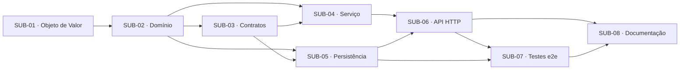

# Artefato 6 — Matriz de Dependências

**Caso de uso:** UC24 — Cadastrar Material

## 1. Matriz

| Atividade | Depende de | Dependências externas | Justificativa técnica | Condição de desbloqueio | Paralelo |
|---|---|---|---|---|---|
| SUB-01 | — | — | Unidade-base reutilizável | Especificação validada | Não |
| SUB-02 | SUB-01 | — | Regras de domínio são a base das demais camadas | SUB-01 em `Done` | Não |
| SUB-03 | SUB-02 | — | Contratos referenciam tipos do domínio | SUB-02 em `Done` | Não |
| SUB-04 | SUB-02, SUB-03 | — | Orquestra domínio e contratos | SUB-02, SUB-03 em `Done` | Sim, com SUB-05 |
| SUB-05 | SUB-02, SUB-03 | — | Implementa a porta de repositório e armazena a entidade | SUB-02, SUB-03 em `Done` | Sim, com SUB-04 |
| SUB-06 | SUB-04, SUB-05 | — | Delega ao serviço e injeta o adaptador concreto | SUB-04, SUB-05 em `Done` | Não |
| SUB-07 | SUB-06, SUB-05 | — | Exige a aplicação completa | SUB-06, SUB-05 em `Done` | Não |
| SUB-08 | SUB-06, SUB-07 | — | Documenta o contrato verificado | SUB-06, SUB-07 em `Done` | Parcial (redação antecipada) |

## 2. Grafo de dependências

## 3. Dependências entre casos de uso

| Caso de uso | Motivo |
|---|---|
| — | Nenhuma |

## 4. Caminho crítico

**SUB-01 → SUB-02 → SUB-03 → SUB-04 → SUB-06 → SUB-07 → SUB-08**

- Não há dependências circulares.
- Bloqueios não técnicos: validação da especificação, propostas técnicas e dúvidas em aberto.
